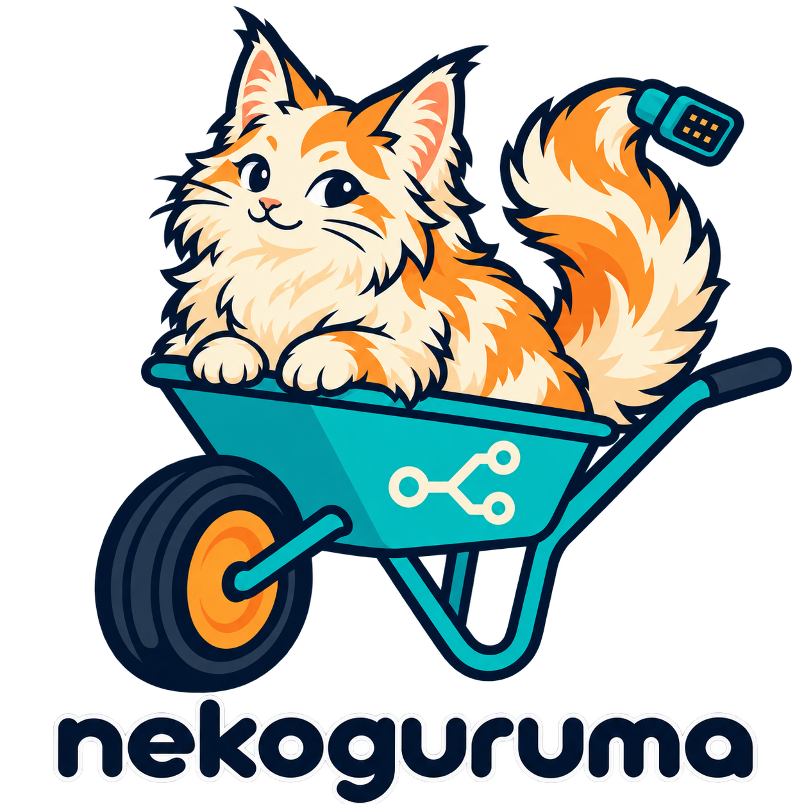

  

# Nekoguruma (NGR)

**Nekoguruma** (猫車, Japanese for "wheelbarrow"; literally "cat cart") is diagnostic software for vehicles. Its short name **NGR** stands for *Networked Gateway for Remote diagnostics*. The full lowercase name `nekoguruma` is used for file system paths and configuration directories; `ngr` is used for the command name.

## Workspace Structure

Cargo workspace corresponding to the design document `docs/system-architecture.md`, plus simulators for testing.

| Crate | Role | Design document |
|---|---|---|
| `shared-proto` | Commands, events, capabilities, job types, the signed job instruction's body, the answer proof's header names and proved-status tables | 5.1 / 5.3 / 6.4 / 9.5 / 11.1 / 14.4 |
| `shared-crypto` | Agent key (ECDSA P-256) and connection proof; the server's answer proof; signature verification for all 3 trust layers | 6.4 / 11.1 |
| `diag-ir` | IR schema, bytecode, VM | 8.2 |
| `diag-frontend` | ODX/OTX parser, CSV + Starlark->IR conversion (server only) | 8.3 / 8.4 |
| `vendor-manifest` | Manifest parser for ECU distribution packages | 11.2 |
| `j2534-defs` | ABI-independent J2534 constants, protocol names, COMPARAM mapping | 8.5 |
| `server` | Web API, jobs, distribution management, GW; a library plus the `ngr-server` binary (local profile: loopback listener, Host/Origin guard, PostgreSQL with embedded migrations, health, registration-code redemption, the agent connection-proof exchange, the control channel WebSocket and its hub, local users with the `user` command, login and the operator session, the bundled RustFS object server it starts as a child and the object store, a bucket on it, job creation, the job delivery queue) | 3.2 / 13.3 |
| `agent` | Discovery, job execution, journal, agent key and state directory, registration with the server, the control channel session and the `connect` command that runs it; library plus the `ngr-agent` binary | 3.3 |
| `worker-host` | ABI detection from the library header, launching worker services, authenticated gRPC client | 7.3 / 7.4 |
| `iso22900*`, `j2534-0404*`, `vci-service-*` | J2534 / D-PDU API FFI, wrappers, discovery, mocks and the gRPC worker services (`docs/worker-crates.md`) | 3.4 / 7.1.2 / 7.4 |
| `ngr-library-resolver` | Resolves a VCI name to its vendor library, one module per standard and version (J2534 v04.04: Linux definition files, Windows registry; ISO 22900 D-PDU API: root description file, ISO 22900-2:2022 clause 8.7), and runs the 7.2 pre-load writability check (ADR-270) and signer check (ADR-278) | 7.1 / 7.1.1 / 7.2 |
| `ngr-oplog` | The operational log's outputs: `tracing` layers writing JSON Lines to a private file rotated by size, one per process (ADR-348 item 5), and text for stderr, for the agent and the workers | 12.2 |
| `ngr-pinned-tls` | The client side of TLS to the bundled object server: a handshake that accepts only a leaf certificate with a given SHA-256 pin and checks the handshake signature with its key; (feature `identity`) the object server's key and self-signed certificate, the check that a pair belongs together, and its pin; and (feature `test-server`, which implies `identity`) a TLS server for tests (ADR-505); the one crate whose non-test code depends on rustls | 13.3 |
| `sim-vci` | cdylib exposing J2534 (mock) | 13.4 |
| `sim-ecu` | Simulation of UDS responses and flash state transitions, and the configuration and state files of a simulated ECU | 13.4 |
| `ngr-stand-in-ecu` | The `ngr-stand-in-ecu` binary: serves `sim-ecu` over a Linux SocketCAN interface through the kernel's ISO-TP sockets, the stand-in ECU of the T1 hardware checks | 13.5 |
| `ngr-hw-checks` | Harness of the optional real-hardware checks: the hardware profile, check declarations and their listing, opening the profile's device through a worker with the module match (ADR-275), the guarded handle for checks and the agent's runner (ADR-333, ADR-334), and the check bodies (the T0 loopback) | 13.5 |

## License

MIT. See [LICENSE](LICENSE).
