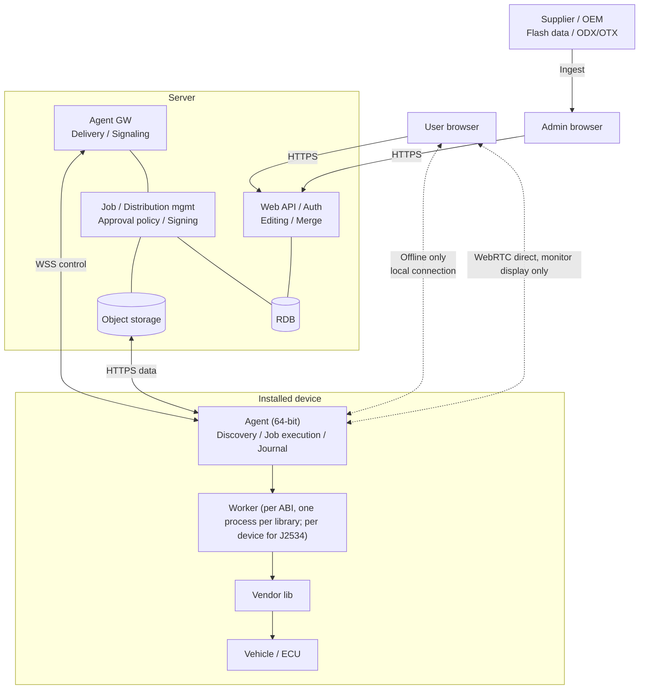
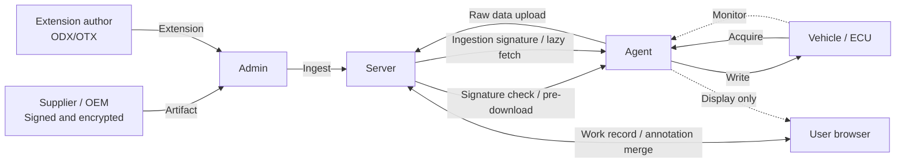
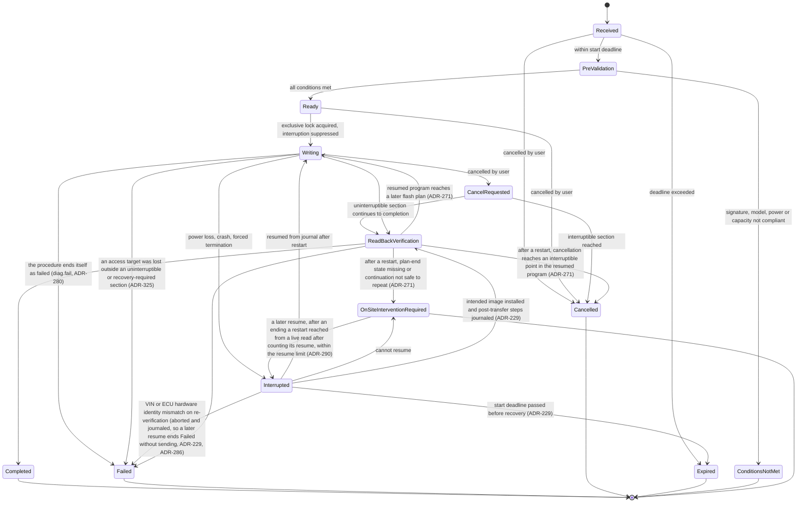
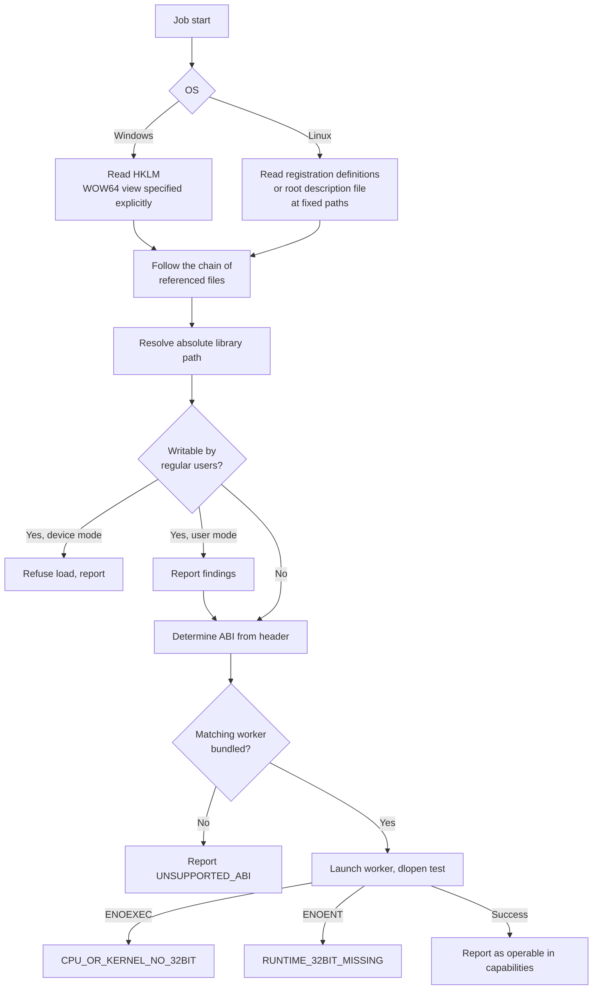
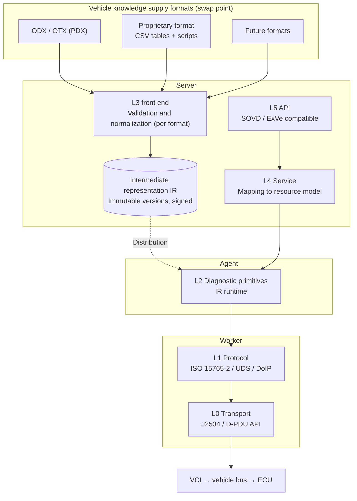
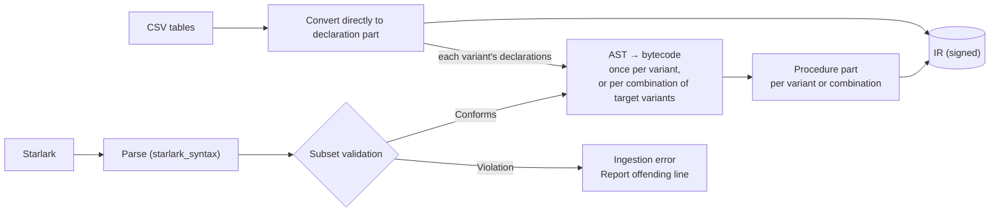

# Nekoguruma: Automotive Diagnostic Software Architecture Design Notes

Created: 2026-09-15 / Status: Under review (proposed architecture)

Project name: **Nekoguruma** (猫車, Japanese for "wheelbarrow"; literally "cat cart"). Short name: **NGR**, for *Networked Gateway for Remote diagnostics*. The full lowercase name `nekoguruma` is used for file system paths and configuration directories; `ngr` is used for the command name.

---

## 1. Background and Requirements

Diagnostic software for vehicles. It connects to a VCI through vendor-supplied shared libraries (J2534 PassThru / ISO 22900 D-PDU API) to read diagnostic data from the vehicle and write to ECUs (reprogramming and configuration values). The UI is delivered as a web app.

### Terminology

| Term | Definition |
|---|---|
| VCI | Vehicle communication interface hardware. The unit of exclusive locking and of vendor libraries |
| Vehicle | The target, identified by VIN. The unit of exclusive locking |
| ECU | The target of writes and diagnostics. The unit of variant identification |
| Agent | A resident process on the device that executes jobs |
| Worker | A separate process that loads a vendor library (one per ABI) |

"Device" is not used in this document in its generic hardware sense, being ambiguous; it always means the installed terminal (proper names such as the RFC 8628 Device Authorization Flow excepted).

D-PDU API and J2534 terms used by the worker crates are defined in `glossary.md`.

### Functional Requirements

| # | Requirement |
|---|---|
| R1 | Access VCIs and vehicles through each vendor's shared library |
| R2 | Obtain library locations from a configuration file. On Windows, obtain the configuration file location from the registry (HKLM) |
| R3 | Installation is acceptable on devices that read and write |
| R4 | Editing and redisplaying acquired data must be possible in an ordinary browser without installation |
| R5 | Take every possible measure to prevent unintended interruption during writes |
| R6 | For responsiveness, save locally first and synchronize with the server in the background |
| R7 | Acquired data may be edited concurrently by multiple users |
| R8 | Management is per user. Shared OS accounts are also permitted |
| R9 | Remote operation and operation of unattended devices are possible use cases |
| R10 | Real-time monitoring targets update intervals as fast as 10 ms |
| R11 | Also provide a configuration that runs entirely within localhost, for testing and personal use |
| R12 | Diagnostic sequences are implemented in-house. Layers are separated so they can be replaced |
| R13 | External interfaces are SOVD / ExVe compatible |
| R14 | Support ODX / OTX. The supply format must be replaceable, and proprietary formats (CSV tables + scripts, etc.) must also be supported. D-Server (MCD-3D) is out of scope |
| R15 | Implement as a framework. VCI-specific items and target vehicle/ECU definitions can be added freely without redistributing the core |
| R16 | Pre-fetched jobs can be started offline. However, operations requiring seed/key need to be online |
| R17 | The UI is usable offline (PWA caching, plus a local connection allowed only when offline) |
| R18 | Any interval during monitoring can be committed as acquired data by an after-the-fact operation |
| R19 | A single monitoring session can be subscribed to from multiple browsers |
| R20 | The UI provides a framework part and a reference implementation; business-specific screens and supported screen sizes are defined by the user |
| R21 | Work record fields can be extended as record templates and referenced from both procedures and screens |

### Assumptions

- Target OS: Windows / Linux. Linux hosts are x86_64 and aarch64 (with i686 and armhf workers for 32-bit vendor libraries, 7.3), on glibc-based distributions with glibc 2.17 or later and kernel 3.2 or later (ADR-232). On Linux, J2534 reuses the Windows API definitions as-is; only registration information such as library locations uses a definition specific to this software (7.1.1)
- Vendor library standards: J2534 (PassThru) and ISO 22900 (D-PDU API). Adapters are structured as two kinds, one per standard, plus absorption of vendor-specific quirks
- Vendor libraries may be a mix of 32-bit and 64-bit (J2534 DLLs are mostly 32-bit, so an x86 worker is required). ARM may also be included
- Whether and how vendor libraries communicate over the network is not our concern (outside the system's guarantees)
- No assumption is made about how vendor libraries pass data (callback / polling / blocking read)
- Data written to ECUs (firmware, configuration values) is ingested exactly as signed and encrypted by the supplier (OEM)
- The target is a three-level hierarchy: VCI -> vehicle bus -> ECU. Vehicle access may require OEM online authentication (security gateway)
- Vehicle knowledge primarily targets ODX / OTX, but the supply format is abstracted by an intermediate representation and is replaceable. D-Server (ISO 22900-3 / MCD-3D) is out of scope
- Devices are not necessarily under organizational management
- Always-online is the baseline, but disconnection during processing and slow environments must be handled. Offline start is allowed only for pre-fetched jobs; operations requiring seed/key and vehicles requiring OEM authentication must be online (5.7)

---

## 2. Overall Architecture

A **server-relay architecture** is adopted. Operations are performed in a web app (PWA) in an ordinary browser, and a resident agent with almost no UI is deployed on the device to which the VCI is connected. The agent maintains a persistent outbound connection to the server, and receives and executes jobs. Only when offline does the browser connect locally to the agent from cached screens (5.7.1).



### Design Principles

1. **Minimize the responsibilities of the dedicated application.** Leave in the agent only what can run only locally, and what cannot survive interruption unless it is local.
2. **Direct browser-agent interfaces are exceptions.** To avoid the attack surface of listening on localhost and the browser's local network access permission prompt, the server path is the default. There are two exceptions: WebRTC direct connection for monitoring (read-only, Chapter 10) and local connection when offline (5.7). Each requires that "the server path cannot substitute for it," and the accepted operations are restricted.
3. **Layer trust by what is signed (11.1).** ECU flash data is protected by the supplier signature verified by the ECU, extension packages by the operator's distribution key, and job instructions by the server's instruction key. The server is treated as "a path that only carries, and is not trusted."
4. **Confine scale- and environment-dependent decisions to replaceable points.**
5. **The core holds only standards and interruption countermeasures; individual facts are moved out as extensions.** Extensions are expressed as data, and code-based extensions are limited to the server side (Chapter 9).
6. **The agent treats every worker alike; the workers absorb their APIs' differences.** When a specification is designed, the agent should, as far as possible, not branch on which worker (J2534 or D-PDU API) or which library it drives. A difference between the APIs, or between libraries, is absorbed in the worker, the compatibility layer that knows it, which presents the result through the common worker interface (3.4, ADR-351). Where a difference cannot be absorbed (a value one API cannot give at all), the interface carries its absence explicitly, and the agent treats the absence the same way whichever worker it comes from.

---

## 3. Division of Responsibilities

### 3.1 Web App (Ordinary Browser)

This framework provides a UI framework and a reference implementation; business-specific screens are defined by the user (9.6). The following are the functions handled by the UI layer.

- Instructing acquisition, writing, monitoring, and procedure execution
- Redisplaying acquired data, and editing work records (judgments, manually entered values, findings)
- Saving edits to IndexedDB first, per operator, and synchronizing to the server via an Outbox
- Storing received monitoring data in a ring buffer and drawing it to Canvas / WebGL with `requestAnimationFrame`. A capture operation turns any interval into acquired data (4.6)
- Responding to HMI requests (confirmation, value input)
- Caching app assets and job packages as a PWA, and connecting locally to the agent when offline (5.7.1)
- Admin functions: ingesting and publishing artifacts and extension packages, policies, and managing who may use each agent

### 3.2 Server

- Authentication and authorization (6.8), job issuance (confirmation level, two-person approval, execution time window, start deadline)
- Artifact management: immutable versions, supplier signature verification, compatibility checks, staged rollout
- Ingesting extension packages and applying the ingestion signature (11.1), normalizing to IR via supply-format frontends (8.2)
- Acquired data: immutable chunk storage of raw data, merging annotations and work records, change-feed delivery, downsampling and derived-data computation
- Seed/key computation (keys are not placed on devices. 8.10)
- Issuing monitoring sessions and brokering WebRTC signaling
- Relaying HMI requests
- Audit logs (operator, agent, approval records)

### 3.3 Agent

- Discovery (re-run for each job, including ACL verification)
- Launching workers according to ABI
- IR runtime (executing procedures, verifying preconditions, issuing HMI requests)
- Resumable upload of acquired data
- Write jobs: signature verification -> pre-check -> write -> read-back verification -> resume via journal
- Monitoring: negotiating update intervals based on measurements and delivering frames, holding the ring buffer and capture (4.6)
- Holding offline job packages, and listening locally when offline (5.7.1)
- Reporting status and `capabilities`, approvals and notifications in the system tray, self-update (on hold while a job is running)

Each device's operating mode is fixed to exactly one of "user mode" or "device mode."

### 3.4 Worker

- One process per library, a dedicated thread per VCI. A J2534 library with several configured devices runs one process per device, so each device is its own worker (ADR-281)
- Absorbs differences in libraries' data-passing methods and always outputs externally as a "timestamped sample sequence"
- Absorbs the differences between its API and the common worker interface, and between libraries, so that the agent need not tell the workers apart (Design Principle 6). For example, each worker names its error events' extra error information itself: the D-PDU worker from the library's MDF, the J2534 worker from the cases it tells apart (ADR-351)
- Splits a single data source into a recording path that tolerates no loss and a monitoring path that drops old data when delayed
- Implemented in coarse-grained operation units (acquire / write / read-back verification)
- Many J2534 DLLs are not thread-safe, which matches the per-VCI thread design. L0 / L1 (transport and protocol) also reside in the worker
- Implementation: the worker binaries are the gRPC services `j2534-0404-service` (J2534 v04.04 libraries) and `iso22900-service` (D-PDU API libraries); their crates are described in `worker-crates.md`. Both expose the D-PDU API, so the agent drives either kind of library through one interface. One build per ABI (7.3)

---

## 4. Data Flows (4 Streams)

| Stream | Flow | Characteristics |
|---|---|---|
| ECU artifacts | Supplier -> Admin -> Server -> Agent -> ECU | One-way, not re-signed |
| Extension packages | Author -> Server (ingestion signature) -> Agent | One-way, lazy fetch |
| Acquired data | Vehicle (ECU) -> Agent -> Server (raw data) -> Browser | Bidirectional, concurrent editing |
| Monitoring | Vehicle (ECU) -> Agent -> Browser | Display only. Can become acquired data via a capture operation (4.5) |



### 4.1 ECU Artifacts (Firmware, Configuration Values)

- Versions are immutable. Updates are always published as a new version
- Packages signed and encrypted by the supplier are stored without changing a byte and identified by hash
- The system does not re-sign, repackage, or decrypt (11.1)
- Provide staged rollout and rollback to the previous version

**Scope of pre-download**: Not every device holds every version (that would be huge across vehicle models). Fetching is triggered in the following three cases.

| Trigger | Scope fetched |
|---|---|
| Job issuance | Versions used by that job (completed before writing starts) |
| Advance designation | Versions for vehicle models/ECUs designated by an admin or user (preparation for offline work. 5.7) |
| Standing designation | Only when "versions to always keep" are designated per device |

All are cached in an area that cannot be modified with user privileges. Deletion criteria are as follows.

- Versions under standing designation are not deleted
- Others are deleted by days since last use and a cache size limit (oldest first)
- Previous versions designated as rollback targets are excluded from deletion

### 4.2 Extension Packages

- IR, screen and report definitions, message text, unit systems (9.2)
- VCI profiles are not extension packages: they are installed on the device outside this software (9.3)
- The server verifies them on ingestion and signs them with the operator's distribution key (ingestion signature. 11.1)
- The agent lazily fetches only what it needs. The initial sync scope follows 9.4
- The delivery path is shared with ECU artifacts (HTTPS data channel), but re-signing and fetch scope differ

### 4.3 Acquired Data

Covers time-series data, snapshots, and self-diagnostic data.

**All values acquired from the vehicle are non-editable.** Diagnostic data is evidence of vehicle state, and a design that allows values to be rewritten afterward undermines its value as a record (also avoided from the standpoint of UNECE R156 record retention). Editing is limited to information entered by the operator.

| Data | Value correction | Annotation / judgment |
|---|---|---|
| DTC, self-test results | No | Yes |
| Freeze frame, ECU identification | No | Yes |
| Data stream (PID) | No | Yes |
| Work record (judgment, manually entered measurements, findings, attachments) | Yes | Yes |

- Raw data is immutable; annotations and work records are overlaid as separate layers
- Work record corrections are recorded as operations of `{target, base value, new value, reason, editor}`
- Annotations are independent records; additions never conflict with each other
- Only work records need three-way merge, so concurrent-edit conflicts are substantially reduced
- Time series are stored as the responses received from the vehicle (records: response bytes, monotonic timestamp, source), chunked by time; signals are decoded from them with the decode plans of the IR that produced the recording (8.2.2), and display data is downsampled by min/max from the decoded signals (ADR-236)
- Scale for the initial implementation: fastest period 10 ms per request, up to 64 KiB/s of response bytes per monitoring session or acquisition job, and up to 1 hour of time series per acquisition job (ADR-236)

**Retention period**: Determined from both business needs (the statutory retention period for maintenance records) and the personal-data nature of VINs. Statutory periods differ by jurisdiction, so the retention period is an operator setting per tenant and record kind, with no jurisdiction-specific defaults (ADR-237). For deletion requests, job execution records (audit logs) must be retained even if raw data is deleted, so a mechanism is provided to redact only the VIN-containing parts.

#### 4.3.1 Record Templates

Work record field definitions are embedded in neither IR nor screen definitions, and are held as **an independent extension point (record templates)**. This is because there are records tied to procedures (operation checks after reprogramming, measurements during routine execution) and records not tied to them (exterior inspection at intake, customer complaints, overall findings).

- **Structure**: A list of fields (identifier, label, type, unit, required flag, options, judgment criteria)
- **Types**: Limited to number, choice, boolean, text, attachment
- **Judgment criteria**: Hold upper/lower limits and pass/fail conditions, used for input validation and automatic judgment
- **Scope**: Both generic templates independent of vehicle model and vehicle-model-specific templates are allowed
- **Reference from IR**: Procedures have an instruction "request input of a record template" (treated as a kind of HMI request. 8.6)
- **Reference from screen definitions**: The same template can also be used for records without a procedure
- **Storage format**: Stored as template ID, field ID, value, and edit history

**Auto-fill from acquired values**: Values from acquired data may be filled into record fields automatically. Auto-filled values are **non-editable because they come from the vehicle**, and values the operator re-measures by hand are **recorded as a separate field**. Both are kept, and which one came from the vehicle is clear.

### 4.4 Synchronization

- The server is the source of truth; local storage is treated as "cache + outgoing queue"
- Outbox pattern. IDs are client-generated (UUIDv7), with idempotency keys attached
- Three-way merge using per-field versions. Applies only to work records and annotations (values acquired from the vehicle are non-editable. 4.3). The user resolves only on conflict
- `navigator.storage.persist()`, a single sync-owner tab via Web Locks, and a leave warning when unsynced

### 4.5 Acquisition Metadata

VCI model and serial, VIN, ECU address, part number and software version, the version of configuration values at acquisition time, versions of the vendor library, IR and agent, and the vehicle clock and PC clock and their offset.

The classification of acquired data corresponds to diagnostic data: time series are data streams (PID), snapshots are freeze frames and ECU identification, and self-diagnostic data are DTCs and self-test results. Making DTCs non-editable with annotations only fits their nature as diagnostic records.

### 4.6 Monitoring Capture

Monitoring is display-only, but to meet the need to "keep the waveform from the moment the symptom appeared," a **function to commit any interval as acquired data** is provided.

- **Extraction from ring buffer**: The agent holds the received records (4.3) during monitoring in a ring buffer for a fixed duration. When the user performs a capture operation, the interval going back from that moment is extracted as acquired data (the trigger can be applied after the fact)
- **Retention time**: The default retention time is determined from the VCI profile's minimum update period and the amount of memory, up to 10 minutes (ADR-236). Excess is discarded oldest first
- **Treated the same as acquired data**: The captured interval is immutable as raw data and uploaded via the same path as ordinary acquired data. Not editable; annotations only (4.3)
- **Metadata**: Records the capture operation time, the extracted interval, the path (WebRTC direct / via server), and the measured update interval. Because frames may be dropped on the display-only path, whether samples are missing is also recorded
- **Automatic capture**: A procedure definition (IR) can instruct capture when a condition is met (e.g., a threshold is exceeded)

Monitoring frames before capture are not treated as records and are not synchronized. This distinction is shown explicitly on screen.

---

## 5. Communication and Interruption Handling

### 5.1 Job Types

| Job | Required role | Default confirmation level | Offline start | Re-execution |
|---|---|---|---|---|
| Acquisition | Operator | Notification only | Yes | Safe |
| Monitoring session | Operator | Notification only | Yes | Safe |
| Capture of a monitoring interval | Operator | Notification only | Yes | Safe |
| Procedure execution (inspection, routines) | Operator | With grace period | Yes (to the extent preconditions are met) | Depends on procedure attributes |
| Configuration value write | Operator | With grace period | Conditionally (5.7) | Use caution |
| ECU reprogramming | Reprogrammer | On-site approval | Conditionally (not when seed-key / OEM authentication is required; 5.7) | Decide after checking state |

Section 6.3 is authoritative for confirmation level definitions and defaults; this table is a per-job-type summary for reference. Remote execution requires both the Remote Operator role and remote permission on the agent side (6.8). ECU reprogramming on unattended devices additionally requires two-person approval.

### 5.2 Communication Channels

| Purpose | Channel | Notes |
|---|---|---|
| Control | WSS (outbound, 443) | Commands and events only |
| Data | HTTPS | Resumable chunked transfer |
| Monitoring | WebRTC DataChannel | No ordering guarantee, no retransmission. Second and later subscriptions go through the server (10.4) |
| Offline operation | Loopback (HTTP / WebSocket) | Listens only while disconnected. Limited to starting pre-fetched jobs and retrieving progress (5.7.1) |

Channels are separated so that bulk transfers do not clog the control channel. Fallbacks such as long polling are provided for proxy environments.

### 5.3 Handling Disconnections

- Commands are idempotent. The agent ACKs receipt, records the job ID and the ownership generation (ADR-229) in the journal, and ignores duplicates: a command whose job ID it has recorded under the same or a later generation; recovery state is likewise journaled per job ID and generation, so a device that gets a job back recovers from the handover's checkpoint summary, not from its older journal
- Jobs have a start deadline; expired commands are not executed but reported
- Events are delivered reliably via a sequence-numbered Outbox; the server deduplicates by "agent ID + sequence number"
- On reconnection, the state of incomplete jobs is reconciled (not everything is resent; see 15.1 for scale-specific handling). Reconnection uses exponential backoff + jitter
- A disconnection is not treated as a job failure. The server never automatically reissues write jobs

### 5.4 Handling Low-Bandwidth Environments

- Events are split into "must-deliver" (completion, failure) and "may be thinned" (progress)
- Artifacts are fully fetched by the time the job is issued, so that line speed does not affect the start of writing (4.1)
- Upload bandwidth limiting. Timeouts are judged by "no progress for a set period", not total time
- Metadata and self-diagnostic data are sent first; time-series chunks are sent afterward

### 5.5 Device-Side Safeguards

- Windows: `SetThreadExecutionState`, `ShutdownBlockReasonCreate` (`PRESHUTDOWN` for services)
- Linux: logind inhibitor locks, `loginctl enable-linger`
- Exclusive locks on the VCI and vehicle (8.8)
- Preparation of all data before writing, journaling of each step, read-back verification. The journal is an append-only log per job and ownership generation, each record synced before the commit returns (ADR-244). It has one writer: whoever opens it for writing holds an exclusive OS lock on a sidecar file, which the OS releases if the process dies, so a second run of the same job cannot write it at the same time (ADR-255)

**Journal protection**: The journal and local cache contain VINs and diagnostic results. They are encrypted with a key protected by the OS credential store and bound to the device when a TPM is available. Once job completion and sync completion are confirmed, the body is deleted, leaving only the job ID and a result summary. If revocation of the agent key is detected, the local cache and journal are erased.

### 5.6 Write Job State Transitions



Procedure execution jobs additionally have an **awaiting HMI response** state. S3 keep-alive continues while waiting, and the wait is maintained during a disconnection. If the HMI timeout is reached, execution proceeds to an interruptible point and then stops (8.10.1); a waiting form completes as timed out so that it can, and the run never ends as completed (8.6, ADR-340). Unmet preconditions (8.9) end the job as ConditionsNotMet at the pre-validation stage.

After a restart, ReadBackVerification is the state check's match itself (the intended software version, and the interrupted pass's post-transfer steps journaled complete); the agent then resumes the program from the VM state journaled at the plan's end, provided every diagnostic primitive outside the program's flash plans is safe to repeat and outside any recovery-required section, and so is every step of the plan beginning at this plan's end up to its erase or its recovery-required point, which the continuation may run before that plan's first record, except that for a plan that allows a restart only a step unsafe to repeat counts, as in its replay (otherwise on-site intervention), and the job ends in Completed or Failed as the rest of the program decides, through Writing again if it reaches a later flash plan (ADR-271).

OnSiteInterventionRequired is final, except for one case. An OnSiteInterventionRequired that a restart reaches after it counted its resume, from a live read (identity or software version not established, an unexpected version, a precondition that does not hold, the default session not confirmed, a continuation not safe to repeat or a missing plan-end state), ends that run but is not journaled: a later resume of the job may try again, counting another resume, within the plan's resume limit (8.2.5), which bounds the repeats (ADR-290). The on-site endings derived from the journal and the program, or from the caller's input, are decided again by every resume before it counts one (ADR-286).

A procedure outside every flash plan (a plain procedure) takes the Interrupted to OnSiteInterventionRequired edge when a request to a primitive not safe to repeat is not confirmed, when it cannot be repeated or continued without sending one (an unsafe primitive, a recovery-required section or a flash plan ahead, an uninterruptible section, no identity), when its resume limit is reached, or when the VIN is not established; these endings are OnSiteInterventionRequired, never Failed, which stays the procedure's own verdict (8.2.5, ADR-335). Endings other rules give a resumed or repeated run keep their states: the procedure's own failure, the identity abort, and a lost access target during the reopening of 8.2.4, which ends as Failed while the journal holds no transfer-start marker (ADR-325).

Cancellation by the user does not take effect immediately. In an uninterruptible or a recovery-required section (8.10.1), the cancel request is held, and the job transitions to Cancelled once it reaches an interruptible point; a procedure that ends before reaching one finishes instead (ADR-330), except when the held cancel was raised by an HMI timeout: such a run ends as cancelled even if the procedure ran to its end (8.6, ADR-340). The start of a run from the program's first instruction is always an interruptible point, so a cancel that comes before the first step ends the job with nothing sent, even when the whole procedure is one such section (ADR-337). For every terminal state, the result is finalized only by the agent's report. The server never treats a disconnection as a failure or automatically reissues a write job.

### 5.7 Starting Work Offline

Sites can have poor reception: workshop basements, inside metal structures, roadsides in suburban areas, and so on. Always-on connectivity is the baseline, but **offline start is permitted only for pre-fetched jobs**.

| Job type | Offline start | Conditions |
|---|---|---|
| Acquisition | Yes | Offline job package fetched in advance, except procedures with an operator form or record input |
| Write (no seed-key) | Yes | Same as above, except vehicles requiring OEM authentication and procedures with an operator form or record input |
| Write (seed-key required) | **No** | The seed changes on every connection and cannot be precomputed, so online is mandatory |
| Operations on vehicles requiring OEM authentication | No | Gateway authentication requires an online connection |
| Procedures with an operator form or record input (8.6) | No | Only the server relays HMI requests, and the offline local path (5.7.1) only starts jobs and reads progress (ADR-340) |

**Offline job package**: While online, the signed job instruction, artifacts and IR are fetched together. The validity period is kept short; expired packages are not executed but reported (same mechanism as the start deadline in 5.3).

**Handling results**: Results of offline execution are kept in the journal and synced via the Outbox once connectivity is restored.

The web UI shows in advance whether the target vehicle and operation can be started offline, and if not, the reason (seed-key required, OEM authentication required, operator form or record input required: only the server relays HMI requests, 8.6, ADR-340).

#### 5.7.1 UI Path While Offline

Because the UI is a web app served by the server, the screen itself cannot be opened offline. The screen is made available through **PWA conversion (caching via Service Worker)**, and **only while offline does the browser connect locally to the agent**.

- **Service Worker cache contents**: app assets, fetched job packages, IR, vehicle and ECU definitions
- **Listener control**: The agent listens on loopback only while its connection to the server is down. When the connection is restored, it stops listening and returns to the normal server-mediated path
- **Restricted operations**: Only starting pre-fetched jobs and retrieving progress. Creating new jobs, changing settings and adding extensions are not accepted
- **Authentication**: An offline token is fetched together with the job package while online. Its validity period is kept short
- **Origin handling**: The PWA runs on the server's origin, so requests to `127.0.0.1` are cross-origin. The agent configures CORS and limits allowed origins to the PWA's serving origin. Connections from an HTTPS page to `http://127.0.0.1` are not mixed content, because loopback is treated as a secure context
- **Security**: Origin validation, Host header validation and CSRF protection are applied, and Origin is not used for authorization decisions (the cautions for local deployment in 13.3 apply as-is)
- **Permission prompt**: Granting permission once for the PWA's origin is sufficient. This is covered as part of the installation instructions
- **Result sync**: Execution results remain in the agent's journal and are synced via the Outbox once connectivity is restored. The browser is responsible only for display

**Rationale for this exception**: The purpose of design principle 2 is to avoid the attack surface of a localhost listener and the permission prompt, and while offline there is no server-mediated alternative. The risk is contained by restricting accepted operations and limiting listening to disconnected periods only.

If the decision is made to drop offline work from the requirements, this exception becomes unnecessary and is replaced operationally by providing mobile connectivity on site.

---

## 6. Identity and Authorization

### 6.1 Separation of Identities

| | Agent | Operator |
|---|---|---|
| Identified entity | Device x OS user (or device) | Person |
| Authentication | Agent key | Web login |
| Permissions | Receiving and reporting jobs only | All operation permissions |

The agent key proves only that "this is this execution environment on this device". Only operators logged in on the web can issue jobs, and jobs are authorized by the "operator x agent" combination. While offline, the only thing possible is starting jobs already issued while online; no new jobs can be issued (5.7). Even when OS accounts are shared, individuals can be identified from server-side logs.

### 6.2 Operating Modes

| | User mode | Device mode |
|---|---|---|
| Startup | At login or explicit start | At OS startup (service) |
| Registration unit | Device x OS user | Device |
| Keys and journal | User area | Device area |
| Execution account | Logged-in user | Dedicated low-privilege account |

Unattended devices use device mode. Each device is fixed to one mode, eliminating contention for the same VCI at configuration time.

**Expected use cases for unattended devices**: permanently installed devices on inspection lines, test benches, setups that stay connected to a vehicle for long-duration measurements, and so on. Used when remote operation is needed even with no user logged in. Typical workshop work devices are expected to use user mode.

### 6.3 Approval Levels

| Job | Default confirmation level |
|---|---|
| Acquisition | Notification only |
| Configuration value write | Auto-start with grace period |
| FW write | On-site approval |
| FW write to an unattended device | Two-person approval + execution time window |

Policies are set per "job type x agent" and cannot be looser than the organization defaults. Remote operation requires both the operator's remote operation role and remote permission on the agent side.

### 6.4 Credentials

- Registration via one-time code or device authorization flow (RFC 8628)
- The key pair is stored in the OS credential store (Windows: DPAPI, Linux: libsecret). A TPM is used where possible
- On shared accounts, the browser's edit cache is separated per operator ID, with automatic logout on inactivity and re-authentication before writes

### 6.5 Startup Method

The startup method is decided at installation per device type and, like the operating mode, is fixed per device.

| Device type | Mode | Startup |
|---|---|---|
| Personal / general use | User mode | Explicit start |
| Shared work device | User mode | Auto-start |
| Unattended device | Device mode | Auto-start (service) |

The reason for explicit start on general-use devices is that it directly addresses concerns about always-on connections, and "being running" serves as effective consent to remote operation. The following are provided as support.

- Launch from the web UI via a custom URL scheme (`nekoguruma://`)
- Continuous display of online status in the web UI (operation buttons disabled while offline)
- Jobs can be issued while offline and are executed at startup (stale instructions are not executed thanks to the start deadline)
- Attempts to exit during job execution are refused after confirmation

### 6.6 Connection Restriction Presets

On general-use devices, operations from anyone other than the device's user are blocked by default. Settings are presented as presets, and relaxing them requires action on that device (changing settings from the tray). They cannot be relaxed from the web UI alone.

| Preset | Contents |
|---|---|
| Personal only (default for general-use devices) | Owner only, remote denied, on-site approval required |
| Owner + remote | Owner only, remote allowed, writes require on-site approval |
| Shared | Managed by the allowed-user list |

Restrictions are layered, separating those that depend on the server from those the agent enforces on its own.

| Layer | Decided by | If the server is compromised |
|---|---|---|
| Limiting the allowed-user list to the owner | Server | Can be bypassed |
| Disabling remote permission | Agent | Effective |
| Requiring on-site approval | Agent | Effective |
| Explicit start | User | Effective |
| Operator ID matching | Agent | Effective |

**Operator ID matching**: The agent compares the operator ID in the job instruction against the owner's ID recorded at registration and rejects on mismatch. Even if the allowed-user list is rewritten, the guarantee that only the registered owner's instructions are executed is enforced entirely locally.

These protect against connections from other operators; anyone who can log in to the same device is out of scope. That falls under OS login management and disk encryption.

### 6.7 Installation and Initial Registration

The installer decides and configures the following. They are fixed per device; changing them requires reinstallation or re-registration.

| Item | Decided by | Timing |
|---|---|---|
| Operating mode (user / device) | Administrator or installer | At installation |
| Startup method (explicit / auto) | Same as above | At installation |
| Deployment profile (standard / local) | Same as above | At installation |
| Server URL and distribution key root | Bundled with installer | At installation |
| Per-device settings (drivers, udev rules, shared lock area, auto-start) | Run with administrator privileges | At installation |
| Per-user registration (key pair generation, agent registration) | The user (administrator in device mode) | At first startup |
| Connection restriction preset (6.6) | Default is "Personal only" | At registration |

On organization-managed devices, these can be distributed as a configuration file.

### 6.8 Unified Permission Model

Permissions consist of three axes, **evaluated in the order role -> agent acceptance settings -> confirmation requirements**. Any layer can deny on its own; none can relax.

**Axis 1: Operator role (decided by the server)**

| Role | Permissions |
|---|---|
| Viewer | View acquired data |
| Operator | Acquisition, configuration value writes, editing work records |
| Reprogrammer | ECU firmware writes |
| Remote Operator | Execution while not on site |
| Approver | Approving side of two-person approval |
| Administrator | Publishing artifacts, policy settings, agent registration, fetching agents' operational logs and raising an agent's log level for a while (12.2), reading the SOVD `logs` resource (8.7) |

Roles are granted per organization and can be scoped by vehicle model or OEM (e.g. Reprogrammer for a specific OEM).

**Axis 2: Agent-side acceptance settings (decided by the agent)**

Allowed-user list, remote permission, operator ID matching, connection restriction preset (6.6). This layer remains effective even if the server is compromised.

**Axis 3: Per-job confirmation requirements (decided by both)**

Confirmation level (6.3) and two-person approval. The server decides the requirements, and the agent determines whether on-site approval has been given.

---

## 7. Local Resource Access

### 7.1 Discovery

| Standard / OS | Chain |
|---|---|
| J2534 / Windows | Per-VCI key under `HKLM\SOFTWARE\PassThruSupport.04.04` -> `FunctionLibrary` (absolute path of the DLL). `Name` / `Vendor` are used for display |
| J2534 / Linux | Registration definition specific to this software (7.1.1) -> `FunctionLibrary` (absolute path of the .so) |
| ISO 22900 (D-PDU API; ISO 22900-2:2022 clause 8.7 and Annex F, the same chain as 2009 clause 9.7) | Registry value `Root File` under `HKLM\SOFTWARE\D-PDU API` (Windows) / path fixed at build time, `/etc/pdu_api_root.xml` by default (Linux); in debug builds a runtime override replaces either, for tests (ADR-228, ADR-282) -> root description file (XML) -> the `MVCI_PDU_API` entry whose `SHORT_NAME` matches -> `LIBRARY_FILE` (`file:` URI, absolute local path of the API library). The entry's module and cable description files (MDF, CDF) are referenced alongside and verified under 7.2, not followed to find the library |

- Specify the registry view explicitly with `KEY_WOW64_32KEY` / `KEY_WOW64_64KEY`
- Expand a `REG_EXPAND_SZ` value only from a fixed list of system folder names, taking each folder from the HKLM value of the same registry view (so the view's bitness decides it), never from the process environment; any other variable is refused, and the result must be an absolute local path (ADR-277)
- Also follow and verify the chain of paths referenced by configuration files
- Redo discovery at every job start; no change-monitoring mechanism is kept
- A worker service's `config.toml` does not name a library path: the chains above (registry values, registration definitions and the root description file) are the only sources, and the per-library settings in that `config.toml` (modules, CAN channel mode, vendor IOCTLs, logging) are keyed by the library name that the chain resolves (ADR-281)
- A registration definition indicates where the library is. How that VCI is handled (capabilities, quirks, ABI overrides, COMPARAM mapping) is declared in the VCI profile (9.3)

#### 7.1.1 J2534 Registration Definition on Linux (Proprietary Specification)

J2534 on Linux **reuses the Windows API definitions as-is**. Function signatures and structures are common as per the standard; OS differences appear only in the discovery path. Since Linux has no common registration store equivalent to the registry, registration information is defined in a format specific to this software.

**Search path**: `/etc/nekoguruma/j2534/` only, written by the administrator, in both operating modes. Per-user locations (such as `$XDG_CONFIG_HOME`) are not supported. The directory is fixed at build time; a runtime override exists only in debug builds, for tests (ADR-228), and in a debug build it also replaces the Windows registry, so tests use the same definition files on every platform (ADR-282).

**Format**: One TOML file per VCI, with keys named as the Windows registry values (ADR-266). A single large file would have installers from multiple vendors editing the same file and conflicting, so the granularity matches the registry's one key per VCI.

**Fields**: Mapped to the Windows registry values, with field names matching the value names, so that discovery results map onto the same structure.

| Field | Content |
|---|---|
| `Name` | The VCI name a caller resolves; it stands for the Windows device's registry key name, which identifies the device there (the Windows `Name` value is for display) |
| `Vendor` | For display |
| `FunctionLibrary` | Absolute path of the .so |
| Supported protocols and capability flags | Correspond to the respective Windows values |
| `LongSize` | Width of `unsigned long` in the vendor implementation (see below) |
| `SearchPaths` | Additional search paths for resolving dependent libraries (optional) |

**Creating definition files**: There is no guarantee that vendor installers will write definitions specific to this software, so operation takes one of the following forms.

1. An administrator creates them manually
2. This software ships templates for known vendors
3. Vendors are asked to register in this format

The agent provides a generation helper, run with administrator rights. It actually `dlopen`s the specified .so, checks for the presence of J2534 symbols (`PassThruOpen` etc.), and then writes out the definition file.

**OS differences absorbed on the worker side**

- **Calling convention**: Windows uses `WINAPI` (`stdcall` on x86), Linux uses the standard C convention. They are identical on x86_64 but differ on x86 workers
- **Width of `unsigned long`**: The J2534 API uses `unsigned long` extensively. On Windows it is 32bit even on 64bit; on Linux x86_64 it is 64bit. Since vendor implementations interpret this differently, a definition file can state it with the optional `LongSize`; without it the ABI default of 7.1.2 applies
- **Structure alignment**: The packing of `PASSTHRU_MSG` etc. is specified explicitly on the worker side
- **Dependency resolution**: A .so depends on rpath / `LD_LIBRARY_PATH`. Handled via the additional search paths in the definition file

#### 7.1.2 ABI Interpretation Rules

J2534 (SAE J2534-1/-2) is a specification that assumes DLLs on Windows; the standard specifies none of Linux, 64bit, or ARM. ISO 22900-2 is an OS-neutral C API definition but does not specify an ARM-specific ABI. **Implementations on ARM are treated as inference without backing from the standard.**

Basis for the inference: AArch64's AAPCS64 matches x86_64's System V ABI in that `unsigned long` is 64bit (LP64), there is a single calling convention, and it is little-endian. Therefore AArch64 applies the x86_64 interpretation as-is, and armhf applies the x86 interpretation as-is.

| Architecture | `unsigned long` | Calling convention | Status |
|---|---|---|---|
| Windows x86 | 32bit | `stdcall` (`WINAPI`) | Standard-compliant |
| Windows x64 | 32bit | Single | Standard-compliant |
| Linux x86 | 32bit | Standard C (cdecl) | Proprietary definition |
| Linux x86_64 | 64bit | Single | Proprietary definition |
| Linux aarch64 | 64bit | Single | **Inferred** (treated as identical to x86_64) |
| Linux armhf | 32bit | Single | **Inferred** (treated as identical to x86) |

- The ABI interpretation is held as data, as a mapping table "architecture x bitness -> `long` width, calling convention, alignment", rather than scattering conditional branches through the code. This keeps the fix confined to one place if an inference turns out wrong. The table lives in `worker-host` (`Abi`: name, default `long_size`, interpretation source); the calling convention and packing are applied by each worker service's sys layer for the target it is built for
- If `LongSize` is not specified in the registration definition, the inferred value from this table is the default. ARM gets no special treatment; the same rule applies
- Structure layouts consist of `unsigned long`, pointers and fixed-length arrays, so they match if the widths are the same. However, armhf aligns 64bit integers to 8 bytes (i686 uses 4 bytes), so explicit packing specification is retained
- `long_size` can be overridden in the registration definition (`LongSize`), and `long_size`, calling convention and alignment in the VCI profile (9.3), so that vendors for which the inference is wrong can be supported by adding an extension alone, without modifying the core

### 7.2 Pre-load Verification

- Verify that configuration files, libraries and their folders are not writable by regular users (blocking privilege-escalation paths). Only system principals may own or modify the library, its own folder and the files that named it; further ancestor folders may let regular users add entries but not replace or remove them (ADR-270). The worker's own configuration file is checked earlier, at startup (ADR-285)
- In device mode, refuse to load if writable, and report the reason
- The worker checks its own configuration file before it reads any setting from it, since the logging settings there name a file the worker opens. In device mode a file that fails the check is not read: logging starts with its defaults and the service does not start. In user mode the findings are reported and the file is used. A file that is absent at startup configures nothing for the worker's lifetime. The service takes its per-library settings from the file only on that verdict, and the library check below does not check the file again (ADR-285)
- If an Authenticode signature is present, also verify the signer. A signature is present when the PE header's security data directory is not empty (an embedded signature; catalog signatures are not looked at). It is then verified against the operating system's trust store with no user interface, no revocation check (switched off explicitly, so the machine-wide policy cannot enable it) and no network access; a time-stamped signature outlives its certificate's expiry. The PE headers are located through the DOS header's pointer, wherever they are in the file. The check protects nothing against someone who can write the file, since stripping the signature makes it unsigned, which passes; the writability check above is the gate. Any failure, including a verified signature whose signer identity cannot be read, is a finding on the library that device mode refuses and user mode reports (the check's error carries the verdict and the open file, so user mode loads the file it checked); no signer is pinned, and a successful check reports the signer's name and SHA-256 thumbprint. Other platforms have no signer check (ADR-278)
- Load by absolute path (`LoadLibraryEx` / `dlopen`)
- The agent starts a worker with the library name, the device's operating mode (6.2) and, for J2534, optionally the label of one `modules` entry together with that entry's `pname`, which the agent read when it took the per-VCI lock; the worker refuses to start when the entry it reads for the label names a different `pname` (8.8.1). The worker does not infer the mode: in device mode it refuses a library that fails a check above, in user mode it reports the findings and loads (ADR-281). A J2534 worker started with a module label opens only that module, so each configured device of one library is its own worker process and several can be connected at the same time; a vendor library that cannot be loaded in two processes at once limits itself to one device at a time (ADR-281)

**Trusted locations**

On Windows, the basis for trust is that HKLM can be modified only by administrators. Linux gets the same premise by reading registration definitions only from `/etc/nekoguruma/j2534/` (7.1.1), in both modes. The locations of every file that decides which library is loaded (registration definitions, the D-PDU API root description file on Linux), and of the worker service's configuration file, which holds per-library settings but no library path (ADR-281), are fixed at build time. They are not taken from environment variables or command-line arguments, so another process cannot redirect a worker to a different file; a runtime override is compiled into debug builds only, for tests (ADR-228). In a debug build that override also takes precedence over HKLM on Windows (ADR-282); release builds read only HKLM there.

**One resolver, checked where the library is loaded**

Resolving a VCI name to a library path, and the checks above, live in one shared crate used by both the agent and the worker services. The agent uses it for discovery and to report loadability in `capabilities` (9.5); the worker service resolves the name it was started with through the same code and runs the checks itself immediately before loading, so the file that is checked is the file that is loaded. Only its configuration file is checked earlier, at startup, before any setting is read from it (ADR-285). The crate holds one module per standard and J2534 version (J2534 v04.04; ISO 22900-2 D-PDU API, whose root and module description files are in its installation clause and Annex F: 9.7 in the 2009 edition, 8.7 in the 2022 edition), each keeping the operating-system differences of that standard's discovery chain (7.1) behind one interface; the checks are shared by the standards (ADR-266).

### 7.3 ABI Detection and Worker Selection

Determine the ABI from the library header (PE Machine / ELF `EI_CLASS`, `e_machine`, `e_flags`) and launch the corresponding worker.



| Host | Bundled workers | Requirements for the 32bit side |
|---|---|---|
| x86_64 (Win/Linux) | x64 / x86 | IA32 compatibility + i386 glibc |
| aarch64 (Linux) | arm64 / armhf | CPU AArch32 support + armhf glibc |

- Providing a 32bit runtime environment is a prerequisite on the vendor library side; the agent only detects and reports
- Discovery results carry the distinction "ABI interpretation: standard-compliant / proprietary definition / inferred", reported via `capabilities` (7.1.2). This is the starting point for investigating issues on ARM environments
- Immediately after loading, the worker calls a side-effect-free function (`PassThruReadVersion` etc.) and checks that the return value is valid. ABI interpretation errors are detected at this point, aborting before communication with the vehicle begins
- Launch-test failures are classified by the `exec` error code (`ENOEXEC`: CPU/kernel not supported, `ENOENT`: dynamic loader missing)
- Results are reported in `capabilities` with reason codes
- Emulation of a different architecture is out of scope (Linux)
- The launch test runs through the worker service itself, not through a separate probe binary: the agent launches the service for the detected ABI, connects the module and calls `GetVersion`, which the j2534-0404 service answers with `PassThruReadVersion`. The test therefore exercises the same binary, FFI layer and `long_size` that the job will use, and each ABI ships one worker binary per library kind

**Implementation** (`crates/worker-host`): the agent starts a worker service with the VCI's library name and the device's operating mode (`<scheme>:<library name>?mode=<device|user>`; `ngr-agent run` takes the mode from its `--mode` option); the service resolves the path itself (7.1) and checks it (7.2). The worker refuses to start without a valid mode. Both `iso22900-service` and `j2534-0404-service` resolve their library through `ngr-library-resolver` and apply the mode to the 7.2 checks they run before loading. To choose the build, the agent resolves the name through `ngr-library-resolver` as each build would (the build's registry view on Windows, with both views read explicitly on 64-bit Windows; the registration definition on Linux) and takes the first build whose library header matches its own ABI (`agent::launch`, used by `ngr-agent run`). `abi::detect_file` reads the header and returns the ABI name of the 7.1.2 table. Worker binaries are installed as `<workers>/<ABI name>/<service binary>`, and `WorkerLayout::find` reports a missing build as `UNSUPPORTED_ABI`. The J2534 `long_size` (the definition file's `LongSize`, else the 7.1.2 default from `Abi::default_long_size`; `agent::launch` takes it from the definition it resolved for the chosen build, refuses an 8-byte width for an ABI whose `unsigned long` is 32 bits wide, ADR-284) is passed to the j2534-0404 service in the `NGR_J2534_LONG_SIZE` environment variable; its sys layer converts between 32-bit and 64-bit structures at the FFI boundary.

### 7.4 IPC

Serialize in a format with fixed type widths (Protocol Buffers etc.). Sending structures as-is is not possible due to size differences in pointers, `size_t`, `long` and `time_t`.

The worker services use two channels:

| Channel | Format | Use |
|---|---|---|
| stdin / stdout | JSON-RPC 2.0, one document per line | Control: `set_auth_key`, `get_status` (gRPC endpoints), `stop`. Closing stdin stops the worker |
| Loopback TCP | gRPC (Protocol Buffers) | D-PDU API calls |

The gRPC calls are described in `rpc-api-guide.md`, and the mapping of the D-PDU API onto J2534 in `j2534-0404-architecture.md`. Design decisions of the worker crates are recorded as ADRs in `adr/` (index: `adr/INDEX.md`).

The agent generates a 32-byte key per worker instance and hands it over only through stdin. The gRPC listener accepts only bearer tokens signed with that key (HMAC-SHA256), so another local process cannot drive the worker even though the port is reachable. The agent's gRPC client mints a short-lived token from the key for every call, so the key itself is never sent over the socket.

---

## 8. Diagnostic Logic Layers and Interfaces

Diagnostic sequences are implemented in-house. The layers are separated so that the supply format of vehicle knowledge can be swapped. External interfaces are SOVD / ExVe compatible.

**D-Server (ISO 22900-3 / MCD-3D) is out of scope.** ODX / OTX are supported, but are interpreted by our own runtime without depending on the MCD-3D API.

### 8.1 Layer Structure

| Layer | Role | Placement | Unit of swapping |
|---|---|---|---|
| L0 Transport | J2534 / D-PDU API | Worker | Implementation per standard |
| L1 Protocol | ISO 15765-2, UDS (ISO 14229), DoIP in future | Worker | Protocol implementation |
| L2 Diagnostic primitives | RDBID, ReadDTC, RoutineControl, security access, reprogramming procedure building blocks | Agent | Shared implementation |
| L3 Vehicle knowledge | Vehicle definitions (model identification and topology, 8.8.2), ECU variant definitions, service definitions, conversion formulas, procedure definitions; generic OBD as a standard package (ADR-237) | Distributed as data in intermediate representation (vehicle definitions stay with the server, 8.8.2) | Front end per supply format |
| L4 Service | Mapping to the SOVD resource model | Server | Mapping implementation |
| L5 API | SOVD / ExVe compatible endpoints | Server | External contract |



### 8.2 Intermediate Representation (IR) and the Swap Point

The supply format of vehicle knowledge is abstracted by an intermediate representation (IR). **The swap point is the server-side front end**; the agent executes only IR regardless of format. The agent needs neither an ODX parser nor a script engine, which keeps its responsibilities minimal.

- **Server (at ingestion)**: A per-format front end validates syntax, referential integrity and the supported subset, and normalizes to IR. The IR is signed as an immutable version and distributed via the same path as artifacts
- **Agent (at runtime)**: Reads the IR and performs request encoding / response decoding, physical value conversion, ECU variant identification, and procedure execution

| Supply format | Front end | Positioning |
|---|---|---|
| ODX / OTX (PDX) | Standard-format parser and validator | Primary target |
| Proprietary format (CSV tables + Starlark) | CSV parser + Starlark->IR transpiler (8.4) | Swap target |
| Future formats | Additional implementation | Room for extension |

Even with the proprietary format, the generated IR and the agent-side runtime are shared. It is a design invariant that format differences must not leak into L2 or below.

A PDX can reach several hundred MB for a single vehicle model. Since only IR is distributed to agents, the impact on delivery is limited, but server-side ingestion time and storage should be estimated.

#### 8.2.1 IR Structure

| Element | Contents | Required properties |
|---|---|---|
| Declaration part | ECU variants, service definitions, request / response layouts, DOPs and conversion formulas, DTCs, COMPARAMs, flash descriptions | Fast decoding, partial loading, small memory footprint |
| Procedure part | Procedure control flow, waits, branches, HMI requests, retries | State serialization, determinism, auditability |
| Package | Manifest, per-variant splitting, signature, dependencies | Content addressing, differential delivery |

#### 8.2.2 Declaration Part

**FlatBuffers is adopted.** It allows zero-copy partial loading and leaves room to write future tools in other languages. If speed is the top priority and we can commit to using only Rust, `rkyv` is also a candidate. A conversion tool that outputs the same content as JSON is provided for debugging.

- **Pre-expanded decode plans**: At ingestion, everything about an ODX layout that is known in advance is expanded into flat arrays of "bit offset, width, endianness, conversion method". Monitoring sets are always fully flat, so for 10ms-interval monitoring physical values are obtained simply by walking the array. Other requests and responses may in addition refer to nested layouts (next item), which the general decoder follows at runtime
- **Shapes known only at runtime**: Variable-length fields (length from another field, a leading length prefix, a terminator, or the rest of the message) stay in the flat array, and a field can be placed after the previous one instead of at a fixed offset. Repetitions whose count comes from the message, layouts selected by a key (DID tables, nested DIDs, multiplexers) and structures placed or sized at runtime refer to nested layouts. Monitoring sets use only the flat, fixed form (ADR-242)
- **Conversion formulas (COMPU-METHOD)**: Identical, linear and scale-linear are held as coefficients; text tables and interpolation as arrays. No general-purpose expression evaluator is needed. Only procedural conversions such as COMPUCODE are compiled into a small expression bytecode (an instruction subset of the procedure part VM)
- **Decoding**: A positive response is decoded field by field as ODX extracts a parameter (ISO 22901-1 (2008) 7.3.6.3), after its SID and fixed prefix are checked; every conversion but identity and a text table gives a float, a text table gives the internal value and a text id, and a field that cannot be decoded fails the whole response (`diag_ir::decode`, ADR-297). A DTC's status, snapshot and extended field lists are decoded the same way from a starting byte the caller states, since it depends on the service that returned the DTC. A field with a shape follows its nested layout and decodes to the layout's fields, each repeated item's fields, or the chosen case and its fields, and decoding stops with an error past 16 nested layouts, 65,536 decoded values and items, or budgets on the bytes decoded and the table entries looked at, since nested fields can read the same bytes many times (ADR-242, ADR-302)
- **Encoding**: A request's operand is encoded as the inverse of decoding: the SID, the fixed prefix and each field written where and how the decoder reads it, from internal values; every field needs a value that fits it as given, with nothing padded or cut, and a field with a nested layout or a length taken from another field is not encoded yet (`diag_ir::encode`, ADR-308). A field's value that a procedure computes at run time is written into that encoding when the request is sent (8.4, ADR-341)

#### 8.2.3 Procedure Part: Custom Bytecode VM (Recommended Approach)

The procedure part adopts a **custom bytecode VM**. WASM and embedded script engines are not adopted.

| | Custom bytecode VM | WASM | Embedded scripting |
|---|---|---|---|
| State serialization | Can be guaranteed by design | Difficult (entire linear memory) | Mostly impossible |
| Suspend / resume | At any instruction boundary | Limited to section boundaries | Limited to section boundaries |
| Sandbox | Instructions do not exist = structurally safe | Strong with standard features | Depends on configuration |
| Audit / reproducibility | Instruction sequence recorded as-is | Coarse granularity | Difficult |
| Implementation cost | VM + transpiler | Easy to embed | Minimal |
| External dependencies | None | Fairly large | Medium |

Reasons for adoption:

1. **Fit with suspend / resume**: The program counter, operand stack and local variables can be written to the journal in their entirety. The resume requirements in 8.2.5 demand complete restoration of execution state, which makes this the deciding factor
2. **Consistency with the security policy**: There are no file access or network instructions, so there is no room to forget to configure a sandbox (structurally consistent with "limited enumeration of instructions")
3. **Audit**: The executed instruction sequence can be recorded as-is and used for the record retention required by UNECE R156
4. **IR stability**: No need to track specification changes in an external runtime. Operation for 10+ years is assumed

Accepted drawbacks: maintaining the VM, transpiler, debugger and test infrastructure in-house; learning cost for new developers; a transpiler is needed for each new supply format.

**Room for future extension**: Leave room to call WASM only for complex processing that completes within a section. To that end, fix the L2 diagnostic primitive API as the boundary. It is not implemented at this time, however.

#### 8.2.4 Instruction Set

Approximately 50-80 instructions are expected.

| Category | Instructions |
|---|---|
| Stack operations | push / pop / dup / swap |
| Arithmetic, logic, comparison | Integer and floating-point arithmetic (including the remainder, negation and conversion between the two), bitwise operations, comparison |
| Control | Branch, conditional branch, subroutine call and return, declared failure (the procedure ends itself as failed with a code and a detail, ADR-280) |
| Variables | Local and global read/write, array access, byte-string length, concatenation and slices |
| Declarations | Decoding a response field through the declaration part the VM is stepped with (ADR-316). An agent job with a document is made from the variant's document, whose procedure is the program, and the VM is stepped with its declarations on every run, a restart's included; the caller passes the same document again, since the journal does not record it, except that a job that changes an ECU journals the hash of the document whose program runs, in ADR-325's combination record or, for a job without one, in its guard record (ADR-327), so a restart once the journal has reached a flash plan that is given another document ends in on-site intervention. A program that addresses several targets decodes a response through the declaration part of the target its request was sent to (the lowering makes it current first and refuses a field read on a value whose responses may come from two targets), and the job of a procedure with several targets or an access target carries every candidate variant's declaration-only document and every combination's document, steps the VM with the chosen combination's declarations, one per target (8.2.4, ADR-325). A program that decodes without a document, decodes a field the document does not declare, or send-receives a service the document does not declare with a positive response, is refused before its link opens (ADR-318, ADR-321). A send-receive sends only a request that starts with its declared service's request SID, so the policy, the reprogramming-slot check and the flash-plan rules see that SID before the program runs (ADR-322) |
| Diagnostic primitives | Service execution, generic send-receive (the complete request bytes and the declared service whose response they expect, matched by the host against that service and the protocol's negative-response shape, which the declaration part carries with the protocol's application layer; ADR-309 item 4, ADR-321; the agent checks the shape against what the workers support before the link opens, ADR-322), DTC read, routine control, security access request, flash transfer, wait, HMI request, record template input request (4.3.1), monitoring section capture (4.6), log output |
| Targets | Selecting the ECU the following diagnostic primitives and field decodes address, among the targets the program lists (ADR-325) |

No instructions are defined that correspond to external access (files, network, process launch, dynamic code generation).

A flash block is the one case that reads bytes from outside the VM: `FlashBlock` names a declared segment and a block index, and the host returns the block from the job's artifact (`DiagHost::artifact_bytes`). The instruction sends nothing, and the host, not the program, decides what the artifact is (ADR-336).

A runtime input is the one case that reads a measured value: `ReadInput` names a runtime input (the supply voltage, the external supply, the ignition, the engine state or the vehicle speed) and pushes the host's current value as an integer, in the unit the precondition checks use (`DiagHost::runtime_input`); a host that cannot establish the input returns its own error, which leaves the VM state untouched, so the job can be resumed (ADR-288). The instruction sends nothing and is no diagnostic primitive. `diag.precondition` lowers to it for a runtime-input source, and to a send-receive and a field decode for a service source (ADR-338). The call reads the row's default-session source, so a service-backed precondition must be called while the ECU is in a session that answers that read, normally the default session; a negative or undecodable answer ends the run as any field read without a check does, with a VM error that is terminal.

**Several ECUs in one procedure** (ADR-325). A procedure may address up to eight ECUs, which it declares as targets by role name, each bound to an ECU definition of the same package; the ECU of the definition it belongs to is the primary target, which the module-level Starlark calls address, and `diag.ecu(role)` with a constant role gives a handle for the others. The program lists its targets and a `SelectTarget` instruction makes one current; the instructions that address an ECU (service execution, generic send-receive, DTC read, routine control, security access, flash transfer, monitoring capture and field decoding) act on the current target, a program starts on the primary target, and the current target is part of the VM state, so the journal records it. The restart declaration's identity sources, precondition sources and flash plans each name their target; the hardware identity, the software version and the flash plans must name the reprogramming target. A target whose session and unlock the others depend on, such as a security gateway, is an access target with an access program limited to session control (default or extended session), security access and reads: the agent runs it, in declaration order when there are several, before anything else addresses another target and only once the job holds the per-vehicle lock (on a first run after identifying that target's variant and before identifying the others, on a restart after the per-vehicle lock, and after any reopening of the links), and keeps that target alive from the start of its access program to the end of the job by sending TesterPresent itself on that target's link (or, when the definition's author chose the session read for that target, once the access program's request to enter a non-default session has had its positive response, a read of the active-session identifier F186, whose answer counts the target lost at once unless it decodes to exactly the session the access program entered, so a gateway that resets and relocks is caught; such an access target's variants must declare that identifier; an author who chooses TesterPresent only accepts that a relock answered again in time goes unseen), from a task of its own that shares the link with the procedure's requests to that target one exchange at a time, so the session survives waits on the server, on an HMI response or on a `Wait`; the workers' cyclic tester-present stays off there, and the worker must send that probe while a request to another target on the same channel waits for its response (the J2534 worker does not yet, so there a long exchange behind the gateway loses it). A flash plan on an access target is refused, and so is any request but a read that the main program addresses to an access target, and, in a procedure with several targets or an access target, a variant pattern of any target whose service is not a read, since identification runs outside the combination programs and, for the first access target, before the per-vehicle lock. After a reopening of the links a procedure with several targets or an access target goes through this order again before anything else is sent, rereading the VIN from the first access target (or the VIN-source target), identifying each access target just before its program reruns and the other targets after the last one; the reprogramming target past its flash plan is not identified (its VIN, when it is the VIN source, is read through the recorded combination), once a combination has been chosen the variants must be its own and a VIN or variant that differs ends the job in on-site intervention, before that the run picks its combination as a first run does, and a failure of this sequence inside an uninterruptible section ends the job in on-site intervention. Each access target's keep-alive starts over with its rerun, as TesterPresent until the rerun's session control is answered, so a gateway that fell back to its default session while the links were down is not counted lost. An access target whose last good answer (each final response on that link, to a keep-alive or the procedure's request, is dated by the agent's clock reading before sending the oldest request on the link still owed an answer, since a late answer to an unanswered request may be what was credited, and an unanswered request stays owed for the rest of the job; silence, a cancelled keep-alive and a lost event stream count for nothing; the period and the response window are each at most a fifth of the session timeout) is older than its declared session timeout less one period is lost, and stays lost even if later answers arrive; by the rules of 8.10.1 adapted without renewal: the job ends as failed (terminal, journaled like a declared failure) outside any section and in an interruptible section; it continues to the end of an uninterruptible section and then ends, unless a request that got no answer was held for the loss, which ends in on-site intervention; it ends in on-site intervention in a recovery-required section, and in a restart's steps before the erase once the journal holds a transfer-start marker; the access program is not run again by itself. An access target's loss clock starts at the first final response of its access program, so a loss during that program's own waits ends the job too; a request with no answer, a failure in the first-run order included, is held only for access targets that have one, and is handled by its own rule at once when none has. A first run identifies the first access target and reads the VIN from it with no access program run (a procedure with access targets must read its VIN there, and any procedure with several targets must declare a VIN source whose service is a read, since it is sent before the lock), takes the per-vehicle lock, identifies the first access target again and reads the VIN again, then identifies each access target and runs its access program in turn, in declaration order, then identifies the other targets and picks the combination; a VIN that differs or a lock failure leaves only those reads sent; a procedure with several targets and no access target goes the same way with its VIN-source target in place of the first access target, on a first run and on a restart (which reads the VIN again after any wait for the lock, through the recorded combination's declarations without identifying it when that target is the reprogramming target and the journal has reached its flash plan), so every variant that picks the combination is identified with the lock held. A job holds the documents of every combination it may meet, and of every candidate variant, before anything is sent, and all of them are checked then against the candidate list every combination document names and signs, so a job cannot leave out a variant together with its combinations, and must all name one procedure and one conversion identity (a hash over the package's whole source and the converter's version), so a tuple cannot pick a program of another procedure, package revision or converter version with the same targets; the job is a writing job, takes the reprogramming slot and gets its policy class from all of its combinations, not only the one it picks; a job that keeps a journal (every job run with one, ADR-335; a missing journal is a plain start only when no combination has a flash plan, a recovery-required section or a primitive not safe to repeat) journals the chosen document's hash in a record committed after identification (and, for a job that changes an ECU, after the guard of 8.9.1 has passed on every target it changes, with the pass and the reprogramming target's guard list hashes, ADR-327) and before the program's first instruction; a restart uses it and identifies every target again once the lock is held, ending in on-site intervention on a variant that differs, except, once the journal has reached the reprogramming target's flash plan (inside it or past its end), that target, which ADR-229's and ADR-271's checks validate instead; a journal without that record starts again as a first run, unless it holds a terminal record, which ends the job. The agent opens one link per target on the job's VCI under the job's guards (8.8), each the link its variants declare, refusing a declared tester-present ComParam on an access target; targets the VCI cannot open together, two roles bound to one definition or two targets whose links share a request or response identifier on one bus, and a target whose candidate variants differ in link settings, are refused. At most one target is reprogrammed per job; its identity is what the restart checks (8.2.5), and the download services are refused on the other targets. Functionally addressed targets are not yet defined.

Each instruction is atomic: it either completes or leaves the VM state unchanged, and a failed diagnostic primitive leaves the state on that primitive, so the resume origins in 8.2.5 hold at every instruction boundary. A wait for the server (seed-key, HMI including record template input) or for a `Wait` instruction's time is reported as a waiting outcome without changing the state, so the runner stays responsive. The VM holds no resume policy and writes no journal; the job runner decides whether a primitive may be repeated and journals around each step. Types are strict and integer arithmetic is checked. The full semantics are in ADR-233.

The agent runs the VM on a blocking thread per job, on a link set up before the first instruction. A document's job opens the link its variant declares (a procedure with several targets or an access target opens one such link per target, each the one its variants declare, ADR-325 item 8; an identification job opens each distinct declared link of the variants it reads in turn, ADR-327): its one protocol, which must carry UDS over ISO 15765, with its identifiers, baud rate and ComParams, the timings among them; a program without a document still runs on a link its caller builds (ADR-324). The link's resource is named by the ISO 22900-2 (2022) short names of its protocol, bus type and DLC pins (Annex B.1, B.2: UDS on dual-wire CAN, pins 6 and 14), one request that both worker kinds resolve: the D-PDU API through its object ids, the J2534 worker through its resource table (ADR-319). Its host sends the primitives that reach the ECU as calls on the worker's D-PDU API (7.4). For now these are only read-only requests (and an identification job's functional presence request, ADR-327), except that a debug build may send any request, run routines and transfer data on a simulated VCI, `sim-vci` or `iso22900-mock` (ADR-247, ADR-331, ADR-250; the host derives the TransferData block counter from its own count of confirmed blocks); security access, HMI requests, record input and monitor capture are not supported yet, and `Wait` is timed by the agent itself. `ServiceRequest` names the UDS service identifier and returns the whole final response (ADR-309 replaces the host's UDS-specific DTC request and response patterns with ones the IR declares per application layer, 8.4); a negative response is a result for the procedure, and a response pending (0x78) does not end the primitive: the API keeps waiting for the final response (ADR-235 item 3), and the worker passes every pending it sees to the agent, bound to the primitive, for the communication log (8.11, ADR-346). A primitive that gets no final answer fails as no response, and one pending when the worker reports the VCI lost fails at once as a lost VCI, as does the next one when the VCI was lost between two primitives and the worker refuses it on the offline link, naming the loss, so the job does not read a lost device as a silent ECU or a link fault; either way the run ends as an interrupted step, resumed as 8.2.5 says. That contract is in ADR-235, ADR-289 and ADR-294.

#### 8.2.5 Resume Model

For each cause of interruption, the resume origin and whether resumption is possible are defined (corresponding to the interruption countermeasures in chapter 5).

| Interruption type | VM state | Resume origin | Notes |
|---|---|---|---|
| Loss of communication with server | Retained | Continue (wait only) | Seed-key computation, OEM authentication and HMI requests enter a wait state. S3 keep-alive continues |
| Worker crash | Retained | From the diagnostic primitive instruction | Worker restart, reload, vehicle reconnection. A procedure with several targets or an access target first goes through its identification and access order again: the VIN is read again, the access programs rerun and the targets must still match the chosen combination (8.2.4), and a job that changes an ECU runs its guard again (8.9.1). Reads are resent. A flash transfer that had started is not resumed from its block: it is redone from its RequestDownload in the order below (ADR-229) |
| Agent crash / PC restart | Lost | Latest checkpoint in the journal | While no request to a primitive that is not safe to repeat was recorded, from the start of the procedure; afterwards from the latest checkpoint, only into a continuation in which every primitive is safe to repeat, and otherwise on-site intervention (ADR-335). During transfer, query the ECU state to decide; a transfer that has started is redone from its RequestDownload (below) |
| Logoff / shutdown | Lost | Same as above | Prevented by suppression measures, but forced termination cannot be prevented. Device mode is unaffected by logoff |
| Loss of the device's own power | Lost | Same as agent crash | As agent crash; the restarted agent takes its locks again (ADR-229) |
| Vehicle or ECU power loss, cable or VCI disconnection, low voltage | Retained | From the diagnostic primitive instruction, but ECU-side feasibility is a separate issue | The agent and its job survive and keep their locks (ADR-229). A procedure with several targets or an access target first goes through its identification and access order again: the VIN is read again, the access programs rerun and the targets must still match the chosen combination (8.2.4), and a job that changes an ECU runs its guard again (8.9.1). A transfer that had started is redone from its RequestDownload (below). Rewrite possible if the bootloader is intact. If corrupted, on-site intervention (the reason the power supply unit is checked as a precondition) |

**Cases where resumption must not occur**

- The start deadline has passed (terminate as "expired", since another vehicle may be connected)
- The resume is given another flash artifact than the journal recorded (a missing hash on either side counts as another): before the journal reached a flash plan the job is refused, from the plan on it needs on-site intervention, nothing is sent and no resume is counted, and a resume that already needs on-site intervention for another reason keeps that reason; the job check comes first, so a program that reads blocks and is given no artifact, or one too short for a segment, is refused there with the journal untouched (ADR-344)
- A VIN or hardware identity mismatch on re-verification before resuming (abort): the abort is journaled as the job's last record, and a later resume ends in the same abort before the link is opened, sending nothing and counting no resume (ADR-286)
- The number of resumes at the same stage has reached the limit (avoid infinite loops; escalate to on-site intervention)
- The procedure ended itself as failed: a declared failure is terminal and journaled, and a restart does not resume the job (ADR-280)
- A run stopped on the step limit or on an instruction the VM refused: the stop is terminal and journaled like a declared failure, so neither a restart nor a start from the beginning runs the program again (ADR-288)

**Key design points**

- **Step limit per run**: The agent's step limit, a guard against a procedure that never ends, counts the steps of each run on its own: a first run, a start from the beginning on an existing journal, and a restart (its replay up to the erase, the redo from there and any continuation after a read-back verification together). The VM's step count still runs on across runs, since the journal orders its records by it, and a stopped run reports that cumulative count. A redone transfer therefore has the budget a first run has, and the steps of earlier runs cannot stop it after the erase (ADR-287). A run the limit does stop is not run again: the stop is journaled as the job's last record (ADR-288).
- **Checkpoint granularity**: As a guideline, per block for flash transfers and per diagnostic primitive call otherwise. Too fine and journal writes hurt performance; too coarse and rollbacks become large. Block checkpoints record progress (for display and for the handover summary below); they are not a resume origin
- **Interrupted transfers restart from RequestDownload** (ADR-229): ISO 14229-1 has no standard way to continue a download after the ECU has reset or left its programming session. Its TransferData block sequence counter (14.4) only lets the ECU recognize a block repeated after a lost response, and it starts over with every RequestDownload. A transfer interrupted by an agent crash, power loss, worker crash or VCI disconnect is therefore redone from its erase and RequestDownload, provided the procedure's interruptibility attribute allows automatic resumption at that point (8.10.1; the point is the later of the last confirmed step and the request guarded by the newest write-ahead intent marker, so a lost response cannot move it earlier; besides the erase and RequestTransferExit markers, the journal writes an intent ahead of the first diagnostic primitive at or past a flash session's recovery-required point, ADR-253, and ahead of the first diagnostic primitive of each pass through a section marked "recovery required on interruption" outside every flash session's recovery plan, and a job whose journal holds such an intent with no transfer-start marker after it is refused, since a plain start, or a restart of an older transfer, would run the section again, ADR-291; a job whose procedure has such a section keeps a journal even without a flash session, created before anything is sent, so a missing one is refused as for a flash session, ADR-293); in a section marked "recovery required on interruption" the job ends in OnSiteInterventionRequired instead. Because the ECU may still hold the old download when the agent reconnects within the session timer, a restart runs in a fixed order: checks that need no ECU service (start deadline, resume limit, supply voltage), after which the per-stage resume count is incremented and committed to the journal and the attempt is reserved atomically on the server against the limit (idempotently, under a key journaled for the attempt, so a lost response can be retried; the confirmed reservation is journaled before the first ECU request, after which the key is never reused), the reservation being refused to any device other than the job's owner on the server, which changes to the receiving device only when the operator confirms the failed device is disconnected from the vehicle, after which job-scoped messages (job state, progress, HMI requests, checkpoint summaries, reservations) are accepted only from the current owner under the current ownership generation, which the signed instruction and every such message carry and the former owner's late messages are kept as audit data only (a false confirmation is not prevented: simultaneous access that gets past the framework's guards is left to operator procedures and vehicle-side defences, and misuse is made detectable by administrator-only audit records of the handover, of every VIN and hardware identity read, and alerts on a job reporting more than one VIN or on any activity from a former owner, which a prefetched offline job the former owner had not started can still produce, ADR-229); before any of this the agent takes the per-VCI lock and the device's reprogramming slot again after an agent crash or a loss of the device's own power (after a worker crash, VCI disconnect or a loss of the vehicle's or ECU's supply alone, the surviving job keeps the guards it holds); it holds the per-VCI lock for the VIN read and promotes to the per-vehicle lock immediately after a VIN read first matches, in step 2 or the step 3 fallback, before any further ECU traffic (8.8) (if a configured server cannot be reached before the start deadline passes, the job expires; an agent deployed without a server has no handover and relies on the journal count alone); a VIN read and a read of the target ECU's hardware identity (8.9.1: hardware part number, recorded in the journal before the erase; not the software version, which an erased application may no longer report), then teardown with an ECUReset only once the VIN and the hardware identity match, the journal does not show a RequestTransferExit whose post-transfer steps (such as CheckMemory) are unfinished (the journal commits an intent marker before RequestTransferExit is sent, so a crash before its response is recorded cannot hide this case; a transfer-start marker committed before the first erase or RequestDownload request likewise makes a crash at that boundary count as an interrupted transfer, and committing it clears the previous attempt's RequestTransferExit marker and post-transfer progress), and the journal does not record the post-transfer steps as complete for the interrupted pass (ADR-269; then no reset is sent; the agent confirms the default session, and if the ECU reports a non-default session or does not answer or refuses F186 it waits out the session timeout and confirms once more), and the declared safety preconditions (engine off, vehicle stopped, ignition state, supply voltage and external power supply) hold (a decoded VIN that differs aborts the job), or, if the ECU does not answer, answers with a negative response, its hardware identity differs from the journal's, a safety precondition fails or cannot be established, the ECU refuses the reset or its outcome is unknown, waiting out the session timeout and the margin the procedure declares (in every case, passive teardown and the completed path included since a teardown or post-transfer ECUReset may have been accepted while the ECU is still restarting, first the declared ECU startup time and then the confirmation retry window); in every case a confirmation that the ECU is back in its default session, read from the active-session data identifier F186, the only confirmation query the reference implementation uses, and given only by a response naming the default session (otherwise on-site intervention; after an accepted reset, as on the completed path, a failed confirmation is first followed by waiting out the session timeout and one more confirmation, ADR-265); a positive VIN and hardware identity match (any outcome other than decoded, equal values stops the job) and the ECU state check (if the software version shows the intended image is already installed and the journal records the procedure's post-transfer steps as complete for the interrupted pass (a step back into the plan after the completion starts a new pass, ADR-269), the job goes straight to read-back verification, which is that match itself, and resumes the program from the VM state journaled at the plan's end when every primitive outside the program's flash plans is safe to repeat and outside any recovery-required section, and so are the steps of the plan beginning at this plan's end up to its erase or its recovery-required point (for a plan that allows a restart, only a step unsafe to repeat counts), otherwise on-site intervention (ADR-271), and none of the steps below runs; the intended version without those steps recorded is not treated as validated and the transfer is redone, (when the pre-erase and intended versions are the same, only the journal's record decides); the pre-erase version, or a response the procedure declares to mean that no valid application is present, means the transfer is redone (no answer, another negative response or a positive response whose version cannot be decoded is retried and otherwise ends in on-site intervention); any other version ends in on-site intervention); and only then, when the state check calls for redoing the transfer, a validation of every 8.9 precondition the procedure declares (except the 8.9.1 current-software-version match, which the state check's version rules replace during a restart) (a failure ends in on-site intervention before any setup step is replayed), a replay of the procedure's steps leading up to the erase, from the recovery entry boundary the flash session's recovery plan declares (in the procedure part, ADR-245) (programming session, security access and any pre-programming steps it defines), a second check of the preconditions that can change meanwhile (voltage, external supply, ignition, engine and vehicle-speed states, each from a source the procedure declares usable in the programming session, while the first full check uses a source usable in the default session; the VIN and hardware identity are not read again) (a failure ends in on-site intervention without erasing), the erase and RequestDownload. When the procedure declares access programs (8.2.4), the restart identifies the first access target and reads the VIN from it, and runs them once it holds the per-vehicle lock and, after any wait, the VIN has matched again, before any later step; a VIN read there that does not establish the VIN (no answer, a negative response or a value that is not a well-formed VIN) ends in on-site intervention rather than the passive teardown, since the gateway would be locked again by the time the default session is confirmed (ADR-325). Continuing from a later address is ECU-specific; a framework user who needs it writes it as their own procedure on top of the same journal and state check
- **Block bytes come from the job's artifact** (ADR-336): a transfer's blocks are read through `FlashBlock` from the file the job names by content hash. The agent reads it once, hashes it at job check, before the first instruction, and holds the bytes in memory for the job, so within one process a restart of the run reads the same bytes and a file changed afterwards changes no block; across a process restart the journal records the artifact's hash when it is created and every resume compares it with the hash of the artifact it is given (none on either side included), refused before anything is sent while the journal has not reached a flash plan, and on-site intervention once it has (a transfer-start marker, or a last step or request intent within a plan's range; ADR-344); a block whose size plus 2 exceeds the ECU's maxNumberOfBlockLength is refused by the host before it is sent.
- **Plain procedures after a restart** (ADR-335): the agent journals a checkpoint after every diagnostic primitive outside the flash plans and a request record before every one whose section is not safe to repeat. A primitive that may have reached the ECU without a recorded answer, when its section is not safe, ends the job in OnSiteInterventionRequired. A state check with no declared state query counts as not repeatable when the VM state is lost, since the restart has nothing to ask the ECU. The restart repeats the procedure from its start while no such request was recorded, which re-establishes the session and the unlock through the procedure's own steps, and resumes from the latest checkpoint only when everything reachable from it is safe to repeat, the job names a target VIN and the VIN read matches. A resume does not establish the default session first, since a plain procedure declares no session timeout to wait: a primitive counts as safe to repeat only when it behaves correctly in whatever session and security state the procedure can leave the ECU in, so a read the ECU serves only in a non-default session or after an unlock is declared not safe (4.6 defaults reads to safe). Plain starts and checkpoint resumes count against one resume limit
- **Idempotency attribute**: Each diagnostic primitive carries an attribute indicating "whether re-execution is safe" (reads are safe, routine control depends on content, transfer start requires care). The job runner that drives the VM follows this attribute to decide whether to re-execute or to decide based on a state query (the VM itself holds no resume policy, ADR-233). In the IR, it is a one-instruction `Section` over the primitive (ADR-332)
- **Resume always checks the ECU state before acting on the record**: Do not blindly continue from the recorded position; ask the ECU for its current state and reconcile it with the record before any step that changes the ECU. For an interrupted transfer, the checks that need no ECU service and the teardown of the old transfer come first, and the state check follows (ADR-229)
- **Handover to another device**: Since the journal is local to the device, resumption on the same device is impossible if the device fails. A checkpoint summary (job ID, stage reached, target VIN and ECU, version being written, the flash artifact's hash, the chosen combination document's hash for a procedure with several targets or an access target (ADR-325), with the guard pass and the reprogramming target's guard list hashes for a job that changes an ECU, in that record or in a guard record of their own for a job without one, which also holds the running document's hash and the identified variant (ADR-327), the ECU hardware part number and pre-erase software version recorded before the erase, the transfer-start and RequestTransferExit intent markers and post-transfer progress, the server-reserved attempt key it was written under (none for the original run), for a plain procedure whether a request to a primitive not safe to repeat was recorded and whether the last one was confirmed by a later checkpoint (ADR-335), and the number of resumes already made per stage, which every recovering agent, the failed device included, reserves atomically on the server before each recovery so the resume limit holds across devices, which the ADR-229 identity and state checks compare against) is sent to the server so that an agent on another device can take over. Handover follows the same order as a resume, except that the receiving agent never sends the teardown ECUReset and always tears down passively unless the summary records the post-transfer steps as complete for the interrupted pass (ADR-269) and belongs to the job's latest reserved attempt (a summary naming an attempt older than the failed device's last reservation before the handover is stale, and its completed progress is not trusted; the receiver's own reservation does not make it stale), because the summary can lag behind the failed device's journal (ADR-229); this includes the teardown of an interrupted transfer before the state check (ADR-229), the receiving agent takes its own per-VCI lock and reprogramming slot before anything goes through its VCI, a summary that lacks the recorded hardware part number or pre-erase software version ends in OnSiteInterventionRequired before anything is sent to the ECU, and a VIN match is mandatory
- The hardest case to judge is an interruption "after transfer completion but before checksum verification". The software version alone does not decide it: the transfer counts as complete only when the journal records the procedure's post-transfer steps (such as CheckMemory) as complete for the interrupted pass (ADR-269) and the read-back version is the intended one; otherwise the transfer is redone only when the version read shows the pre-erase version, the intended version without that record, or the declared no-application response, and any other outcome ends in on-site intervention (ADR-229)

#### 8.2.6 Packaging and Distribution

- **Unit of splitting**: One file per ECU variant, and per procedure when a definition has procedures: each file carries the variant's declaration part and one procedure (ADR-307). A procedure that declares several targets or an access target (8.2.4) must lower for every combination of one variant per target, and the conversion refuses it past a bound on the number of combinations; each combination gets its own file for the primary variant, naming its procedure (definition and file) and the identity of the conversion that emitted it (a hash over the package's whole source and the converter's version), the candidate variants' declaration-only files of every target and the content hash of the declaration-only file of every target's variant it was lowered against, the primary's included, which the conversion emits for every variant of every target, the primary's included, and its digest covers every definition the program was lowered against; the access programs travel as files of their own, one per variant of its access target, each naming its procedure the same way, its access target and the hash of the declaration-only file of the variant it was lowered for, and a job holds exactly one for every candidate variant of every access target. A job holds the files of every combination it may meet, since the variants behind a gateway are known only after its access program runs, and refuses, before anything is sent, a combination whose named hashes do not match the files it holds and files that do not all name one procedure and one conversion identity (ADR-325)
- **Content addressing**: Each file is identified by its hash. Definitions shared across vehicle models are naturally deduplicated, which also provides differential delivery
- **Lazy fetching**: The agent fetches and caches only the manifest and the target variants
- **Unit of signing**: The manifest is signed, and the manifest holds the hash of each file (the same structure as artifacts)
- **Version compatibility**: The IR carries a schema version, and the agent reports supported versions in `capabilities`. The runtime also checks the version, preventing accidents where an old agent executes new IR: a document is read only after its file identifier, its FlatBuffers structure and its schema version have been verified (`diag_ir::declaration::load_ecu_document`, ADR-296). Until the first release, breaking changes to the IR schema and to the journal's stored state are allowed with no compatibility path for older schema versions, since nothing is stored outside the repository (ADR-281 item 4)

### 8.3 Declaration of the Supported Subset

Because ODX / OTX are large specifications, the supported subset is declared in documentation, and definitions containing out-of-scope elements are **rejected at ingestion**. This avoids discovering unsupported elements at runtime.

| Standard | Supported | Excluded |
|---|---|---|
| ODX | DIAG-LAYER-CONTAINER, ECU-VARIANT, DIAG-SERVICE, REQUEST / POS-RESPONSE / NEG-RESPONSE, DATA-OBJECT-PROP, COMPU-METHOD, DTC-DOP, TABLE, ECU-VARIANT-PATTERN, COMPARAM, flash description (ODX-F), VEHICLE-INFO-SPEC (information components with matching components on diagnostic services, logical links, ECU groups; 8.8.2) | SINGLE-ECU-JOB and MULTIPLE-ECU-JOB (ISO 22901-1 (2008) 7.3.5.7 and 7.3.11; because they presuppose Java job execution on a D-Server. Equivalent processing is written in procedure definitions) |
| OTX | Core, DiagCom, Flash, HMI, Quantities, Logging, EventHandling, i18n | Extensions for external program calls and Java calls (because they contradict the "limited enumeration of instructions" policy) |

OEM-specific extensions and variations in specification interpretation (dialects) are absorbed by adding or updating supply format front ends (9.2). The operating practice is to detect them via ingestion-time validation and provide a corresponding front end.

### 8.4 Conversion from Starlark to IR

The proprietary format (CSV tables + Starlark) is **converted to IR on the server side**. No script engine is shipped in the agent.

Procedures are written in Starlark (ADR-254), a deterministic Python dialect whose base language already has no unbounded loops, no recursion, no exceptions, no classes and no access to files, the network or the clock. Those are the constraints the procedure-part VM imposes (8.2.3, 8.2.4), so the subset removes only the constructs the VM cannot represent rather than most of a general-purpose language.



**Two conversion stages**

1. **CSV tables**: Converted directly to the declaration part. Most vehicle model definitions are covered at this stage
2. **Starlark**: Converted to bytecode by a transpiler restricted to a subset. One file is one procedure, entered at `def main()`
   A flash write is declared by annotations: a plan is a whole function marked `# @flashPlan`, which the lowering expands in place at its one call site (no `Call` or `Ret` stays in a plan, ADR-245), with `# @erase` and `# @recoveryRequired` marking its boundaries; `diag.flash_transfer` expands inside it to RequestDownload, a loop of `FlashBlock` and `FlashTransfer`, and RequestTransferExit. ECU facts of the declaration (timings, segment formats, identity and precondition sources) come from CSV tables (ADR-336).

**Supported subset**

| Supported | Excluded (error at ingestion) |
|---|---|
| Assignment, arithmetic, logic, comparison | A `lambda` or nested `def` that captures a local (closures); functions as values other than those allowed on the left |
| `if` / `elif` / `else`, `for` over a finite sequence, `break` / `continue` | `while` and recursion (not in base Starlark) |
| Top-level `def` and calls to it, with default values and keyword arguments; a capture-free `lambda` or nested `def` bound to a name or passed as an argument, resolved at ingestion by specialization (ADR-300) | `load` (one file per procedure) |
| Bytes literals; constant lists; dict literals as API parameters and literal-key access to responses | Comprehensions, `None`, `*args` / `**kwargs`, keyword-only parameters |
| Diagnostic primitive API calls | `fail`, `print` and reflection built-ins (replaced by `diag.fail` and `diag.log`) |
| Built-in string, number and bytes functions (limited list) | Type annotations (not base Starlark), `set` |

**Conversion rules**

- **Static resolution**: Function calls are limited to those that can be resolved statically. Unresolvable calls are errors
- **Loop limits**: A loop over a constant list is unrolled at ingestion, within a fixed bound on the unrolling work, nested loops multiplying. A loop over a `range` runs; when a bound is not known at ingestion, or the loop has a `@maxIterations` annotation, it gets a runtime iteration limit (default 1000, reported as a warning), and running past it ends the procedure as failed. A range that would step past the 64-bit integer range ends there (ADR-305)
- **Determinism**: Dependence on current time, random numbers or external state is impossible in Starlark itself. Where needed, it goes through the diagnostic primitive API so that execution can be reproduced from the audit log
- **Diagnostic primitive API**: Written as plain synchronous calls and mapped in bytecode to instructions that involve waiting
- **Numbers**: Starlark integers map to the IR's checked 64-bit integers, so a value outside that range is a run-time error. Floor division and remainder keep Starlark's semantics; the transpiler corrects the IR's truncating division (ADR-233) for operands of different signs
- **Error reporting**: Violations are reported with the line and column in the source file. Once a file parses, all subset violations are enumerated at ingestion rather than stopping at the first; a syntax error is reported on its own, because the parser stops at the first one
- **Source maps**: The IR includes a mapping table from bytecode back to the original Starlark positions. Needed for readability of execution traces and audit logs
- **Types**: The VM's instructions are typed and it cannot ask a value's type, so the transpiler infers at ingestion which types each value can have; an operation whose operands can have more than one type, or that needs an instruction the IR lacks, is rejected at ingestion (ADR-304)
- **Sections**: An interruptibility section (8.10.1) is a whole function marked by an annotation, and it covers everything that runs while that function is called, including the functions it calls; sections do not nest (ADR-301). The lowering gives each function a section reaches a copy only that section runs and covers it with the section's attributes, cut around each diagnostic primitive: a primitive's one-instruction range carries the call's idempotency (its `@idempotency` annotation or the call's default), and the pieces between carry `CheckState`, which the job runner judges as code outside every section (ADR-329, ADR-332)
- **Size and nesting limits**: A file larger than 1 MiB, or nested past fixed bounds on brackets, blocks, `elif` chains and expression depth, is refused from its tokens before it is parsed, and a file within them is parsed on a thread with a fixed stack, so that no untrusted file can exhaust the converter's stack and abort the server (ADR-303)

The detailed subset, the API and the annotations for section attributes are in `crates/diag-frontend/docs/starlark-subset.md`.

The CSV tables (one directory per ECU, one fixed file per table, rows that refer to each other by name, and the DID and routine services they generate) are specified in `crates/diag-frontend/docs/csv-tables.md` (ADR-295). The frontend checks them in stages: each file on its own, then the references and rules that span rows and tables; a later stage runs only when the earlier ones found no error, and each stage lists all of its errors (ADR-298). Each variant converts to its own `EcuDocument` (8.2.6). A procedure file is checked once and lowered once per variant, against that variant's declaration part, so the program in each variant's document is the one lowered for it; a procedure that declares several targets or an access target is lowered once per combination of one candidate variant per target instead, against all of their declaration parts, each access program once per variant of its target, and every variant of every target also gets a declaration-only document (8.2.4, ADR-325); an error only some variants give names them, and a procedure is lowered only once the tables are accepted, since it needs their declarations (ADR-311). Leading constant fields of a request or response, such as a sub-function or an echoed DID, become the IR prefix; in the frontend the request's constants also select the declared service a Starlark `diag.request` call means, since the IR's `ServiceRequest` holds only the SID. The IR keeps those constants only as prefix bytes, so the conversion passes the lowering, beside each variant's declaration part, an index of the variant's services with their request constants by name; the lowering selects with it and encodes the request from the IR (ADR-313). The call's response stays the bytes the host returned, from which `ok`, `nrc` and `raw` are read where the procedure reads them, through the negative-response shape of the application layer the variant's protocols declare (ADR-317, ADR-309 item 4). The response type keeps the declared service of its request, so `res["fields"]["name"]` lowers to the instruction that decodes that service's field (ADR-316), typed from the field's declaration (ADR-320). Message shapes (the fields of each request, response, DID record, routine message and nested layout) are written one message per line in wire order, in a notation of the format's own whose model is ODX's (ADR-310); it replaces the CSV field tables and converts to the same IR.

**Verification**: Provide a differential test that ingests the same definition via ODX and via the proprietary format and confirms the generated IR matches. This verifies swappability itself.

**Application-layer profiles**: `diag.read_dtc`, `diag.routine` and `diag.security_access` state an intent, not a UDS request. The frontend lowers them through the profile of the application layer that the variant's protocol declares (UDS first; others, such as KWP2000, are added as further profiles): the profile gives the services each call expands to, maps their responses to result fields shared by every profile, and carries the negative-response shape and response-pending codes, which go into the IR declaration. The IR and the agent keep one generic send-receive that matches the answer against the declared service, so a new application layer changes the agent only for its read-only service list, and the worker only if its pending responses differ from the shape the workers support. A call the profile does not define is rejected at ingestion. Flash transfer and the recovery of interrupted writes (8.2.5) stay UDS-only. Protocols without the request / positive / negative response pattern are not profiles; they belong to the worker's L1 (ADR-309). A profile is typed data in the frontend, checked against those worker limits by tests; its request templates select the variant's declared service by value and position, and its shared result names point at positions in the declared response, so a definition keeps its own names (ADR-314). `diag.read_dtc`'s `dtcs` stays the response's record bytes, from the first record to the end of the message, since the IR has no list value: the procedure reads their count with `len`, a record by its index, and a record's `code` and `status` by literal key, each lowered from the record layout the profile fixes, and an index outside the records stops the run (ADR-323).

**Request params known only at run time** (ADR-341): `diag.request` and `diag.routine` select their service and encode their request at ingestion; a field's value the procedure computes at run time (only a fixed-length unsigned integer field takes one so far) stands as 0 there. When the call runs, the values are computed in source order and each is checked against its field's width; a value that does not fit ends the procedure as a declared failure (`PARAM_OUT_OF_RANGE`, ADR-280) before the request is sent. The value's bits are then written where the ingestion-time encoder places them, and the request is sent.

The scope of the subset can be broadened by updating the supply format front end (9.2). As long as the agent-side runtime and the IR schema do not change, no redistribution of the core is needed.

### 8.5 COMPARAM Mapping

ODX COMPARAMs (communication parameters) are defined with the D-PDU API in mind. When used via J2534, a mapping table is needed to convert them into `PassThruConnect` flags and `PassThruIoctl` parameters. This mapping absorbs differences between L0 / L1 standards, so it resides on the worker side. The table is held as data in `j2534-defs` (`comparam` module), and only contains values, never structure layouts, so it is independent of the ABI interpretation (7.1.2).

### 8.6 HMI Request Path

OTX HMI elements (confirmation, value input) are relayed via the server, because execution is on the agent and the screen is in the browser. This is realized by adding one type of "inquiry event" to the existing job model.

- Since this waits on human interaction, round-trip time is not an issue. S3 keep-alive continues while waiting
- If the connection drops while waiting for HMI, a timeout transitions to a safe abort point
- The procedure sends a form or a record template as a typed form (the form or template id and its parameters, constant or taken from the procedure's run-time values) and receives one of three outcomes: answered, with the entered text, the chosen option or the record's overall judgment; declined; or timed out. A Starlark procedure reads them through literal keys (`ok`, `timed_out`, `value`). The server validates the operator's input against the form or template and stores a record itself; only the outcome reaches the agent (ADR-340)
- The server can refuse an inquiry (an unknown form, parameters the form cannot take), which the job treats as a resumable error and not as an answer. The messages between agent and server, and how inquiries, records and the timeout survive a restart, a replay and a handover, are decided with the agent's HMI support; an answer is never reused by another run, every HMI message carries the job's ownership generation (ADR-229), and a record repeated by a restart never counts twice (ADR-340)
- The HMI timeout completes a waiting form inside a section that must not be interrupted, so the procedure runs on to the next interruptible point and then stops; a run whose HMI timeout fired never ends as completed (ADR-340, ADR-330)

### 8.7 External Interfaces (SOVD / ExVe)

| SOVD resource | Correspondence with existing design |
|---|---|
| components | VCI → vehicle → ECU hierarchy |
| data | Data streams, ECU identification (derived from IR data objects) |
| faults | DTCs (not editable, annotations only; derived from IR DTC definitions) |
| operations | Acquisition jobs, routine execution, procedure execution |
| updates | Firmware write jobs |
| modes | Session control, power and ignition state |
| bulk-data | Raw data chunks, freeze frames, captured sections (4.6) |
| logs | Operational logs of the agent and its workers (12.2) |

- SOVD operations / updates follow an asynchronous "start execution -> get status -> complete" model, so the existing job model maps onto them directly
- SOVD presupposes OAuth2, which is consistent with adopting OIDC
- 10ms-interval monitoring cannot be achieved by polling SOVD data resources. Direct WebRTC connection is positioned as a proprietary extension, and the SOVD-compliant and extension parts are clearly separated in the specification
- ExVe (ISO 20077 / 20078) is vehicle data access via OEM backends. Both consumer and provider sides are confined to L5 and do not affect the agent

### 8.8 Vehicle Hierarchy and Exclusive Control

The targets form 3 tiers: VCI (communication interface) -> vehicle bus -> ECU.

- Metadata of acquired data includes VIN, ECU address, part number and software version

**Exclusive control means "detect and fail safe", not "prevent"**. There is no means to stop third-party tools or OBD dongles from connecting, so complete exclusivity is impossible in principle.

| Layer | Means | Limitation |
|---|---|---|
| Same PC | OS-level exclusive lock (a file lock in a device lock directory, ADR-256) | Same PC only |
| Server | Per-VIN soft lock (recording running jobs and warning) | Does not work offline |
| Vehicle | Check session state and bus conditions on connection | Detection, not prevention |

- **Two-stage locking**: First take a per-VCI lock, then after reading the VIN, promote to a per-vehicle lock. Before the VIN is obtained, only the per-VCI lock is effective (addresses the ordering problem that the lock target cannot be identified yet). Every agent job holds the per-VCI lock, and a job that writes also the device's reprogramming slot (8.8.1), as OS locks on files in a device lock directory, which the OS releases when a process dies, taken in that order before the link opens and kept past a link close that cannot be confirmed until the worker process that held the link has ended (ADR-256, ADR-257; ADR-258 names the residual cases, such as an agent killed without its exit path); a per-vehicle lock file must not carry a recoverable VIN, since lock files stay on the device, so the per-vehicle lock is one of 4096 fixed bucket files chosen by a hash of the VIN, created only by a sweep over all 4096 whichever VIN triggered it, so that which files exist never depends on a VIN, and taken after the slot (ADR-262)
- **Monitoring during writes**: Response timeouts and bus anomalies during flash transfer are treated as signs of interference from another tool, and the job is aborted at an interruptible position

#### 8.8.1 Concurrent Work with Multiple VCIs and Multiple Vehicles

Operation with multiple VCIs connected to a single device, handling multiple vehicles simultaneously, is assumed.

- **Worker assignment**: One process per library, a dedicated thread per VCI. Multiple VCIs from the same vendor become separate threads in the same worker, so the VCI profile declares whether the library supports opening multiple devices simultaneously. If not, a separate worker is used per VCI. Exception: a J2534 library with several configured devices always runs one worker per device, each selected by its `modules` label (ADR-281), whatever the profile declares; the entries' `pname`s are unique per library and the per-VCI lock is keyed by the library name and `pname`, so two workers never hold locks for the same configured target
- **Lock units**: Per-VCI and per-vehicle locks are managed independently. A configuration where, on the same device, VCI-A handles vehicle X and VCI-B handles vehicle Y is allowed; only when the two VINs fall into the same per-vehicle lock bucket (about once in 4096 pairs, ADR-262) does one job wait for the other
- **Concurrent job execution**: The agent can execute multiple jobs in parallel. However, ECU reprogramming is limited to 1 at a time per device (because power, bandwidth and operator attention would be divided)
- **Resource contention**: The high-resolution timer for monitoring and the CPU consumption of concurrent acquisition jobs can interfere. During monitoring, the measured update interval is re-evaluated, and if it cannot be achieved, the value is lowered and reported
- **UI display**: The screen explicitly shows the VCI-to-vehicle correspondence to prevent operating on the wrong target

#### 8.8.2 Vehicle Definitions

Which vehicle model a job's vehicle is, and which ECUs that model carries, are described by vehicle definitions, a kind of L3 definition of their own modelled on ODX's vehicle information specification (ISO 22901-1 (2008) 7.3.10) (ADR-326).

- **Identification**: a vehicle definition states its OEM, vehicle model, model year and vehicle type, each possibly with several values. A value for a job's vehicle comes from the operator, or from the vehicle through matching rules the definition declares: a position range of the VIN compared with expected text, or a field of a read service of one of its ECUs compared as variant patterns compare (8.9.1). A definition no known value contradicts is a candidate; one candidate is selected, several are offered to the operator, and with none the operator picks one or works with ECU definitions and generic packages alone. The selected definition's identifier, which carries no personal data, is recorded with the job and its data
- **Topology**: a vehicle definition lists ECU entries, each a role name, the ECU definitions that may fill it in order (alternatives, as ODX's ECU groups; the fitted one is the one whose variant identification selects a variant, and when the ECU matches more than one alternative the entry is ambiguous and the operator chooses among them, ADR-327), whether it is optional, and the entry of the gateway it is reached through, if any. An entry whose ECU answers identification with no matching variant in any alternative using its endpoint is reported as an unrecognized variant, never as absent. How an ECU is reached stays its ECU definition's declared protocol (8.2.4); an ECU reached differently in two vehicles is two ECU definitions
- **Identification procedure** (ADR-327): a read-only identification job runs on the agent from an identification plan the server compiles from the candidate definitions (their identification values, rules and entries, and the documents of the ECU definitions they name), leaving out operator-entered values, which the server applies afterwards, so they cannot narrow the scope check of ADR-326. Every service a variant pattern, a VIN source or a matching rule's field names must be read-only, checked at ingest and before any link opens. Before any other request, the agent sends one functional presence request per bus and functional identifier the plan's declared links give, collecting every answer, and records which bus and response identifier pairs answered (an endpoint is the bus as the agent resolves it, with its baud rate, and the physical request and response identifiers, whatever the timing ComParams; a functional answer does not show the request identifier), since alternative ECUs often share one; a presence answer drops no candidate, since a topology need not list every device. It then reads the VIN, only when a candidate or a definition chosen by hand declares a VIN rule, reading every service and link those rules' VIN sources name (a service and VIN field as one variant document declares them, over that variant's link; one response decoded with every source declaration on that service and link, accepted only when every declaration decodes it to the same well-formed VIN), and establishing the VIN only when every accepted response gives the same one; reads each variant over the link it declares, and each matching rule's field from the source the rule names (a service and field as one variant document declares them, over that variant's link), establishing a component's value only when every rule source for that component on that service and link decodes the response to the same value (rules for different components are evaluated apart), otherwise leaving it unevaluated; drops a candidate only when a fact contradicts it (an identification value outside its own, or an identified ECU it does not list at an address one of its entries uses), never for a missing answer; stops reading ECU definitions no remaining candidate names; and reads next the ECU whose outcome (its variant and the rule fields read with it) leaves the fewest candidates in the worst case, not counting no answer or an inconclusive read, which narrow nothing (ties by how many candidates name it, then by how many of its endpoints answered presence), until every ECU definition still in play is read or out of reach (only its own physical read with no answer puts it there; alternatives sharing an endpoint are each tried) or no candidate remains. An identified variant drops a candidate only after every definition that candidate lists at that endpoint has been read there conclusively without a match (every identification request answered with a positive response that decodes, or with a negative response the ECU definition declares as proof of absence for that request), since an ECU can match two alternatives; a candidate's own definition out of reach, or read with no match while some request went unanswered or got an undeclared negative response (inconclusive), keeps that candidate, for the operator to choose among. Two matching alternatives of one entry make it ambiguous, and the operator picks; an entry read only inconclusively is reported as answered but not identified. The job reports facts, and the server recomputes the candidates from them. When several variants of an ECU match, all are reported and the operator picks one by the variant's operator-facing attributes (for example the transmission); the pick is passed with the jobs that follow, so a job that does not change an ECU runs the picked variant (refused when its patterns do not match), while it never decides which ECU a job changes (8.9.1). The operator can also pick a definition by hand or ask for every ECU to be identified; both plans have no candidates, so nothing is narrowed and every ECU definition in the plan is read. The identification job is authorized without a role's model or OEM scope check, which cannot be evaluated before it runs, and its plan is never narrowed by the role
- **Users**: the server and the UI, and the agent only through identification plans. They identify the vehicle, build the SOVD `components` hierarchy (8.7) and the vehicle view, expand prefetching for a vehicle model to its ECU definitions (5.7), and resolve the model and OEM scopes of roles (6.8) and record templates against the identification values. A role's scope is checked only against values established from the vehicle: a scoped role authorizes a job only when every candidate those values leave is inside its scope, so an operator's entry or choice never widens what a role permits. Agents do not fetch vehicle definitions: a job carries the ECU documents it runs (8.2.4), an identification job its plan, and the agent's locking does not change

### 8.9 Execution Preconditions and Safety Guards

Procedure definitions in the IR declaratively carry **execution preconditions**, which the runtime verifies before execution. Each precondition names the values that satisfy it and its source (an ECU service field or a runtime input) for the default session, plus one for the programming session when a restart can check it again there, in the procedure part (ADR-245). If they are not met, execution does not proceed and the reason is displayed. Since conditions are part of the sequence definition, they can be added per vehicle model via extensions.

The sources are declared in the definition's tables (`identity.csv`, `preconditions.csv`) and copied by the converter into every program of the variant, a plain procedure included. A procedure names the preconditions it requires with `# @preconditions` (ADR-336), and reads a precondition's current value during the run with `diag.precondition`, from the default-session source of its row, whether or not it names the kind in the annotation (ADR-338). It reads the identity the same way with `diag.ecu_info()["vin"]`, `["part_number"]` or `["software_version"]`: each key is converted into a read of that row's service, decoded through the declaration, sent where the access stands, so two accesses are two requests; `["variant"]` is the variant's name, fixed at conversion, and a key whose row the variant does not declare is a conversion error (ADR-339). A negative or undecodable answer to either call's read ends the run, as any field read without a check does. The agent reads the sources of a first run's identity record and of a restart through the job's document: it builds its source table from the declared service and field (ADR-345) and reads the field's raw value, with no conversion, and a source whose shape or kind does not fit (not a single-identifier read of a fixed-length ASCII or unsigned integer field, or a VIN that is not 17 bytes of ASCII, or a precondition that is not unsigned) ends the job at its check, before anything is sent. A job without a document keeps the table its caller supplies.

- Zero vehicle speed, park state, engine off, minimum battery voltage, etc.
- Compliance with SAE J3138 (guidelines on the impact of diagnostic tools on vehicle networks) is ensured here

#### 8.9.1 Preconditions for ECU Reprogramming

Because a failure can render an ECU unable to boot, precondition checks are strengthened.

- Battery voltage, connection of a power supply unit, ignition state
- Matching of VIN, part number and current software version via ECU variant identification (equivalent to ODX ECU-VARIANT-PATTERN; a pattern compares its expected bytes with the decoded value of a response field: bytes and text by prefix, integers by number, never a float, ADR-306; a variant's entries are grouped into patterns, a pattern matches when all its entries do, a variant when any of its patterns does, and the first matching variant in rising order of variant name is selected, as ODX's variant identification does, ADR-315; a job that changes an ECU at a target (a write, reprogramming, a DTC clear, a routine, a reset or any other request outside the read-only set, access programs aside) needs exactly one matching variant of one ECU definition there: it holds a server-signed guard list of every variant, of any ECU definition the tenant may use, whose declared link is on the target's resolved bus and shares its request or response identifier, whatever the identification concluded, and before anything that changes an ECU is sent (with the per-vehicle lock held when the job reads a VIN) it identifies them all over the target's link, collecting every answer on each response identifier a listed variant pairs with the target's request identifier for at least the longest P2 time of the target's and those links, and is refused when another ECU answers there or a request gets two answers on the target's own identifier, when the VCI cannot receive one of those identifiers, or unless exactly the target's identified variant matches and every identification request of every listed variant got a positive response that decodes or a negative response its ECU definition declares definitive for it; a job that changes an ECU without a guard list is refused; the guard runs on every run, restarts and reopened links included, and a refusal once a program step has run ends in on-site intervention; the one exception is the reprogramming target once the journal has reached its flash plan, which ADR-229's hardware identity and state checks validate instead of the variant match (8.2.5), though the guard's requests are still sent there with ADR-229's VIN and hardware identity reads and an answer from a second ECU on a listed response identifier, a second answer on the target's own identifier, or a VCI that cannot receive one, ends the job in on-site intervention, while a restart that carries a different guard list or another document or variant for it, or whose combination record (or, for a job without one, guard record) lacks the guard pass or is missing, ends in on-site intervention, ADR-327)
- Firmware version of the VCI itself (updates are left to the vendor's genuine tools; this system only checks it and gives guidance when incompatible)
- Correspondence between the session configuration indicated by the flash description (equivalent to ODX-F) and the OEM-signed binary. The premise that the binary itself is "ingested exactly as provided" is maintained
- The signature of OEM-provided flash data is normally verified by the ECU itself (falls under "verifiable only by the ECU" in 11.3). Since the agent cannot pre-verify it, this is supplemented by hash matching, and it is confirmed that the ECU does not apply partially transferred data
- If recovery from an interruption requires bootloader operations, it cannot be completed remotely. An on-site contact is a mandatory input when issuing the job

### 8.10 Security Access and OEM Authentication

- **Seed-key computation**: The algorithm is not placed on the device. The agent sends the seed to the server, and the server (or HSM) returns the key. Since S3 keep-alive can be sent while waiting, round-trip time is not an issue. **Operations requiring seed-key are online-only** (because the seed changes on every connection and cannot be precomputed. 5.7)
- **Security gateway**: Recent vehicles require OEM online authentication for access to the diagnostic bus. In this case, an internet connection is mandatory during work not only for writes but also for acquisition, which breaks the premise that "after starting, the agent completes on its own"
- **Gateway ECUs**: A vehicle whose gateway ECU must be unlocked (extended session and security access) and kept in that session while another ECU is worked on is addressed as two targets of one procedure, the gateway being an access target: its access program unlocks it before anything behind it is identified, the agent keeps it alive for the rest of the job, and losing it ends the job by the rules of 8.10.1 adapted without renewal (8.2.4, ADR-325). An access program that unlocks with security access needs the server's key, so such a job is online-only

#### 8.10.1 Interruptibility Section Attributes

Each section of a procedure carries interruptibility as an attribute, structurally defining behavior on authentication expiry or network loss. It is expressed with the same mechanism as the idempotency attribute of the resume model (8.2.5).

| Attribute | Meaning | Example |
|---|---|---|
| Interruptible | Can be safely stopped at any point | Reading identification information, reading DTCs |
| Uninterruptible | Must continue until completion | From start of flash erase to completion of write |
| Recovery required on interruption | Stopping requires on-site intervention | Incomplete state after transition to the bootloader |

**Operating rules**

- Before entering an uninterruptible section, confirm that the remaining validity of the OEM authentication exceeds the section's expected duration. If insufficient, renew the authentication before entering the section
- If it expires during the section, do not stop communication; attempt to continue until the section completes (because ECU sessions that have already passed the gateway are often maintained). After completion, renew the authentication and proceed to the next section
- If renewal is not possible, proceed to an interruptible position, then stop and report "on-site intervention required"
- An uninterruptible section that an agent restart interrupted is not continued: the procedure repeats from its start while no request to a primitive that is not safe to repeat was recorded, and otherwise ends in on-site intervention (ADR-335)
- A lost access target (8.2.4) follows these rules adapted without the renewal, as 8.2.4 describes: its access program is not run again by itself (ADR-325)

### 8.11 Communication Log

When a diagnostic run fails, the agent's communication log tells whether the vehicle or the diagnostic system caused it (ADR-346). Acquired data keeps ECU responses (4.3) and the audit log the executed instructions (8.2.3); neither records the exchanges. The log is written for a reader who knows vehicle communication and the vehicle but not this system, so each entry can be judged on its own: whether the request reached the bus, what happened in vehicle-communication terms, and which side the fault lies on. The internal names (host errors, gRPC status, D-PDU error events, native return codes) stay in a separate `detail` field for developers. Where the evidence does not decide a question, the entry says so (`unknown`, `undetermined`, "not judged") rather than guess.

**Scope and form**

- One log per job and ownership generation, as JSON Lines (one JSON object per line) in local storage beside the job's journal and with the journal's protection (5.5), since it holds the VIN and ECU data: `{job id}.g{generation}.commlog.jsonl`, with a writer lock of its own (ADR-347). Every run of the job and generation appends to the same file; its first line is the header (a file that holds none, an empty one an earlier run created included, gets one after what it holds, marked incomplete), each run starts with `job_start` and a run that ends cleanly ends with `job_end`. A job run without a journal is logged only when its caller asks for a log, or when its procedure uses `diag.log` (its IR shows this when the job starts), whose messages have no other place to go; such a job without a setup is given one in the agent's communication-log directory with a job id of its own (ADR-348). Upload and retention are not decided yet; whatever is decided follows 16.2's rule for troubleshooting logs.
- One entry per exchange: each request the agent sends through the worker host, and each it refuses before sending. A link with the API's own tester present on (`CP_TesterPresentHandling`) sends requests the agent does not send and cannot see one by one: `link_opened` records the setting and its period, and a tester-present error the worker reports is a `link_error` event, so the log shows that such traffic ran even though it has no entry per request. Logging is per UDS message, not per CAN frame (`layer: "message"`; the field `frames` is reserved for a later raw-frame channel).
- Events share the timeline as entries of their own: job start, the variant or combination chosen (`combination_chosen`), resume (with the journal's origin, 8.2.5) and end; worker start, exit and restart; VCI connect (`vci_connected`) and loss; link open (`link_opened`) and close; the identity values read (`identity`); a new VCI clock epoch (`clock_epoch`); a new agent clock reading at reopen (`agent_clock`, below); a message the procedure logs with `diag.log`, with its level (`procedure_log`, ADR-348: it may hold vehicle data, so it is kept here rather than in the operational log of 12.2; ingestion rejects a message built from a value read from a SecurityAccess or Authentication response, so the secrets rule below holds for it); an item of the link the log cannot attach to an exchange (`unattached`); and the settling entries (`primitive_ended`, `vci_loss_settled`, `late_response`, `late_item`, under Settlement below). Every entry, events included, has the next `seq`; an event about earlier entries names them in `refers_to`.
- Bytes that are secrets or bulk are not written. Secrets (the seed and key of SecurityAccess, 8.10, with the data of a SecurityAccess sub-function outside the seed and key levels, which the standard pairs in no defined way (ISO 14229-1:2026 9.4.2.2), and the data of Authentication) are logged as their length only: a key can have so few possible values that any digest of it would let it be recovered by trying them all. A seed also records whether it is all zero, since an ECU whose level is already unlocked answers with a zero seed (ISO 14229-1:2026 9.4), which explains a following refusal. Bulk data (the data of TransferData, in either direction, since an upload carries it in the responses) is logged as its length and SHA-256. The service, sub-function and block counter stay in clear, and so does an Authentication response's return value (ISO 14229-1:2026 9.6.6), which says how the ECU judged the step. One function turns every message into what the log holds, so no entry carries raw bytes (ADR-347).
- The log never changes a job's outcome. A write failure stops the log and marks the job's result "communication log incomplete". A log reopened without a clean close (a torn last line, a line missing or damaged since the last run began, or a last complete line that is not `job_end`: a power loss, an agent crash, a write that failed; damage further back was reported by the run that found it) is reopened after its last complete line and marked incomplete: a torn last line is dropped, and lines not yet flushed may be missing without one. Every reopen, clean or not, writes `agent_clock`, a new reading of the agent's clocks, which starts a new agent epoch, since the monotonic clock starts over with the agent; agent times are compared only within one agent epoch. The journal stays the record a resume uses.

**Link settings for the log**

- The link turns transmit indications on (`CP_TransmitIndEnable`, ISO 22900-2:2022 B.5.1); a library that refuses it opens the link without, and `link_opened` says the link has no transmit indication. SAE J2534 v04.04 gives the indication only on its `ISO15765` protocol (SAE J2534-1 v04.04 clause 8.6). Where the link has loopback on (`CP_Loopback`), a loopback echo is evidence of the send as well, but only when its bytes are this request's, under the same conditions as an unbound transmit indication (`sent_evidence`, below), since the J2534 worker delivers an echo, like a transmit indication, to every link on the channel that has no unique response table or whose table names the request's identifier for normal addressing (ADR-151, ADR-352). A transmitted message's time is taken at its end (ISO 22900-2:2022 8.1.6.2), so a loopback echo's VCI time serves as the transmit-done time.
- The link also turns start-of-message indications on (`CP_StartMsgIndEnable`, ISO 22900-2:2022 B.5.1); `link_opened` says whether the library accepted it. They come only for a multi-frame response's first frame or a UART response's first byte (ISO 22900-2:2022 8.1.6.5), and a received message's own time is its end (ISO 22900-2:2022 8.1.6.3), so a single-frame response on CAN has a start time only when its result item carries a valid start-of-message timestamp (ISO 22900-2:2022 10.1.4.11.4); otherwise it has only its end, judged as "Timing judged" says. An unbound start-of-message indication counts for an exchange only when it carries that exchange's response identifier (on J2534 its data is the sender's CAN ID, SAE J2534-1 v04.04 clause A.4), no other exchange on the same physical channel awaits a response on that identifier, and no ended exchange on it could still own it (an owed request it matches, as "Owed request" below defines it, however long ago it ended, since such an indication can come late as `late_item` allows; on the same opened link, since the worker gives an indication only to an open link (a link error does not end this, since an indication already on its way can still arrive)), since the J2534 worker gives it to every link on the channel (ADR-151); otherwise it is `unattached`.
- The API keeps handling response pending (`CP_RC78Handling` 1, ADR-235 item 3); a worker that sees a pending passes it on, bound to the primitive. The link sets `CP_RC21Handling` and `CP_RC23Handling` to 0, whose defaults depend on the protocol (ISO 22900-2:2022 B.5), so the API never repeats a request on a busy answer the log cannot see, unless the application-layer profile declares that code a pending code (ADR-309 item 5): then the API waits and repeats the request on that code and runs its own completion limit for it (ISO 22900-2:2022 B.5), the log sees neither the repeat nor its transmit, so a response after such a code is not judged against the original transmit (`not_judged`) and the code counts for H4 like an absorbed pending, and the negative-response rows do not apply to it; since the limit in force may restart at a repeat the log does not see, a forwarded 0x78 on such a link is not judged against the limit before it (`not_judged`), so the late-pending row and the `late_item` judgement of a pending do not apply there. Such a link is therefore a link whose VCI absorbs pendings for every rule below, even though its worker forwards 0x78: `pending_visibility` is `absorbed_by_vci`, H4 is not excluded by forwarding, and the possible-pending and suppressed-response rows treat it as absorbing, since a hidden busy answer and repeat look the same as an absorbed pending; `link_opened` records both settings.
- The agent never sets the suppress-positive-response transmit flag (`SUPPRESS_POS_RESP`, ISO 22900-2:2022 Annex I.2.1). With it the API ends a silent exchange without a receive timeout, reports an unexpected positive response as a protocol error and discards one after a pending; without it the suppression bit travels in the request's data, the primitive waits as for any request, and the log judges what comes.
- The worker's error events carry their extra error information (ISO 22900-2:2022 D.4.2): a code, a name, or both, as the worker gives them. The D-PDU worker passes on the library's code and names it by the library's MDF (Annex F, F.4); the J2534 worker names, with no code, a case it tells apart itself. The agent does not interpret either: an entry gives them in `detail`, and its outcome and classification never depend on them (ADR-351).
- The agent reads every item of the link: those of the running primitive, those with no primitive (transmit indications, link errors) and those of earlier primitives.
- A primitive past the agent's deadline stays in flight. It holds the link: a link runs its primitives one at a time from its queue (ISO 22900-2:2022 8.4.17.2), and the J2534 worker holds the channel for a send-receive in progress. So the agent cancels it before it starts the link's next request, and at job end keeps the link open until the primitive ends (its finished or cancelled status, or a lost VCI) or until the agent's own deadline for it and then the link's job-end wait have passed, then cancels it; a primitive left by lost events before that deadline is thus waited for past every limit in force, and one whose cancel before a request already failed is cancelled at once. The job-end wait is the link's worst case for a response already under way (ADR-358): one wait for a consecutive frame (`CP_Cr`, 1 s when the link leaves it to the library or declares 0) plus the transfer of the longest classic ISO-TP message, 4095 bytes, at the separation time the tester's flow control requests (`CP_STmin`) and at most 160 bits a frame at the baud rate, capped at 10 s. The agent's deadline lies past every limit in force, so none is added to the wait after it; the definition declares no largest response, so none is used.
- The host tells its own deadline passing from the VCI ending the exchange without a response.

**Header**

The first line, written when the job starts. With the `vci_connected` and `link_opened` events that follow, it gives everything needed to read the log:

| Group | Content |
|---|---|
| Job | Job ID, ownership generation, job kind (a procedure, a write, an identification job, 8.8.2), the procedure name when the job has one (an identification job has a plan instead), the candidate variants or combinations with each one's document hash and conversion identity (8.2.4, 8.2.6; an identification job's candidates may come from several packages, so the identity is given per document); the one chosen, with its document hash, follows as `combination_chosen` once identification picks it (8.2.4, ADR-325 item 7) |
| Vehicle | The job's target VIN when it has one (an identification job starts without one); the identity values read, a discovered VIN included, follow as `identity` events |
| Per target | Role, ECU definition and variant, as far as known |
| Software | Agent, worker and IR schema versions (the conversion identity is per candidate document, above) |
| Clock | One agent reading as monotonic microseconds since the log began and UTC wall clock, so a later wall-clock step shows |

`vci_connected` carries the worker's version data as far as the API gives it: vendor, hardware name, serial number and version, firmware name and version, API library name and version, and the API, D-PDU (ISO 22900-2:2022 clause 8) or J2534 (SAE J2534-1 v04.04 clause 7) with its `unsigned long` width (7.1.2). J2534 v04.04's `PassThruReadVersion` gives the firmware, library and API versions only, so on a J2534 link the others are absent. A job opens one link per target and may reopen them (8.2.4, 8.8.2), so each `link_opened` carries what that link has in force: the target or, before roles are bound, the endpoint; the physical channel it shares with other links; the protocol, baud rate, request and response IDs; the timing ComParams (`CP_P2Max`, `CP_P2Star`, `CP_RC78Handling`, `CP_RC78CompletionTimeout`, `CP_RC21Handling`, `CP_RC23Handling`, `CP_P1Max` where the protocol has it, `CP_TransmitIndEnable` and `CP_StartMsgIndEnable` and whether the library accepted them, `CP_TesterPresentHandling`); every other ComParam by name; its transmit-confirmation sources, and whether response times can be judged on it; whether it forwards pendings, as the worker's answer to `CreateComLogicalLink` says (`forwards_pendings`, `null` from a worker that does not say; ADR-355), which decides `pending_visibility` (a link the worker does not say forwards every pending is `absorbed_by_vci`); and its timing margin (below). Every exchange entry names its link.

**Terms the entry and the classification use**

- **Timing margin.** Times are compared with a limit only beyond a margin, so a receive timeout that fires at its limit counts as at the limit, not past it. No API reports a VCI's timer spread, so the margin is the agent's default (2 ms), or the value a hardware profile gives for that VCI (13.5), and later its VCI profile (9.3); `link_opened` records the margin in use and where it came from (`default` or `profile`, ADR-357).
- **Drift bound.** How far a VCI's clock may run from the agent's, in parts per million: the agent's default (100 ppm), or the value a hardware profile gives for that VCI (13.5), and later its VCI profile (9.3). No API reports it; `vci_connected` records the bound in use and where it came from. With it, `vci_connected` records the **clock margin**, the VCI-wide tolerance of a single clock reading used when a loss is settled (default 1 ms), from the same sources; each of the three values takes its own source, so a profile that gives one leaves the others at their defaults (ADR-357); a link's timing margin is not used there, since one loss may end exchanges on links with different margins.
- **On one clock.** A difference is taken only between two VCI times of the same clock and epoch, or two agent times of one agent epoch. VCI times are tagged `device` (the VCI's own clock) or `worker` (a worker's synthetic clock, ADR-120); on a J2534 link frame times are `device` (a frame the worker makes up itself, such as a K-line init response, is `worker`) and error and status times `worker`. The worker gives each event item's clock with the item (ADR-353), and the log tags a time by the clock its item names, never by which worker gave it (design principle 6); a time whose item names no clock is compared with no other.
- **Answer of the ECU.** Evidence that the ECU received the request and answered it: a final response, a pending seen, or the first frame of a response. The first frame alone, with no final response or pending, shows the ECU answering but not that the worker would accept its response, which a worker discards when it matches no expected response (ADR-100): it confirms the send and counts as an answer, but it is no matched answer and does not exclude H2 (ADR-354). A flow-control frame from the ECU shows only that the ECU received the first frame, so it gives `sent` `partial`, not `confirmed`. A pending and the final response that follows it are one answer, not two.
- **Matched answer.** An answer of the ECU, other than the first frame of a response alone (above), to a request whose response the worker matches the same way as this one's (the same response identifier and the same expected responses: the positive response's prefix, with what it echoes of the request such as a data identifier or sub-function, and the negative response's pattern, ADR-100). It counts as evidence for later exchanges only on the same opened link (a `link_opened`, a worker restart or a VCI reconnect starts the evidence over, since the link may now be set up differently), since the last link error on the link's physical channel and since the target's last ECUReset or change of session that was accepted, or sent with its positive response suppressed and classified `none`, after which the ECU may be restarting; the answer that accepted that reset or change does not itself count for the exchanges after it.
- **Owed request.** An earlier exchange on the link's target whose request may have reached the ECU whole (`sent` `confirmed` or `unknown`; `not_sent` and `partial` owe nothing) and that has no final response the log can place with it alone: none was delivered to it, or the one delivered to it could belong to another owed request (below). It stays owed until the target's ECUReset or change of session is accepted (or sent with its positive response suppressed and classified `none`), after which the ECU no longer works on earlier requests; a link error, a reopened link, a worker restart or a VCI reconnect does not end it, since a response already on its way can still arrive (8.2.4 keeps unanswered requests owed for a related reason, more broadly: every request on the link, for the rest of the job). An answer could belong to an owed request when it matches that request's expected responses (the worker would have accepted it for that request: the same response identifier and its positive prefix or its negative pattern, which many requests share, so a negative answer to one read may belong to a read of another identifier). **The log never decides between possible owners.** The worker gives an answer to the primitive in flight, so an answer that could belong to an owed request may be that request's late answer: the exchange that received it is the most severe of its row's classification and `undetermined`, the answer is no evidence of that exchange's own send (`sent_evidence` `answer` needs an answer no owed request could own), neither exchange is settled by it, and both stay owed; `link_history` gives in `owed_matching` how many owed requests the answer could belong to. The same holds for every item read late below: an item more than one exchange could own is `unattached`, and each exchange that could own it is at least `undetermined`.
- **Possible pending.** On a link whose VCI absorbs pendings, an exchange that the VCI ended by a receive timeout, or whose final response started, later than P2 plus the margin from the transmit (judged on one clock), or whose timing cannot be judged at all, may have had a pending the log cannot see, or the VCI may have waited past P2. The two give the same times, so a possible pending is neither an answer of the ECU nor evidence of the send, and the rules that depend on it say `undetermined`.
- **Link error.** An error event other than a receive timeout on the link or on any other link on the same physical channel: receive and protocol errors, frame errors, a VCI hardware fault, and a tester-present error other than a negative answer to the API's own tester present (which shows the ECU answered, not a lost frame). A receive timeout is an outcome of its exchange, not a link error. An error event that ends an exchange is `link_error` whatever its extra error information, which `detail` gives (ADR-351); a request the protocol cannot carry is `not_sent` through the worker's refusal reason instead (ADR-350 item 2).
- **Limit in force.** For a request meant for one ECU, P2 from the transmit until an answer that is a pending, then the earlier of P2* from the latest pending and the 0x78 completion limit from the first. Each forwarded pending is judged against the limit in force before it, like a final response: one past that limit plus the margin makes the exchange `late` (`window` `late`, naming the pending), whatever follows, since the ECU answered late and the VCI did not end its wait at that limit. For a request that collects every answer, its window, which restarts on each answer as the worker's does. On a link whose VCI absorbs pendings the pendings are unseen: a limit that depends on them is bounded from the transmit (the first pending came within P2, and the completion limit runs from it), and is judged only where the bound decides.
- **Timing judged.** A time is judged against a limit only from a VCI time tied to the transmission (the transmit done, or a loopback echo's time) to a VCI time of the same clock. A response start or the VCI's receive timeout is judged both ways. A response end is judged one way only, since it includes the response's own transfer (even a single frame takes milliseconds on a slow link such as K-Line): an end within the limit proves the response on time, and an end proves it late only for a response sent as one frame or one UART message, past the limit plus the margin plus the longest transfer its length can take at the link's baud rate and inter-byte limit (`CP_P1Max` where the protocol has it). A multi-frame response's end never proves it late: its transfer includes the flow control the VCI sends, its block size and any waits, which the log does not see (ISO 15765-2:2024 9.6.5, 9.8). Agent times start before the RPC and include worker queuing and the event path, so they never decide lateness or an early timeout; they are reported for the round trip only. Where no rule decides, the entry says "not judged".
- **Suppressed positive response.** The suppression bit counts only for a service with a sub-function, as the definition declares it (ISO 14229-1:2026 7.7.3).

**Exchange entry**

| Field | Content |
|---|---|
| `seq`, `target`, `link`, `origin` | Sequence number; the target role, or for an exchange sent before roles are bound (identification, the functional presence request) the endpoint (link and addresses); the link; who sent it (`procedure`, `repeat` after a resume (8.2.5), `identification`, `guard` (the write guard's reads, 8.9.1), `precondition` (the reads of 8.9), `restart_check`, `teardown` (a restart's ECUReset, 8.2.5), `access_program`, `keep_alive`) |
| `at` | For a request a program issued (`procedure`, `repeat`, `access_program`), the VM position: pc and step count, and the Starlark source position from the program's source map (8.4); the section attributes in force (8.10.1). Absent for the other origins, which the agent sends outside the VM; `origin` names the step |
| `request` | Service ID and name (`0x31`, `RoutineControl`), the request bytes (or their length, or length and hash, above), and whether the positive response is suppressed |
| `sent` | `confirmed`, `partial` (the first frame of a multi-frame request went out, shown by a flow-control frame from the ECU, and the ECU then sent no flow control or asked to wait past its limit, or the exchange ended there), `not_sent` or `unknown`. `sent_evidence`: `tx_indication` (bound to the primitive, or unbound and carrying the exchange's request identifier, SAE J2534-1 v04.04 clause 8.6, while no other exchange on the same physical channel is in flight with that identifier, no ended exchange on it could still own it (one with `sent` `unknown` that no definite refusal, transmit error or flow-control failure ended, however long ago it ended, since a TxDone can come late as `late_item` allows; on the same opened link, since the worker gives an indication only to an open link (a link error does not end this, since an indication already on its way can still arrive)), and the API sends no tester present of its own on that identifier; the J2534 worker gives a TxDone to every link on the channel that has no unique response table or whose table names the request's identifier for normal addressing, ADR-151, ADR-352), `loopback`, `tx_done_time` on the response, `answer` (an answer of the ECU, above), `flow_control` (a flow-control frame from the ECU; `partial` only), `refused` (by the agent; by the worker after a lost VCI, ADR-294; or by the worker for its own reasons: invalid parameters, a full queue, a request the protocol cannot carry), `tx_error`, or `none`. A refusal caused by an earlier response names that exchange in `caused_by` |
| `outcome` | `positive`, `positive_unusable` (a response the worker took but the agent cannot use: a wrong echo, a missing field, too short), `negative` (code, name and `nrc_kind`), `answers` (a request that collects every answer, with their count), `no_response`, `response_incomplete` (the ECU began a response and did not finish it), `vci_did_not_end` (the agent's deadline passed before the VCI ended the exchange), `link_error` (the primitive ended after a link error of its own, named), `not_sent`, `vci_lost` or `unknown` (a worker that exited or does not answer, lost events, an RPC failure, or a primitive that failed to start); the final response bytes. A request meant for one ECU on which the worker delivered more than one answer has the outcome of its first and lists all in `answers` |
| `answers` | For a request that collects every answer within its window (ADR-327's functional presence request, the identifiers a guard checks, 8.9.1), and for a request meant for one ECU on which the worker delivered more than one answer, one item per answer: the response identifier, the bytes, the VCI and agent times, the response time, and its own `outcome`, `classification` and `reason` |
| `rejected` | Each result bound to the exchange's primitive that the agent did not take as its answer (ADR-359): the response identifier, the bytes, the VCI time with its clock and the agent time, and why: `wrong_echo` (not negative, and not beginning as the request's positive response does) or `pattern_mismatch` (a negative response that is not a complete one to the request's SID). Indications and copies of transmitted messages are not results of the ECU and are not listed. A rejected result counts for neither the classification nor `link_history`'s `answered` |
| `events_lost` | When the worker reported that the link's events were lost during the exchange: the agent time the agent read the report and how many such reports it read (the agent stops waiting at the first, so one); the outcome is `unknown` (ADR-359) |
| `pending` | Each pending (0x78) the agent saw, with its VCI and agent time and its interval from the transmit or the previous pending, and `pending_visibility`: `forwarded` or `absorbed_by_vci` (also on a link that forwards 0x78 but on which a profile declared 0x21 or 0x23 a pending code, above) |
| `timing` | The measured response time and `measured_by` (`vci_tx_done_to_rx_start`; `vci_tx_done_to_rx_end`, judged one way only; or `agent`, reported only), the limits in force and the margin, the final response's interval from the latest pending seen, and `window`: `within_p2`; `within_p2_star` (after forwarded pendings); `possible_pending` (absorbed, above); `late` (a final response or a forwarded pending after the limit in force before it, by how much); `timeout_at_limit`; `timeout_early` (by how much); `timeout_late` (a receive timeout past the limit in force plus the margin, by how much; on a link whose VCI absorbs pendings only past the bound that holds whatever the unseen pendings were); `not_judged` (and why) |
| `times` | Agent times (monotonic and wall, with the agent epoch) before and after the primitive was started, at the transmit confirmation and at the end; VCI times (transmit done, response start, response end, error) as raw microseconds, each with its clock and epoch (a time whose item names no clock has none, and is compared with no other); for `vci_did_not_end`, the reading of the VCI's clock taken at the agent's deadline (`deadline`), with the clock the worker names for it and the read's round trip |
| `link_history` | `answered`: how many exchanges on this link got an answer of the ECU earlier in this log; `answered_since_error`: how many since the last link error on its physical channel; `answered_same_match`: how many matched answers (above) count for this exchange; `owed_matching`: how many owed requests (above) this exchange's answer may belong to; and `this_exchange`, whether this exchange itself got one |
| `supply_voltage` | The last supply-voltage reading of the VCI (8.9) in millivolts and its age, when one was taken |
| `text` | One sentence in vehicle-communication terms, such as "sent on the bus; no response within P2 (50 ms)" |
| `classification`, `reason` | `vehicle`, `system`, `undetermined` or `none`, with the reason in the same terms |
| `detail` | For developers: the host error, the D-PDU error event by name and its extra error information as the worker gives it (`extra_error_info`, the code, and `extra_error_info_name`, the name; ADR-351), gRPC status, worker error detail and native return code |

The response latency measured at the VCI is its response start less its transmit done, the points the client's P2 timing is measured between (ISO 14229-2:2021 clause 9); it covers the vehicle network and any gateway as well as the ECU. Without a response start it is the response end less the transmit done, which includes the response's own transfer and is judged one way only (above), and without VCI times the agent's times (reported, never judged), each named in `measured_by`. The rest of the round trip is the system's: the RPC, the worker to the bus, and the event path. VCI times are aligned with the agent's clock per clock, by the least delay seen between a VCI time and the agent receiving the event; the 32-bit microsecond values (ISO 22900-2:2022 8.1.6.1) are unwrapped, and a reset, a backward step that is not a wrap, or a reconnect whose time base did not carry on (below) opens a new epoch (`clock_epoch`). The raw values stay in the entry.

**Classification**

Every row of the table follows from one rule. Four hidden causes can make the system look like the vehicle:

- **H1**, the request never reached the bus. Excluded by `sent` `confirmed` or `partial`, or by an answer of the ECU in this exchange.
- **H2**, the worker dropped a response that did not match (ADR-100), or the address or response filter is wrong. Excluded by a final response or a pending in this exchange, or by a matched answer (above); the first frame of a response alone does not exclude it (ADR-354).
- **H3**, the VCI's receive path or the transport lost or damaged a frame. Excluded only by no link error during the exchange or window; never for a missing flow-control frame, which per-message logging cannot place.
- **H4**, the VCI absorbed a pending. Excluded on a link that forwards pendings, or by a receive timeout at or within P2 judged on one clock, since a pending restarts the VCI's wait; a final response within P2 does not exclude it, since a prompt pending may come before it; a pending is never presumed absent.

One presumption is accepted, and it is the only one: the VCI's own timer, and its handling of pendings as `CP_RC78Handling` configures it (each pending restarts its wait), are presumed right where they cannot be judged, so a receive timeout at P2 within the margin shows that no pending came, since otherwise no silence could ever be placed on a link without transmit times (on J2534 the worker runs P2 on its own timer); a timer fault is found only by judged timing, and an entry that rests on the presumption says so. The presumption never supplies a pending the log did not see: where a time judged on one clock is past the visible limit and only an absorbed pending would make the VCI right, both readings stay (H4, the possible-pending rows below). An exchange is `vehicle` when every reading the evidence leaves is a fault of the ECU or the vehicle network; `system` when every reading names a failed part of the system, or the evidence shows one (an agent or worker refusal for its own reasons, a worker or RPC failure, lost events, a VCI fault of its own, a timer judged wrong), or when the system gave up on or missed an exchange that ended well; `none` when every reading is fault-free; otherwise `undetermined`, with the reason naming the readings. Faults observed together in one exchange take the most severe (`system`, then `undetermined`, then `vehicle`, then `none`); alternative readings never combine.

An exchange entry is classified by the first row that matches; `outcome`, `sent` and `window` are those of the entry, and the terms are those above. A link error that the exchange's own link reported during the exchange, without being its outcome, is a fault seen in it: the entry takes the most severe of the matching row's classification and that error's classification by the `link_error` rows, and names both. A link error on another link of the same physical channel counts only as evidence (H3), not as a fault of this exchange.

| Outcome | Classification | Reason, in the entry's terms |
|---|---|---|
| `not_sent`, refused by the agent because of an earlier response (no block length in the RequestDownload's answer) | `undetermined` | Not sent: the ECU's earlier response, named in `caused_by`, does not give what the next request needs |
| `not_sent`, refused by the agent (policy, block length, undeclared service) or by the worker for its own reasons (invalid parameters, a full queue, a request the protocol cannot carry) | `system` | Not sent: the agent or the worker refused it, and why |
| Any outcome after a forwarded pending past the limit in force before it ("Limit in force") | `system` | Two faults seen together: the ECU sent the pending late, by how much, and the VCI did not end its wait at that limit; the outcome that followed is named as well |
| `vci_lost` (`sent` as the evidence gave it before the loss, so a transmit indication, loopback or answer already seen keeps `confirmed`; otherwise `unknown` while pending, and `not_sent` when the worker refused the request after the loss, ADR-294) | `undetermined` until settled (below) | The VCI was lost; a VCI powered from the vehicle's connector is also lost when the vehicle's supply drops; the last supply reading and its age |
| `unknown`: worker exited or not answering, events lost, RPC failure, a primitive that failed to start | `system` | Named as such, with `sent` as the evidence gives it (usually `unknown`) |
| `vci_did_not_end`, with the VCI's own limits (the limit in force plus the margin) past after a confirmed send by a reading of the VCI's device clock taken at the agent's deadline, less that reading's own round trip, on a link whose start-of-message indications are on and gave none, and with the reading past that limit by more than the longest transfer of a single-frame response, which gives no start indication (so no response was under way); on a D-PDU link `GetTimestamp` reads that clock, and on a J2534 link it reads the worker's (ADR-120), so this row cannot apply there | `system` until settled (below) | The VCI did not end the exchange within its own timing |
| `vci_did_not_end` otherwise | `undetermined` until settled (below) | The agent stopped waiting before the VCI ended the exchange; a long transfer can outlast the agent's deadline |
| `link_error` by a VCI hardware fault or a locked resource | `system` | The VCI reported a fault of its own, or the link's resource was held elsewhere, named |
| `link_error` by any other error event (an initialisation error, which a wrong address or keyword can cause as well as the VCI; receive, protocol or frame error; tester-present error; an unlisted code) | `undetermined` | The link reported the error, named; the vehicle network and the VCI's receive path can both cause it; `link_history` shows whether the network answered earlier |
| `no_response` with `window` `timeout_early` | `system` | The VCI gave up waiting before the limit in force, by how much |
| `no_response` with `window` `timeout_late` | `system` | The VCI ended its wait after the limit in force, by how much: its own timer did not fire in time |
| `no_response` to a request whose positive response is suppressed, with `sent` `confirmed`, a matched answer (above), no answer of the ECU, no link error during the exchange and no possible pending, and either ended by a receive timeout at P2 within the margin or within P2, on one clock, or on a link that forwards pendings with none seen (the worker runs P2 on its own timer, so its timeout is at P2) | `none` | No response was expected (after a pending the ECU owes its final response even then, ISO 14229-1:2026 7.7.3, so an exchange with one is judged by the rows below) |
| `no_response` to a request whose positive response is suppressed, with no answer of the ECU, otherwise | `undetermined` | No response was expected, but the request may not have reached the bus (H1), a wrong address or filter may have hidden a negative response (H2), a link error may have lost a frame (H3), or a pending the VCI absorbed may have obliged an answer (H4), as named |
| `answers` with `window` `timeout_early` or `timeout_late` | `system` | The VCI ended the collecting window before or after its limit, by how much |
| `answers` | A link error during the window counts as a classification of its own beside the answers' (it may have hidden an answer, H3): by the `link_error` rows above when the exchange's own link reported it, and as `undetermined` when another link of the channel did, so it is part of every "most severe" below and the request is never `none` with one. So does a possible pending in the window (on a link whose VCI absorbs pendings, a window that ended later than its limit plus the margin, or whose timing cannot be judged), as `undetermined`, since another ECU's pending may have extended it or the VCI may have overrun it (H4). On a guard's request (8.9.1), `vehicle`, or the most severe of its answers' classifications if that is `system` or `undetermined`, when an answer came on an identifier other than the target's or a second answer on the target's own (a second ECU, which makes the guard refuse the job), unless, on each identifier, the extra answers are no more than the owed requests (above) they meet, when each may be a late one (a late answer can come at any time; with more extra answers than such owed requests, a second responder is shown) (`undetermined`); otherwise the most severe of its answers' classifications, or `none` when all are `none` or, for the functional presence request with `sent` `confirmed`, no link error during the window and no possible pending (on a link whose VCI absorbs pendings, a window that ended later than its limit plus the margin, or whose timing cannot be judged, may hide one, H4), none answered and no pending was seen (a pending seen is an answer of its ECU, which then owes its final response, so it is classified as an answer of its own by these rows) (silence is no fault there, ADR-327 item 2); a presence request with no answers and `sent` `unknown`, or with a link error during the window, is `undetermined` (H1, H3) | How many ECUs answered, on which identifiers, and the answer that set the classification. Each answer is classified by these rows as an exchange of its own against the window; the target's own identifier of a guard is classified as a single exchange, so its silence counts as a no-response |
| A request meant for one ECU on which the worker delivered more than one answer | `vehicle`, or the most severe of its answers' classifications if that is `system` or `undetermined`; `undetermined` when the extra answers are no more than the owed requests (above) they meet, since each may be a late one; with more extra answers than owed requests, a second responder is shown | More than one ECU answers on this identifier, with each answer (an ordinary request ends at its first answer, and the worker discards a later one, so a second responder is usually not seen) |
| `positive` to a request whose positive response is suppressed, on a link that forwards pendings, with no pending seen and `window` not `late` | `vehicle` | The ECU sent a positive response although the request asked it not to (ISO 14229-1:2026 7.7.3) |
| `positive` to a request whose positive response is suppressed, on a link whose VCI absorbs pendings, with no pending seen and `window` not `late` (a response past the bound is late on either history, below) | `undetermined` | The ECU answered on a link whose VCI absorbs pendings, where even within P2 a pending may have come first; whether a pending the VCI absorbed obliged it to answer cannot be seen (H4) |
| A final response (`positive`, `negative` or `positive_unusable`) with `window` `late` | `system` | Two faults seen together: the ECU answered after the limit in force, by how much, and the VCI did not end its wait at that limit but still took the answer; the outcome is named as below |
| A final response (`positive`, `negative` or `positive_unusable`) with a possible pending (above), no pending seen and `window` not `late` | `undetermined` | The ECU answered after P2, or at a time not judged, with no pending seen: on time after a pending the VCI absorbed (classified by its outcome below), or late without one, with the VCI past its own limit (`system`); the two give the same times (H4) |
| `negative` to an `identification` or `guard` request with a code its definition declares definitive for that read (8.9.1, ADR-327) | `none` | The ECU answered as the definition expects: the read has no value here |
| `positive` | `none` | (a response whose timing is not judged, such as an end that proves it neither on time nor late, rests on the one presumption above: the VCI took it, so its timer found it within the limit in force; the entry says so) |
| `positive_unusable` | `undetermined` | The ECU's response does not match the definition, and how |
| `negative`, `nrc_kind` `security_key` (0x35), `definition_mismatch` (0x11, 0x12, 0x13), `ambiguous` (0x14, 0x31), `session` (0x7E, 0x7F), `access` (0x33, 0x34), `sequence` (0x24, 0x73), `attempts` (0x36, 0x37: the attempt counter or its delay may come from an earlier job or another tester), `secured_data` (0x38 to 0x3A), `authentication` (0x50 to 0x5D) or `unknown_code` (0x10 generalReject, reserved values, and any code not listed in this table) | `undetermined` | The ECU does not accept the request as the definition built it, in the active session or access state, or at this point of the sequence (a repeat after a resume can cause it), named and given as bytes; for 0x35, the key the server computed (8.10) does not match what the ECU expects, and the key service, the variant's secret and the seed it was given (a zero seed shows a level already unlocked) are not told apart |
| `negative`, `nrc_kind` `ecu_state`: busy (0x21), conditions (0x22, 0x81 to 0x8D, 0x8F to 0x94, and the ranges 0x95 to 0xEF and 0xF0 to 0xFE that ISO 14229-1:2026 Annex A.1 reserves for conditions not correct), a subnet component that did not answer (0x25), a failure that prevents the action (0x26), and programming state (0x70 to 0x72) | `vehicle` | The ECU answered and refused the request, named and given as bytes |
| `no_response` with a possible pending and no pending seen | `undetermined` | The VCI ended the wait later than P2, or at a time not judged: either the ECU answered with a pending the VCI absorbed and then fell silent, or the VCI waited past P2; the two give the same times (H4) |
| `response_incomplete` | `undetermined` | The ECU began a response that did not complete: a consecutive frame lost in the vehicle network or in the VCI's receive path, the ECU stopping, or, with no pending in the exchange and no matched answer, a response the worker dropped because it matched no expected response (H2, which the start alone does not exclude), cannot be told apart (the transport is not logged) |
| `no_response`, with `sent` `confirmed` or an answer of the ECU in this exchange, either a matched answer (above) or a pending seen in this exchange (which shows the address, the filter and the response patterns match this ECU), and no link error during the exchange | `vehicle` | Sent on the bus; no response within the limit in force, from an ECU that has answered requests matched this way |
| `no_response`, with `sent` `confirmed` or an answer of the ECU in this exchange, otherwise | `undetermined` | Sent on the bus, but this ECU has not answered a request matched this way since the last link error or its last reset or session change (a wrong address, response filter or response pattern, and so a response the worker dropped, is not excluded, H2), or a link error came during the exchange (H3) |
| `no_response` with `sent` `unknown` and no answer of the ECU | `undetermined` | No evidence that the request reached the bus (H1) |
| Anything else | `undetermined` | What the log could not decide, and why |

**Settlement**

Evidence that comes after an exchange's entry is written never rewrites it. It comes as a settling entry that names the exchanges it settles in `refers_to` (a list, since one loss can end several; never another settling entry), carries each exchange's link, origin and request so it can be read without the earlier entry (a torn line, a worker restart), and is classified, for each exchange it refers to, from every item of that exchange known at its own `seq` and the facts of the settling entries before it (a give-up, a kept power), with `link_history` as of that `seq`. A system-side fault an earlier entry observed (a timer judged wrong, a give-up, a lost event) stays observed, but one it only inferred from an item that had not been read yet is not observed: when the item arrives (a start-of-message indication read after a `vci_did_not_end` entry that relied on its absence), the settling entry classifies the exchange with it in place of that inference. For an observed fault, a settling entry takes the most severe of that fault and its own classification, so new evidence about the ECU never clears it. A settling entry that refers to several exchanges gives each its own classification and reason in `exchanges`, since one loss can end an exchange that had already shown a system fault beside one that had not; its top-level classification is the most severe of them. A settling entry that changes the evidence another exchange's classification rests on also refers to that exchange and reclassifies it: an answer of the ECU it adds to an earlier exchange (a late response or a pending; the start of a response alone confirms the send but is no matched answer, ADR-354) becomes a matched answer for the later exchanges on the link with the same match and, once it is a final response, ends the earlier exchange as an owed request for them; a late link error ends the matched answers from before it (`late_item`, below), but not an owed request. An exchange's standing classification is the one the latest entry referring to it gives that exchange, except that a cancellation by the agent settles nothing and leaves it as it was. Nothing else settles an exchange. The settling entries:

- **`primitive_ended`**, the end of a primitive the agent stopped waiting for (an exchange logged `vci_did_not_end`): a response, a receive timeout, a link error, or a cancellation (before the link's next request, or at job end, above), with the same fields an exchange entry gives its end (`outcome` with the response bytes or the named error, `answers`, `timing`) and every item of the primitive that came after the earlier entry (transmit indication, loopback echo, start-of-message indication, forwarded pendings), so `sent` and `sent_evidence` are restated from all the evidence and the limits in force and the timing are taken from the pendings as they came. It is classified by the exchange rows as if the agent had waited for that end, except that an end within the limit in force (a final response that is not late, a receive timeout at the limit) is `system` whatever its outcome, since the job gave up on an exchange that ended in time; the outcome is named as well, and a cancellation by the agent is recorded but settles nothing (above). A primitive ended by a lost VCI (on a D-PDU link the loss cancels the link's primitives, ISO 22900-2:2022 8.4.17.2.1) takes the `vci_lost` row, and a worker exit the `unknown` row. Because the agent cancels a primitive before the link's next request, the real end is known only when the primitive ends before that request or within the job-end wait.
- **`vci_loss_settled`**, the settling of a lost VCI, referring to every exchange the loss ended or caused: the ones in flight when it came, and every request the worker refused afterwards on the offline link, naming the loss (ADR-294), until the reconnect. The first reading of the VCI's own clock after it reconnects is set against the gap the agent's clock measured since the last device time before the loss. A clock that carried on reads that last time plus the gap, modulo the 32-bit wrap, within twice the clock margin (one for each reading) plus the drift bound times the gap; a clock that restarted reads no more than the gap plus the same tolerance. The power was kept only when the reading fits the first and not the second and the reconnected VCI has the serial number it had before (the API must give one on both connections; without it another, already powered VCI could fit the same way, so the loss stays `undetermined`): the loss is then `system`, the PC's connection to the VCI. A reading that fits both (the last time plus the gap reaches the wrap) or neither leaves it `undetermined`, and so does a restart: on a D-PDU link the time base restarts at boot or on a reset (ISO 22900-2:2022 8.1.6.1), and the agent sends no reset at reconnect, so a restart shows the VCI was powered off and the vehicle's supply is not excluded; on a J2534 link the device clock's origin is the vendor's and may restart when the library is reopened. A gap that spans an agent epoch cannot be measured, so that loss stays `undetermined`. On a D-PDU link the reading can be taken at the reconnect, and `vci_loss_settled` follows `vci_connected` at once. On a J2534 link the frame timestamps have a vendor-defined origin and are passed through uncalibrated (ADR-120), so nothing shows whether they come from the VCI or survive its power loss: the loss stays `undetermined` and `vci_loss_settled` records `power_kept` as `unknown`, unless a hardware profile (13.5) states that this VCI's frame clock is its own and restarts at power-up, in which case `vci_loss_settled` follows with the first device-timestamped frame. `vci_loss_settled` carries the inputs and the comparison, so a reader can redo it: the last device time before the loss and the reading after the reconnect, each with its clock and epoch; the gap the agent's clock measured; the clock margin and the drift bound with where each came from; the value a clock that carried on would read and the tolerance around it; whether the reading fits a clock that carried on and whether it fits one that restarted; and whether the serial numbers match. `power_kept`, a field of `vci_loss_settled` only, is `true`, `false` or `unknown`; any outcome but a clock that carried on opens a new epoch.
- **`late_response`**, a response the worker delivers after an exchange the VCI ended. It can be logged only when the worker delivers it: the J2534 worker discards a frame no primitive expects (ADR-100), and a D-PDU library may do the same, so on such links a response after the exchange ended is not seen and the entry's `window` is all the log holds. It belongs to the ended exchange on its link that it could belong to as an owed request (above), however long ago that exchange ended, when that exchange is the only one that could own it; when two or more could (a request repeated after a timeout, or an exchange in flight that awaits the same response), it is `unattached` and each of them is at least `undetermined` (above). It is judged by its time on one clock with that exchange's transmit, against that exchange's limit in force: started before the limit less the margin, it is `system` whatever the exchange's own classification (the ECU answered in time and the system missed it); after the limit plus the margin, `vehicle` (the ECU answered late, by how much), or the classification its outcome takes from the rows that do not turn on timing if that is `system` or `undetermined` (a `positive_unusable` response, a code such as 0x35; past the bound a possible pending no longer leaves the timing open, since both histories are late); between them, on a link whose VCI absorbs pendings between P2 and the bound, or when its time cannot be judged on one clock with that transmit, `undetermined`.
- **`late_item`**, a transmit indication, loopback echo, start-of-message indication or forwarded pending for an ended exchange, or a link error read after an exchange's entry whose VCI time falls within that exchange (on one clock; it is then a fault seen in the exchange, or H3 evidence, as for any link error above; it also settles every later exchange on the physical channel whose classification rested on a matched answer from before the error, since the error ends that evidence; an owed request survives it; a link error read late whose time falls between exchanges is a `late_item` too, refers to no exchange of its own, and settles those later exchanges in the same way), under the attribution rules above (an item bound to a primitive belongs to that primitive's exchange whatever else is in flight), except that a start-of-message indication, a forwarded pending, or a transmit indication or loopback echo for an exchange whose `sent` is still `unknown`, when it is bound to no primitive, belongs, like a `late_response`, to the one ended exchange that could own it (an owed request it matches, above, or for a transmit indication or loopback echo one whose `sent` is still `unknown`), however long ago it ended on the same opened link, since the worker gives an indication only to an open link (a link error does not end this, since an indication already on its way can still arrive), provided no exchange in flight on the same physical channel uses that identifier (its request identifier for a transmit indication or loopback echo, its response identifier for a start-of-message indication or pending; two possible owners, ended or in flight, leave it `unattached` and each of them at least `undetermined`). A pending bound to its primitive came while the primitive ran and only reached the agent late: it is placed in the exchange as if read in time (against the limit in force before it, with the late-pending row), and the exchange is reclassified with it. A forwarded pending that came after the VCI ended its exchange (an unbound one, placed as above) is judged like a `late_response`, against the limit in force before it: within it, `system` (the ECU answered in time and the system missed it); after it plus the margin, `vehicle`, since the VCI ended its wait in time; otherwise `undetermined`; the late-pending row does not apply to it. Otherwise a `late_item` restates `sent` and the answers of the ECU, and reclassifies the exchange with them (a start-of-message indication confirms the send and is an answer, but no matched answer for the later exchanges, ADR-354); a start-of-message indication for an exchange that ended without a response is judged first like a `late_response`, by its time against that exchange's limit in force: started before the limit less the margin, it records that the response started in time, and the exchange is `system` once that response completes (as a `late_response`: the system missed a response that started in time), but while it does not, the outcome is `response_incomplete` and `undetermined` stands, since the ECU stopping after its first frame and a frame lost in the network or the VCI's receive path cannot be told apart; after the limit plus the margin, it records that the ECU started late and the VCI ended its wait in time, and the exchange is `vehicle` once that response completes (as a `late_response`), but while it does not, `response_incomplete` stays as well and the most severe, `undetermined`, stands; otherwise, or when its time cannot be judged on one clock with the transmit, the outcome becomes `response_incomplete`, since the response began and did not complete. A late link error whose time cannot be placed on one clock with the exchanges (on J2534 its time is on the `worker` clock) counts as a possible link error during every exchange on the physical channel whose entry was written since the link's items were last read before it: it settles each of them as `undetermined` at least (H3), and ends the matched answers from before it.

An `unattached` item is not classified.

Per-message logging **cannot place**:

- faults inside the transport: ISO-TP flow control and pacing (ISO 15765-2:2024 9.6.5, 9.7, 9.8) and CAN-level causes (no acknowledge against lost arbitration, error frames), which the worker's extra error information may name in `detail` but which the log does not classify (ADR-351);
- a response the worker drops because it does not match the request (a wrong identifier echo, a response on an unexpected identifier, ADR-100), which the log sees as no response (so a no-response is `vehicle` only after a matched answer, above);
- a late answer to one exchange that matches the next request (the same request repeated after a timeout), which the log sees as the next exchange's answer;
- the timing inside a chain of pendings the VCI absorbed;
- the real end of a primitive the agent cancelled before the link's next request;
- the individual tester-present requests the API sends itself, and their answers.

A raw CAN channel for those is deferred: it would be a second channel on the same pins, which most VCIs cannot open beside the diagnostic one, and is a capability a hardware profile would have to show (13.5).

**Example logs** (abridged; each entry is one line in the file; a D-PDU link with transmit indications on, whose VCI absorbs pendings, P2 50 ms, margin 1 ms)

An ECU negative response:

```json
{"event":"exchange","seq":31,"target":"primary","link":1,"origin":"procedure","at":{"pc":212,"steps":1840,"source":{"file_index":0,"line":57,"column":9}},"request":{"sid":"0x31","service":"RoutineControl","bytes":{"clear":"3101ff00"},"suppressed":false},"sent":"confirmed","sent_evidence":"tx_indication","outcome":{"result":"negative","response":{"clear":"7f3122"},"nrc":"0x22","nrc_name":"conditionsNotCorrect","nrc_kind":"ecu_state"},"pending":[],"pending_visibility":"absorbed_by_vci","timing":{"response_ms":18.4,"measured_by":"vci_tx_done_to_rx_end","window":"within_p2","p2_ms":50,"p2_star_ms":5000,"margin_ms":1},"times":{"vci":{"tx_done":{"us":1833402117,"clock":"device","epoch":0},"rx_end":{"us":1833420517,"clock":"device","epoch":0}}},"link_history":{"answered":8,"answered_since_error":8,"answered_same_match":2,"this_exchange":true},"text":"Sent on the bus; the ECU's single-frame response ended within P2, so it was on time, and it refused the routine start: conditionsNotCorrect (0x22).","classification":"vehicle","reason":"The ECU refused the request because its conditions were not met.","detail":{}}
```

An ECU that stops answering:

```json
{"event":"exchange","seq":44,"target":"primary","link":1,"origin":"procedure","at":{"pc":260,"steps":2210,"source":{"file_index":0,"line":63,"column":5}},"request":{"sid":"0x22","service":"ReadDataByIdentifier","bytes":{"clear":"22f189"},"suppressed":false},"sent":"confirmed","sent_evidence":"tx_indication","outcome":{"result":"no_response"},"pending":[],"pending_visibility":"absorbed_by_vci","timing":{"response_ms":null,"window":"timeout_at_limit","p2_ms":50,"p2_star_ms":5000,"margin_ms":1},"times":{"vci":{"tx_done":{"us":1834020511,"clock":"device","epoch":0},"error":{"us":1834070630,"clock":"device","epoch":0}}},"link_history":{"answered":13,"answered_since_error":13,"answered_same_match":4,"this_exchange":false},"text":"Sent on the bus (transmit confirmed); no response within P2 (50 ms).","classification":"vehicle","reason":"The ECU answered 13 requests on this link, 4 of them to this same read (22 f1 89), then did not answer this one.","detail":{"host_error":"NoResponse","error_event":"PDU_ERR_EVT_RX_TIMEOUT","extra_error_info":257,"extra_error_info_name":"RX_TIMEOUT_NO_RSP"}}
```

A lost VCI, then its reconnect:

```json
{"event":"exchange","seq":63,"target":"primary","link":1,"origin":"procedure","at":{"pc":301,"steps":2604,"source":{"file_index":0,"line":71,"column":9}},"request":{"sid":"0x2e","service":"WriteDataByIdentifier","bytes":{"clear":"2ef19800001234"},"suppressed":false},"sent":"unknown","sent_evidence":"none","outcome":{"result":"vci_lost"},"pending":[],"pending_visibility":"absorbed_by_vci","link_history":{"answered":20,"answered_since_error":20,"answered_same_match":3,"this_exchange":false},"text":"The USB connection between the PC and the VCI was lost while waiting for the response; whether the request reached the bus is unknown.","classification":"undetermined","reason":"The VCI was lost; until it reconnects, a drop of the vehicle's supply is not excluded.","detail":{"host_error":"VciLost","error_event":"PDU_ERR_EVT_LOST_COMM_TO_VCI","extra_error_info":4609,"extra_error_info_name":"USB_DISCONNECT"}}
{"event":"vci_connected","seq":64,"text":"The VCI reconnected."}
{"event":"vci_loss_settled","seq":65,"refers_to":[63],"exchanges":[{"seq":63,"link":1,"origin":"procedure","request":{"sid":"0x2e","service":"WriteDataByIdentifier","bytes":"2e f1 98 00 00 12 34"},"classification":"system"}],"clock":{"last_before_us":1835511040,"reading_us":1866720397,"agent_gap_us":31209200,"expected_us":1866720240,"tolerance_us":2031,"drift_ppm":1,"drift_from":"default","clock_margin_us":1000,"fits_carried_on":true,"fits_restarted":false,"serial_match":true},"power_kept":true,"text":"The VCI's time base carried on across the loss, so it kept its power: the USB connection to the PC was lost, not the vehicle's supply.","classification":"system","reason":"The VCI kept its power across the loss, so the vehicle's supply did not drop: the loss was the PC's connection to the VCI."}
{"event":"link_opened","seq":66,"link":1,"target":"primary","text":"The link to the primary target was opened again."}
```

---

## 9. Extension Model (Framework Design)

This software is implemented as a framework. VCI-specific items, target vehicle and ECU definitions, and the composition of screens and reports must be addable without redistributing the core.

**Principle: extensions are expressed as data. Code extensions are limited to the server side.** The more extensions involve code, the more signing, sandboxing and ABI compatibility issues arise, so they are kept within the range that preserves the policies of "a closed enumeration of instructions" and "minimal agent responsibility".

### 9.1 Boundary Between Core and Extensions

| | Scope |
|---|---|
| Core | J2534 / D-PDU API calls, UDS and other protocol processing, IR runtime, jobs and suspend/resume, sync and delivery |
| Extension | Individual facts (which VCI, which vehicle model, how to present it) |

The core has no knowledge whatsoever of specific VCIs or vehicle models.

### 9.2 Extension Points

| Extension point | Form | Location | When added |
|---|---|---|---|
| VCI profile | Data (declarative) | Agent (installed outside this software; 9.3) | No redistribution needed |
| Vehicle definitions (model identification and topology, 8.8.2) | Data | Server | No redistribution needed |
| ECU definitions (IR declaration part) | Data | Agent | No redistribution needed |
| Procedure definitions (IR procedure part) | Data | Agent | No redistribution needed |
| Screen/report definitions | Data | Server | No redistribution needed |
| Record templates (field definitions for work records) | Data | Server | No redistribution needed |
| Unit system (metric / US customary) | Data | Server | No redistribution needed |
| Message text and localization | Data | Server | No redistribution needed |

Report output as a maintenance record (PDF, etc.) is generated from screen/report definitions. The unit system is held as an operator setting and does not affect raw data (raw data keeps the raw values as captured).
| Supply-format frontend | Code | Server | Server update |
| OEM authentication provider (including access schemes for security-related functions such as SERMI; ADR-237) | Code | Server | Server update |
| Transport standard (new API) | Code | Worker | Agent update |

### 9.3 VCI Profile

VCI-specific differences are expressed declaratively. Whereas the registration definition in 7.1 covers where the library is located, this describes **how to handle that VCI**.

| Item | Content |
|---|---|
| Conformance | J2534-1 / -2 version, D-PDU API |
| ABI interpretation overrides | `long_size`, calling convention, alignment (overrides the values inferred in 7.1.2) |
| Capabilities | Supported protocols, baud rates, number of concurrently connectable channels, whether button events can be obtained (10.4) |
| COMPARAM mapping | Mapping table to `PassThruConnect` flags and `PassThruIoctl` parameters (8.5) |
| Known quirks | Initialization order, wait times required after specific API calls, unsupported APIs and workarounds |
| Timing | The VCI's timing margin, drift bound and clock margin (8.11 "Timing margin", "Drift bound"), which replace the agent's defaults for that VCI (ADR-357); not read yet, since the agent reads no VCI profile |
| Constraints | Threading constraints, whether multiple devices can be opened concurrently (8.8.1), minimum monitoring period (measured), default ring buffer retention time (4.6) |
| Operational info | Whether it works in device mode, who performs signature verification (11.2) |

**Distribution**: VCI profiles are not distributed through extension packages (9.4) and are not written by the agent. They are local files at fixed, administrator-only locations (7.2), installed and updated outside this software, for example by a package management or software distribution service. This covers both the profile data the agent reads and the per-library settings the worker services read from their own configuration file (for example the CAN channel mode and vendor IOCTL layouts). Their trust rests on the location being writable by administrators only, not on the ingestion signature (11.1) (ADR-228).

Whether this can be turned into data determines the success of the framework approach. When a quirk is found that requires code to handle, first consider whether it can be generalized as a profile item.

### 9.4 Common Extension Package Format

Even across different kinds, a single distribution mechanism is used.

- **Structure**: extension manifest (ID, version, supported core version range, dependencies, hash of each file) + content files. This is distinct from the ECU artifact manifest (11.2) and the IR manifest (8.2.6); where the text needs to distinguish them, a qualifier is added
- **ID**: namespaces are separated using reverse-domain notation (`com.example.ir.xyz`)
- **Signing**: the manifest is signed with the operator's distribution key (ingestion signature; 11.1). Individual author keys are not registered on the agent
- **Compatibility**: the core reports its schema versions and supported features via `capabilities`, and does not load out-of-range extensions, reporting the reason instead
- **Conflict resolution**: the priority when multiple extensions apply to the same target (organization-defined > bundled, etc.) is documented explicitly
- **Initial sync scope**: right after new registration, data for all vehicle models is not delivered; only manifests and common definitions are fetched. Model-specific IR is lazily fetched once the target is determined. When offline work is planned, targets are specified in advance and prefetched (5.7)
- **License records**: the manifest records the origin and license scope (organization-internal only / redistributable, etc.). License terms themselves are a matter of individual contracts; the system's requirement is that "the redistribution scope of ingested data can be controlled". A setting restricts distribution to within the tenant, and origin and license at ingestion time can be audited

### 9.5 capabilities (Contract Between Agent and Server)

The capability information reported by the agent is defined in one place. Based on it, the server does not deliver jobs to agents that cannot execute them.

| Category | Content |
|---|---|
| Platform | OS, host architecture, whether under emulation (7.1.2), operating mode (user / device) |
| Worker | Available ABIs, whether a 32-bit runtime is available and the reason code |
| VCI | Detected VCIs, conformance, ABI interpretation category (standard-conformant / proprietary / inferred), loadability and reason, who performs signature verification |
| Schema versions | IR schema version, extension package schema version, protocol version |
| Features | Whether direct monitoring connection is possible, measured minimum update period, whether offline execution is possible |
| State | Offline job packages held, versions of cached extensions |

**Compatibility policy**: the server accepts agents of the current generation and one generation back (N-1). Older agents are prompted to update and receive no jobs. For ECU reprogramming, the server can specify a minimum agent version and does not deliver to agents below it.

### 9.6 Scope of UI Provided

What this framework provides is **the UI framework and screens directly tied to safety and regulatory compliance**; business-specific screens are provided as a **reference implementation**. Production business screens are defined by framework users.

**Classification criterion**: whether replacing it would compromise safety or regulatory compliance.

| Screen/function | Category |
|---|---|
| Authentication, agent connection, job issuance and monitoring, monitoring subscription (10.4), offline operation (5.7.1), sync and conflict resolution | UI framework |
| Ingestion and publication of artifacts and extension packages | Framework-provided (not replaceable) |
| Policy settings (approval levels, roles, remote permission) | Framework-provided (not replaceable) |
| Agent registration, management and revocation | Framework-provided (not replaceable) |
| Tenant and user management | Framework-provided (not replaceable) |
| Audit log viewing | Framework-provided (not replaceable) |
| Vehicle selection, job execution, waveform display, work records | Reference implementation (replaceable) |
| Report output | Reference implementation (replaceable) |

Non-replaceable screens are shown from the user's UI via a separate route or by embedding.

**Delivery method**: the server serves UI assets from a static directory specified in configuration, and serves the bundled reference implementation if none is specified. Users can deploy the UI without rebuilding the server. The personal deployment uses only the bundled UI, preserving the advantage of a single binary.

Per-tenant UI bundle uploads are not adopted, because the server would then serve arbitrary JavaScript, blurring responsibility for CSP management and XSS. If per-tenant UIs are required, separate servers are deployed.

**UI-server contract**: types generated from OpenAPI / AsyncAPI and the UI framework package (npm) are provided to users. The compatibility policy is up to N-1 generations, as for agents (9.5).

- **Screen sizes and device support are defined by the user**. Even in a configuration where monitoring is subscribed from mobile devices (10.4), the user designs those screens. The framework guarantees only the subscription and data delivery mechanisms
- Screen/report definitions (9.2) are maintained as a data extension point usable from both the reference implementation and user implementations

### 9.7 Handling Code Extensions

- **Server side (frontends, OEM authentication providers)**: since the server is under management control, dynamic loading via a separate process or WASM is practical
- **Worker side (new transport standards)**: treated as core updates, not dynamic extensions, so that paths running third-party code in-process are not extended beyond vendor libraries

### 9.8 SDK and Conformance Testing

The following are provided for extension authors.

- The UI framework package (npm) and type definitions generated from OpenAPI / AsyncAPI
- Schema definitions and templates, and a CLI for local validation before ingestion
- A conformance test suite using a mock VCI and a vehicle simulator (sharing the simulator adapter from Chapter 13)
- IR dry runs (execution with vehicle access mocked)
- The verification status of extensions is shown on screen as "conformant" or "unverified". Use of unverified extensions is made explicit

---

## 10. Real-Time Monitoring

### 10.1 Path

- WebRTC DataChannel (unordered, no retransmission). Connects directly on the same PC / same LAN; if that cannot be established, it automatically falls back to relaying via the server with a reduced update rate
- Connection information is exchanged via the authenticated server. Mutual fingerprint verification prevents impersonation by port hijacking
- The direct path is read-only. It accepts no commands at all
- If the user denies the browser's local network access permission, display continues via the server

### 10.2 Absorbing Data Delivery Styles

| Library style | How the worker receives | Timestamping |
|---|---|---|
| Callback | Only copies into the ring buffer and returns immediately | Vehicle-side time, otherwise receive time |
| Polling | Periodic calls driven by a high-resolution timer | Time immediately after the call |
| Blocking read | Continuous reads on a dedicated thread | Sample number x period |

The adapter statically declares its delivery style, whether vehicle-side time is available, nominal sampling period and threading constraints. Since vendor libraries are often not thread-safe, calls are funneled into a dedicated thread per VCI.

### 10.3 Performance Targets

- The fastest 10 ms interval is a **target**, not a guarantee. Data arrival interval and display latency are evaluated at the 99th percentile
- At session start, a few seconds of measurement are taken and the agent returns the achievable update interval. The screen shows both the target and the measured value
- The measured value depends not only on VCI performance but also on the vehicle's bus load and ECU responsiveness, so it varies by vehicle even with the same VCI. The minimum period in the VCI profile is an upper-bound guide; the measured value is authoritative
- Windows: high-resolution waitable timer (`CREATE_WAITABLE_TIMER_HIGH_RESOLUTION`), MMCSS, disabling power throttling during monitoring
- Time is taken from a monotonic clock (QPC / `CLOCK_MONOTONIC`), and its correspondence to wall-clock time is recorded only once at session start
- Each frame carries a sequence number, timestamp and time source
- When sending backs up, old frames are dropped and the latest values take priority
- A session is limited to 64 KiB/s of response bytes (ADR-236). When the requested signals exceed it, the agent reports the longer intervals (lower sampling rates) it will use together with the measured achievable interval

### 10.4 Subscription from Multiple Browsers and Capture Operations

Assuming the technician is in the driver's seat or under the vehicle and not in front of the PC, **a single monitoring session can be subscribed to from multiple browsers**. Waveforms can be checked from a mobile device and a capture (4.6) can be triggered.

- **Subscription topology**: since a WebRTC direct connection is 1:1, only the first subscriber connects directly. The second and subsequent subscribers are served via the server at a reduced update rate
- **Session binding**: multiple browsers subscribe to the same monitoring session ID. Authorization follows the existing roles and allowed-user list (6.8)
- **Capture path**: the direct path remains read-only; capture instructions are sent to the agent via the server. The round-trip delay is absorbed by the ring buffer's **post-trigger scheme** (4.6). The lookback window (previous 10 s / 60 s, etc.) is selectable by the user, capped at the ring buffer's retention time
- **Offline constraints**: since multiple subscriptions and capture operations go via the server, they do not work offline. The offline local connection (5.7.1) is limited to a browser and agent on the same PC. Offline work uses operations from the PC screen or automatic capture (an IR condition being met)
- **Trigger means**: automatic capture (an IR condition being met) and manual operation from a browser are the baseline. Since J2534 / D-PDU API do not specify VCI hardware buttons, this is an extension point: the VCI profile declares "whether button events can be obtained", and it is enabled only on supported models

---

## 11. Artifact Ingestion and Trust Model

There are two kinds of ingestion targets, with different paths and handling.

| Target | Examples | Re-signing | Distribution to agent |
|---|---|---|---|
| ECU artifacts | Flash data, configuration values | No (bytes are not modified) | Prefetched at job issuance or by advance designation (4.1) |
| Extension packages | IR, screen/report definitions, message text, unit systems | Yes (ingestion signature) | Only what is needed, lazily fetched (9.4) |

Both are ingested by the server and managed as immutable versions. Below, 11.1 covers the trust model common to both, and 11.2 covers ingestion processing specific to ECU artifacts. For the extension package format and manifest, see 9.4.

### 11.1 Three Layers of Trust

Each signed object differs in what is guaranteed, the basis of trust and the revocation path.

| Signed object | Signer | Agent's basis of trust | What is guaranteed | Key rotation |
|---|---|---|---|---|
| ECU flash data | OEM (provider) | Verified by the ECU itself | Authenticity of the data | OEM-managed |
| Extension packages (IR, screen definitions, message text) | System operator's distribution key | Root key embedded in the agent | Provenance (ingested under the operator's control and not tampered with) | Agent update |
| Job instructions | Server's instruction key | Key received at registration | Target VCI, vehicle, approval record, expiry | Re-registration |

**Ingestion signature**: having extension authors (VCI vendors, OEMs, organizations) sign with their own keys would make the set of keys to register on agents grow without bound, breaking the key distribution principle. Therefore, extensions received from authors are verified on the server side and then **re-signed with the operator's distribution key**.

What this re-signing guarantees is **provenance**, not authenticity. Flash data written to ECUs is excluded from re-signing; it is carried without modifying its bytes and verified by the ECU itself (11.3).

**Key hierarchy**: the distribution key root is embedded in the agent and stored offline. Day-to-day signing uses an intermediate key, enabling key rotation. Root key updates go through agent updates.

- Separating the key update path from the server prevents a compromised server from sending "a fake key and a fake package" together
- The agent verifies on its own immediately before writing and does not trust the server's judgment
- Encrypted data is not decrypted by the system. Decryption is done by the ECU or the vendor library

### 11.2 ECU Artifact Ingestion

- Versions are immutable. Ingested files are stored without modifying their bytes and identified by hash
- Since manifest formats differ by provider, metadata is read by vendor-specific parsers. If there is no manifest, an administrator enters the target models etc., and this is recorded as "based on administrator declaration"
- Staged rollout and rollback to the previous version are provided

### 11.3 Who Performs Signature Verification

| Method | Agent behavior |
|---|---|
| Library has a verification API | Calls that API before writing |
| Signature format is public | The adapter verifies on its own |
| Only the ECU can verify | No prior verification possible. Compensated by hash comparison against the manifest |

When only the ECU can verify, the hash the agent compares against comes from the manifest. Since the manifest itself is signed with the distribution key, provenance is guaranteed. However, the final guarantee that "this is genuine data signed by the OEM" lies with the ECU, and the system does not substitute for it. The verification method is declared in the VCI profile (9.3) and also shown in the web UI. The method is confirmed on real hardware for each vendor.

The flash artifact itself is hashed by the agent before the first instruction: the job names it by content hash, as it names documents, and `check_job` refuses a mismatch and any plan segment that lies outside the file (ADR-336). The journal records its hash at creation and a resume compares it with the artifact it is given, so another file is never run against the first one's journal (design 8.2.5, ADR-344).

---

## 12. Implementation Technologies

Everything is unified on Rust, organized as a single Cargo workspace.

```
shared-proto     commands, events, capabilities, frame formats
shared-crypto    provider signature verification, ingestion signing and verification with the distribution key, root key verification, job instruction signing, hash computation
vendor-manifest  per-vendor manifest parsers
diag-ir          IR schema, bytecode definition, VM (shared by server and agent)
diag-frontend    ODX/OTX parser, CSV + Starlark→IR transpiler (server only)
j2534-defs       ABI-independent J2534 values: status codes, protocol IDs, config/IOCTL IDs, COMPARAM mapping (sim-vci)
worker-host      ABI detection, worker service launch and control channel (agent)
iso22900*        D-PDU API FFI, safe wrapper, discovery, mock, gRPC worker service
j2534-0404*      J2534 v04.04 FFI (unsigned long width facade), safe wrapper, discovery, mock, gRPC worker service
vci-service-*    gRPC interface, service launcher (stdio control, bearer tokens), service config
server / agent
```

Signature verification is needed on both server and agent, and is consolidated in a shared crate to avoid inconsistencies from duplicate implementations. Verification logic for all three trust layers (11.1) lives here.

| Area | Choice |
|---|---|
| Web framework | axum |
| DB | PostgreSQL (sqlx). Also bundled for personal deployments, for uniformity |
| Job queue | PostgreSQL `SELECT ... FOR UPDATE SKIP LOCKED` |
| Object storage | S3-compatible storage abstracted behind a trait, swappable with a local file implementation |
| Authentication | OIDC (`openidconnect`). Personal deployments use bundled simple authentication |
| WebRTC | `webrtc-rs` (agent side) |
| Agent local listener | axum (enabled only when offline; 5.7.1) |
| Web assets | Serves the static directory specified in configuration. If none is specified, serves the reference implementation bundled via `rust-embed` (9.6) |
| Frontend | TypeScript + React/Svelte; waveforms with uPlot / WebGL-Plot. The UI framework and the reference implementation are distributed separately (9.6) |
| PWA | Service Worker (Workbox, etc.). Caches app assets and job packages, and switches to the local connection when offline (5.7.1) |
| Schema | Type generation from OpenAPI / AsyncAPI |
| IR declaration part | `flatbuffers` (alternative: `rkyv`) |
| IR procedure part | Custom bytecode VM (`diag-ir`) |
| VM state serialization | `postcard` (written to the journal) |
| ODX / OTX parsing | `quick-xml` (server only) |
| Starlark->IR conversion | Obtain the AST with `starlark_syntax` (the parser of `starlark-rust`), validate the subset, then convert to bytecode |

### 12.1 Implementation Notes

- Catch panics with `catch_unwind` so they do not cross the FFI boundary
- Workers are cross-built on Linux for 6 targets (Windows: x64 / x86 as `*-pc-windows-gnullvm` with llvm-mingw, ADR-227; Linux: x86_64 / i686 / arm64 / armhf, linked against glibc 2.17 with `cargo-zigbuild`'s target suffix, ADR-232)
- 32-bit workers statically link libstdc++ / libgcc and dynamically link only glibc (fully static linking is impossible because of `dlopen`)
- Do not declare dependencies on i386 / armhf packages
- The `diag-ir` VM also runs on the server side, validating procedure definitions at ingestion with a dry run (execution with vehicle access mocked). `diag_ir::dry_run` resolves each request to the declared service it belongs to, answers it from a script or, without one, with a positive response built from the service's declaration, decodes every answer, and reports the requests, the decoded values, the other primitives reached and how the run ended; waits pass at once, and a key or operator answer must be scripted (ADR-328)
- IR golden tests (known definition -> generated IR -> expected request bytes and decode results) are kept as regression tests: `crates/diag-frontend/tests/golden.rs` converts the example ECU with a golden procedure and compares the IR, the requests its programs send and the values its declarations decode from recorded responses with expected files, which `NGR_UPDATE_GOLDEN=1` rewrites when a change is intended. Fuzzing against malformed IR is also performed (the cargo-fuzz targets in `fuzz/`, run by CI)

### 12.2 Operational Logs

The operational log tells the developers and maintainers of NGR why NGR itself misbehaved (ADR-348). It is a third record beside the audit log (8.2.3), which is the evidence of what a job did, and the communication log (8.11), which places a failed exchange on the vehicle side or the system side. It is never evidence and nothing reads it to decide what to do, so an entry lost to rotation is acceptable; an event that belongs in one of the other two records is written there, and the operational log at most names it.

- **Library and levels**: the agent, the workers and the server log through `tracing` with its five levels (`error`, `warn`, `info`, `debug`, `trace`), `info` by default. There is no fatal level: a process that cannot continue logs `error` before it exits
- **Configuration**: workers take `level` and `output` from `config.toml` per API, library and architecture (ADR-024, ADR-033), checked before use (7.2, ADR-285). The agent reads the same fields from a table of its own in the same file, under the same check. Its default output is stderr when run from a terminal and its file alone when run as an OS service (6.5). Whatever the output, the agent also writes its rotated file, which is what the server collects, in a directory that defaults, as an OS service, to `/var/log/nekoguruma/` (Linux) or `%ProgramData%\nekoguruma\logs\` (Windows), created by the installation for the service account, and from a terminal to the user's state directory (`$XDG_STATE_HOME/nekoguruma/logs/`, or `%LOCALAPPDATA%\nekoguruma\logs\`); only `null` turns it off, and a fetch then reports that the agent keeps no log
- **Forwardable outputs**: `journald`, `eventlog` and a stderr that is not a terminal (an OS service's, which the service manager may forward, a file output's fallback included) write each `external` field as its length only; the full text stays in the local file, on a terminal and in a worker's stderr, which the agent reads through a private pipe
- **Workers' output**: the agent reads each worker's stderr line by line into its own log, with the worker's API, ABI and worker number as fields and its configured library name in `external`, at the line's own level when the agent can read one and `info` otherwise, and each line cut at 8 KiB, the reader holding at most 8 KiB and discarding the rest up to the next line break, so a line that never ends cannot exhaust the agent's memory. A worker configured with an output of its own (a file, `journald`, `eventlog`) keeps it, and its entries then stay there: they are not in the agent's log, so neither a fetch nor a failed job's result carries them, a setting for local investigation on the device
- **Form**: a file output is JSON Lines, one entry per line with the UTC timestamp, level, `tracing` target, process (`agent`, `server`, or a worker's API and number, never a configured library or VCI name), message, span fields and any `external` text; stderr stays text. Entries logged during a job carry the job id, ownership generation and VCI name (the name in `external`), so they line up with the job's journal and communication log
- **Files**: every process writes a file of its own (a worker's name adds its API and a worker number to the configured path: the smallest number whose lock file beside the log it can hold with an exclusive OS file lock, released when the process ends, so no two running workers share one, whichever agent launched them, the per-VCI D-PDU workers of one library, 8.8.1, and a J2534 library's devices included), readable and writable only by the process's account and administrators, since entries can hold `external` text
- **Size**: a file is rotated by size (10 MiB by default) and the oldest rotated file is deleted beyond a count (5 by default), so one process's log stays near 60 MiB
- **Content**: never a VIN or other vehicle identity, a key, token, credential, seed or key value, OEM authorization or signing material, personal data, or the payload of a diagnostic exchange. Text NGR does not write itself (a vendor library's error description, a worker's stderr line, a file path, which may name a user's home directory) goes in a separate `external` field, escaped so that one entry stays one line; detail kept from gRPC clients (ADR-089) goes there too, and so does any name that may identify a person or a device (16.2's operator, device name, OS user name and IP address, and a VCI name, J2534 `pname` or label), span fields included. Text a procedure builds at run time never comes here: a `diag.log` message goes to the job's communication log (8.11) and a `diag.fail` detail stays in the journal and the job's result, the operational log noting only that it happened; a value read from the vehicle is logged as the fact, not the value. The agent's `tracing` calls, and those of every workspace crate it links, have been checked against this list; `crates/agent/docs/operational-log.md` gives the rule a new call follows, and a crate whose calls are not checked yet is excluded by a safety filter that neither the configuration nor a level raise changes (ADR-348 item 9)
- **Time**: entries carry the device clock, which is not trusted; the server records its receive time beside entries it fetches
- **Collection**: nothing is streamed. The server fetches an agent's entries for a time range at or above a level through an enumerated instruction (16.3), up to 4 MiB per request over the data channel (5.2) in time order, with a cursor to continue from (a cursor whose entry was rotated away resumes at the oldest entry left and says entries were lost), and a failed job's result carries that job's entries at `info` and above, up to 1 MiB (over that, the entry that recorded the failure first, then `error`, `warn` and `info` entries in that order, each newest first, with a count per level of those left out). Entries leave the device without their `external` fields unless an administrator's fetch asks for them, and such a fetch follows 16.2's rule for troubleshooting logs: the agent waits for a user of the device to approve it with a command of the agent's own run on the device, over a local-only socket or named pipe that works while the server is connected and accepts only the account that registered the agent (6.7) or a local administrator, checked from the OS's peer credentials (not the offline listener of 5.7.1, and never through the server), which shows the scope, for that request only, and without approval within 10 minutes it answers without them; nothing sent automatically carries them. Only administrators fetch logs; the server keeps them apart from the audit log, for a retention period set by the operator. Another enumerated instruction, also for administrators only, raises the agent's level filter for at most 24 hours, without touching outputs or paths: one level for every target, laid over the configured filter so that no configured directive becomes less verbose, and never over the agent's safety exclusions (targets not yet checked against the content rule), which a separate filter keeps out whatever the level
- **Server**: JSON Lines to stdout for the platform to collect (14), or the rotated file in a local deployment (13), with the job id shared with the agent's entries. A component's SOVD `logs` resource (8.7) is served from these entries, `debug` and `trace` both reported as `debug`

---

## 13. Deployment Profiles

The same code is switched by configuration. Profile differences are limited to swapping interface implementations and are not scattered as code branches.

| Component | Standard deployment | Local deployment (testing / personal use) |
|---|---|---|
| Web delivery / API | Server | Local service on 127.0.0.1 |
| RDB | PostgreSQL | Bundled PostgreSQL |
| Object storage | S3-compatible | Local files |
| Authentication | OIDC | Local users |
| TURN | coturn as needed | Not required |
| Distribution form | Container | OS service |

### 13.1 Functional Limitations of the Personal Deployment

| | Details |
|---|---|
| Can do | Use VCIs, capture, view data, edit work records and annotations, write configuration values to vehicles that do not require OEM authentication |
| Cannot do | Operations requiring seed-key computation (server-side keys are needed), operations on vehicles requiring OEM authentication, operations requiring two-person approval |

Such operations are hidden in the UI from the outset and are also stated explicitly in the documentation.

### 13.2 Advantages of the Local Deployment

- Both the page and the agent are on loopback, so the browser's local network access permission prompt does not apply
- `127.0.0.1` / `localhost` are treated as secure contexts, so no certificate is needed
- Monitoring stays within the PC, making the 10ms target easier to achieve
- Since everything is always local, the offline path of 5.7.1 (PWA + listening only while disconnected) is not needed. This is where it differs from the standard deployment

### 13.3 Caveats for the Local Deployment

- Listen on `127.0.0.1` only. Perform Host header validation, WebSocket Origin validation and CSRF protection
- Other OS users on the same PC can also connect, so login is mandatory
- `localhost` and `127.0.0.1` are treated as different origins, so pin one and redirect to it
- In the personal deployment, backup is the user's responsibility, so provide an export function

### 13.4 Testing Use

- **Simulator adapter (VCI side)**: supports the 3 data-passing methods, 32-bit/64-bit builds, and injection of delays, disconnects, crashes and write failures
- **Vehicle simulator (ECU side)**: simulates responses to UDS services, negative response codes, flash session state transitions (a verified download changes the reported software version from the next ECU restart on, so the 8.2.5 state check can tell a restart before verification from one after it), response delays, response pending (NRC 0x78) chains and no-response, security access seed generation, and the diagnostic session timeout (S3) and security access delay timers. The P2 and P2* it reports in the DiagnosticSessionControl response are configurable, with the values ISO 14229-2 (2021) clause 9.2 recommends by default, and are reported only: its response delays and pending chains are set separately, so a test can also make it answer outside the timing it reports. Its state can be kept in a file across restarts of the process that loads the VCI-side simulator, so a worker crash can be tested against an ECU that keeps its state (ADR-241). Essential for interruption/resume testing. Combined with the VCI-side simulator, CI runs without real hardware. The D-PDU mock library can stand in front of the same simulated ECU, so the D-PDU worker is tested against it too (ADR-299)
- **Network fault injection**: reproduce disconnects and slow links with Toxiproxy or similar
- **Clock substitution**: for testing start deadlines and execution time windows, and the vehicle simulator's timers, which run on an injectable clock (ADR-239)
- **CI matrix**: OS x worker ABI x operating mode

### 13.5 Real-Hardware Checks

The simulators in 13.4 are what CI relies on. Some things they cannot show: how a vendor library actually behaves, timing and electrical behaviour on a real bus, and the per-vendor items in 17 ("Items to Confirm Early"). Real-hardware checks cover these. Running them is **optional**: no CI job runs them, and a check that cannot run because no hardware is attached never blocks a change. Writing them is not: each check is written as part of the work that adds the behaviour it covers, and its parts that need no hardware (the profile parser, the guard, the report writer, the listing of permitted checks) are tested in CI. The reasons and the alternatives considered are in ADR-275.

**Target classes.** A hardware profile (below) declares which class the attached setup is. The classes are not ordered: a loopback, a stand-in ECU, a bench ECU and a vehicle differ in topology and in what may be sent to them, so a setup of one class never stands in for another. Each check declares the set of classes it can run on, and it runs only when the profile's class is in that set.

| Class | Setup | Operations allowed |
|---|---|---|
| T0 Loopback | A VCI with no ECU: two CAN channels of the same VCI, or the VCI and a second CAN interface, wired to each other with termination | Bus-level traffic only between the profile's two endpoints (open, connect, filters, loopback frames, and the ComParams the profile's links allow). No ECU-addressed request |
| T1 Stand-in ECU | A VCI talking over a real CAN bus to `sim-ecu`, run on a Linux host through a SocketCAN interface instead of through `sim-vci` | Every UDS service, including writes, reprogramming and fault injection: the ECU is simulated, so no ECU can be damaged. The VCI, the wiring and the link are real, so link setup and hardware controls stay under the guard below |
| T2 Bench ECU | A real ECU on a bench, powered from a laboratory power supply | Reads; configuration-value writes, routines and reprogramming, with the security access or OEM authentication they need, only inside an authorized job under the conditions below, and reprogramming only when the profile declares the ECU expendable |
| T3 Vehicle | A real vehicle through its diagnostic connector, ignition on, engine off | Read-only: session control to the default or extended session, reads of DIDs and DTCs, tester present, monitoring. No writes, DTC clearing, routines, resets or security access |

T1 is what makes write and interruption checks safe on real VCIs: the VCI, its library and the bus are real, and the ECU keeps the fault injection and the persistent state of 13.4.

**Writes on a real ECU.** On T2, a check that writes or reprograms runs a job through the agent, the same path a production job takes, so every existing guard applies: the device-side safeguards and write-job state transitions (5.5, 5.6), the execution preconditions (8.9, and 8.9.1 for reprogramming), and the authorization, confirmation and approval levels that section 6 sets for that job type. A T2 write or reprogramming check is written only once all of these exist for its job type; until then, write checks run on T1 and T2 checks stay read-only. The class guard is a ceiling on top of these, never a replacement for any of them.

**Device requirements.**

| Item | Requirement | Needed for |
|---|---|---|
| Host PC | Windows 10/11 x86_64; Linux x86_64. Optionally a Linux aarch64 board, to check the inferred ARM ABI (7.1.2) | All classes |
| J2534 VCI | SAE J2534-1 v04.04 library supporting the CAN and ISO 15765 protocols (J2534-1 6.5.5, 6.5.6) at 500 kbit/s with 11-bit and 29-bit identifiers. Preferably two CAN channels through the additional channels of SAE J2534-2 (clause 7), which gives T0 without a second interface. A Linux library, if the vendor has one, checks the `unsigned long` width (7.1.2) | All classes |
| D-PDU API VCI | ISO 22900-2 (2022) library with a root description file (Annex F.1) and the ISO 15765-2 (2024) transport and network layer protocols (clauses 9 and 10) on CAN. One device that provides both APIs covers this and the J2534 VCI | All classes |
| CAN interface | A USB-CAN adapter with a SocketCAN driver in the mainline Linux kernel | T0 without a second VCI channel, T1 |
| Wiring | A diagnostic-connector (SAE J1962) breakout with the pin assignments listed in SAE J2534-1 6.8: CAN high and low on pins 6 and 14, battery on pin 16, chassis and signal ground on pins 4 and 5; a 120 ohm terminator at each end of the bus (about 60 ohm measured across it) | T0 to T2 |
| Power supply | Adjustable 12 to 14 V laboratory supply with a current limit, enough for the VCI and the bench ECU. A switch the host can control (for example a USB relay) lets a check cut power during a transfer | T1 power-loss checks, T2 |
| Bench ECU | An ECU that speaks UDS (the application layer protocol of ISO 14229-1 (2026) clause 7) over ISO 15765-2 (2024) clauses 9 and 10 on CAN, with its pinout known, and either no security access or a seed/key algorithm available to the tester. A spare unit, declared expendable, for reprogramming | T2 |
| Vehicle | A vehicle with a diagnostic connector the owner allows diagnostic reads on | T3 |

**Hardware profile.** A TOML file outside the repository describes the attached setup; the path is given in the `NGR_HW_PROFILE` environment variable. It names the VCI (its API, `j2534-0404` or `iso22900`, its library name, resolved as in 7.1, and the module: a device name or serial number the library reports for it), the target class, and the complete link: protocol, baud rate, connector pins, the physical, response and functional CAN identifiers and their width, the addressing format and padding, and the transport ComParams the link uses (the same values an IR `Protocol` declaration carries). It may give the VCI's timing margin (8.11 "Timing margin"), beyond which the T2 timing check judges the latency the VCI measured against the P2 the ECU reports; without it the check records the latency and judges nothing (ADR-356). It may also give the VCI's drift bound and clock margin (8.11 "Drift bound"); a job the harness runs takes all three from the profile, each one the profile leaves out at the agent's default (ADR-357). A T0 profile names both loopback endpoints this way: two channels of one module, or two modules, possibly of different APIs or a SocketCAN interface. A profile can only narrow what its class allows, with three exceptions: on T2 it may allow reprogramming of an ECU it declares expendable, and on T1 and T2 it may name the commands that switch the power supply off and on, and the specific hardware controls (below) the attached wiring is safe for. A T3 profile can add nothing. A check refuses to start when the profile's class is not in its set, when it needs an operation the profile does not allow, or when the library reports no module or more than one module matching the profile, so the class is never applied to the wrong device. A J2534 library reports no serial number, and a configured module is listed whether or not its device is plugged in, so for J2534 the match is not proof of identity on its own: the profile names the label and the device name (`pname`) of the configured `modules` entry, the check's worker is meant to be started with that label so it lists only that entry (ADR-281); until it can be (ADR-281 item 3) the harness requires the worker to list exactly one configured entry, the profile's, and to report one module, and the entry's `pname` must equal the profile's; after opening, and before the link is created, the check compares the firmware and library versions the device reports with the ones the profile records; and only that VCI is connected to the host while the check runs (procedure step 1).

**Guarded VCI access.** Checks do not rely on their own care to stay within the class. A check gets the VCI only through a guarded handle the test harness creates; the harness does not hand out the worker client or the vendor library, and a hardware check that opens either directly is rejected in review. When a check runs a job through the agent, the guard sits between the agent and the worker: the harness gives the agent's job runner a worker client that wraps the real one and passes every call through the same guard, so the production job path is mediated exactly like a direct check. The runner calls the worker through a trait (`agent::client::WorkerApi`, ADR-334), so the harness's guarded client (`ngr_hw_checks::guard::GuardedClient`, over the same handle a direct check uses) is the runner's client in a hardware run, and the production client is unchanged. The harness owns the module: it opens and closes the device, and the job's link set-up neither lists, connects nor disconnects it. The guard needs every ComParam the profile pins before a link connects, which the runner's own set-up does not give, so the guarded client completes the set-up from the profile (the rest of the response table's entry, and the other pinned ComParams before the connect), each added request decided like any other and the runner's own values compared with the profile's unchanged. The runner's own link set-up refuses 29-bit identifiers and a document-declared link with extended addressing, so those profiles run through the agent only on a hand-built link, where the client appends the extended format and address bytes. The guard sees every operation and fails the check before anything reaches the device when an operation is not allowed:

- Link setup: the harness creates and connects exactly the links the profile describes (one, or a T0 profile's two loopback endpoints). A check cannot create any other link or change the protocol, baud rate, pins or other physical-layer ComParams.

- UDS requests: the service, and the sub-function where it matters, are compared with the class's list. On T3 this list is an allow-list of read-only services. On T2 a state-changing request passes only from the authorized job and only when that job declares the exact request: the data identifier for a write, and for a routine the routine identifier, the sub-function and the parameters (exact values or stated bounds). A routine the job does not declare is refused even when its sub-function matches.
- Raw frames and periodic messages: the guard decodes the UDS request a frame carries and applies the same lists. On T3, and on T2 outside an authorized job, only frames to the profile's request identifiers carrying a read-only request pass; on T2 a state-changing request passes only from the authorized job. On T0 only traffic between the two loopback endpoints passes. A SocketCAN end of a T0 loopback is not on the worker, so it has a guard of its own, which offers only that end's loopback frames (ADR-343).
- Hardware controls: programming voltage, pin changes (J2534-1 6.7, 6.8) and vendor IOCTLs are refused on every class by default. On T1 and T2, a control passes only when the profile lists that control together with its complete parameters (for programming voltage the pin and the voltage, for a pin change the pins, for a vendor IOCTL its identifier and the exact payload or a stated safe range) and the request matches them; on T2 it must also be part of an authorized job. Reading the battery voltage is always allowed.

**Check requirements.** Each check declares its requirements as static data the harness can read without running it: the classes it can run on and the operations it needs beyond its class's reads (configuration writes, reprogramming, power switching, named hardware controls). The harness collects these declarations from every `hw_` check, so it can list which checks a profile permits and refuse a check before it opens the device, rather than when the guard first refuses a request.

**Running.** Hardware checks are ordinary Rust tests marked `#[ignore]` with a reason naming this section, and their names start with `hw_`, so `cargo test` and the CI profiles skip them. They run with `cargo nextest run --profile hardware --run-ignored=only`. The `hardware` profile selects the `hw_` tests and runs them one at a time (one VCI is one shared resource, 8.8.1) with no retries; `--run-ignored=only` is part of the command because a nextest profile cannot include ignored tests by itself. When `NGR_HW_PROFILE` is not set, a hardware check fails rather than passing silently: running it was an explicit request.

**Cleanup.** The harness registers a teardown step as it acquires each resource (before it switches power on, when it opens a device, when it connects a link) and runs the steps that were registered, in reverse order and each at most once, when the check ends, whether it passes, fails or panics: return an ECU to the default session where one was addressed, close the channel and the device and, when the profile names the power commands, switch the supply off. A check that runs a write or reprogramming job through the agent is the exception: the job runner owns interruption and recovery (5.6, and 8.10.1 for sections that must not be interrupted), so the harness first lets the job reach a state from which 5.6 allows teardown and only then runs this generic cleanup; it never cuts power during such a job except in a deliberate power-loss check on T1. If the process dies or the host loses power so that cleanup cannot run, the ECU falls back to the default session by itself once tester present stops (the S3 session timeout of ISO 14229-2 (2021) 9.5); the operator then switches the power or ignition off and, after an interrupted write on T2, follows the recovery of 5.6 before the next run.

**Reports.** Each run writes a report: the date and time of the run, host and OS, worker ABI, VCI vendor, model, firmware and library version (read through the API where it offers them), target class, and the result of each check. It is written to a directory in the running user's data directory, readable by that user only, and never inside the repository. VINs and serial numbers are masked in the report unless the profile asks for them in full; the owner of the setup decides how long reports are kept.

**Procedure.**

1. Prepare the setup for its class: only the profile's VCIs and CAN interfaces connected to the host, wiring and termination checked (about 60 ohm across CAN high and low with power off), supply voltage set and current limit on, for T3 the ignition on and the engine off.
2. Write or check the hardware profile, then list the checks that the profile permits without running them (the harness compares each check's declared requirements with the profile; `cargo run -p ngr-hw-checks -- list`, whose profile keys are described in `crates/ngr-hw-checks/docs/hardware-profile.md`).
3. Run the checks for the milestone or area being looked at with the command under **Running** above.
4. Read the report.
5. Turn findings into lasting records: a vendor behaviour the VCI profile can express becomes a profile item (9.3), an answer to an item in 17 ("Items to Confirm Early") is written down there, and a defect is fixed or tracked as an open item.
6. Check that the target is as it was found: default session, and for T2 and T3 the power or ignition off.

---

## 14. Cloud Deployment

The server is a single Rust binary whose only dependencies are PostgreSQL and S3-compatible storage. It is deployed to a service that can run containers as-is. It does not depend directly on cloud-specific managed services; these are abstracted behind interfaces to remain compatible with on-premises and local deployments (OIDC for authentication, S3-compatible for storage, PostgreSQL for queues).

| Purpose | AWS | Azure |
|---|---|---|
| Runtime platform | ECS on Fargate | Container Apps |
| Load balancer | ALB (extended idle timeout) | Same as left |
| DB | RDS for PostgreSQL | Database for PostgreSQL |
| Artifacts / raw data | S3 | Blob Storage (swapped implementation) |
| Authentication | Cognito | Entra ID |
| TURN | coturn on EC2 | coturn on a VM |

Serverless functions are not used because they are unsuited to maintaining persistent connections.

### 14.1 Caveats for Maintaining WebSockets

- Extend the load balancer's idle timeout and send heartbeats from the application
- When containers are replaced, all connected agents are disconnected. Absorb this with exponential backoff + jitter and state reconciliation on reconnection. Allow a longer grace period before shutdown
- Scale on connection count, not CPU
- With multiple instances, job delivery is by default done by each instance polling the DB and delivering only to its own connections (where a delay of a few seconds is acceptable)

### 14.2 Serving UI Assets

The UI is served as a static directory (9.6), so it is by default served from object storage + CDN, not via the application container. To keep the Service Worker cache from holding stale versions, assets use hashed filenames, and the switch-over policy on update (immediate or on reload) is defined.

### 14.3 Large Data

Uploads of captured data and downloads of artifacts go directly to storage via pre-signed URLs, not via the application container. URL expiry is kept short. Uploads are resumable with S3 multipart.

### 14.4 Devices over the Internet

The agent uses only outbound 443, so no inbound firewall rule is needed on the device.

- Do not separate endpoints for the corporate network and the internet; consolidate on a single public endpoint (considering devices taken off-site)
- Place WAF / DDoS protection in front of the load balancer. Note that WAF cannot inspect WebSocket payloads
- Do not restrict by source IP; protect with authentication
- Registration one-time codes have a short expiry and limited attempts. Connection rate is also limited
- To handle lost or stolen devices, allow immediate revocation per agent
- mTLS (using the agent key as a client certificate) is an additional option. Revocation management and the TLS termination setup need to be checked
- Certificate pinning makes connection impossible behind TLS-decrypting proxies, so decide based on the environment
- In case the agent cannot connect, provide a feature for it to self-diagnose and display the connection path

### 14.5 Backup and DR

| Target | Objective |
|---|---|
| Raw captured data | RPO close to 0 (protected once upload completes) |
| Artifacts / extension packages | Re-obtainable (can be re-acquired from the provider) |
| Audit logs | Must not be lost (regulatory compliance). Also consider append-only storage for tamper resistance |
| Annotations / work records | Daily backup |

### 14.6 Monitoring and Paths

A direct WebRTC connection is established only when the browser and agent are on the same PC or the same LAN. Remote monitoring goes via TURN and the 10ms target cannot be met, so the display switches to a reduced update rate. TURN cost scales directly with relayed data volume, so introduce it only after confirming the need for remote real-time monitoring.

---

## 15. Configuration by Scale

The deciding factors are the number of agents and, significantly, job frequency (how many captures/writes per device per day). Thresholds are guidelines that assume confirmation by load testing.

| | S (up to 100 units) | M (up to 1,000 units) | L (up to 10,000 units) | XL (over 10,000 units) |
|---|---|---|---|---|
| App | 1-2 instances | 2-4 instances | 5-20 instances | API/GW split |
| DB | Single | Single + read replica | Pooler + replicas | Sharding / partitioning |
| Queue | DB polling | DB polling | LISTEN/NOTIFY | Dedicated MQ |
| Job delivery | Within same instance | DB polling | Inter-instance forwarding | Connection registry |
| Event recording | All in DB | Must-deliver only in DB | Must-deliver only + async | Streaming platform |
| Audit log | Single table | Retention period set | Partitioned | Separate store |

### 15.1 Main Measures per Stage

- **M**: autoscaling by connection count, no DB updates on heartbeat (held in memory + periodic batch writes), jitter in reconnection backoff, retention periods for audit logs and change feeds
- **L**: queue moved to `LISTEN/NOTIFY`, PgBouncer and read replicas for read paths, partitioned audit logs, inter-instance forwarding using the recorded connected instance, caps on concurrent jobs and connection acceptance rate limiting
- **XL**: service split into Web API / agent gateway / job execution, dedicated message broker, offloading progress events to a time-series store, per-tenant partitioning

### 15.2 Included in the Initial Implementation Regardless of Scale

1. Keep the app stateless (hold no state in memory other than connection information)
2. Include the tenant ID in the schema from the start
3. Abstract delivery and queues behind interfaces
4. Set retention periods on ever-growing tables (audit logs, change feeds, events)
5. Measure connection counts, job counts and DB query counts

### 15.3 Other Load Factors

- Writes to ECUs consume bandwidth, so cap concurrency per tenant and per artifact version (staged rollouts also help smooth load)
- Uploads of captured data go directly to storage and do not load the app, but can saturate site links. Address with time-of-day distribution and agent-side bandwidth limits
- When many users open the same dataset, aggregate change feed delivery per subscription
- Cap the number of concurrent sessions for monitoring via TURN
- Right after a new vehicle model definition or artifact is published, many devices may fetch it simultaneously. Serve via CDN or directly from object storage, not via the application container. Add jitter to publication notifications to avoid fetch spikes

---

## 16. Legal and Security Considerations

### 16.1 Demarcation of Responsibility

Since this is provided as a framework, the scope of responsibility is made explicit.

| Scope | Responsibility |
|---|---|
| Core, UI framework, non-replaceable admin screens, signing and key management | Framework provider |
| Correctness of extension package contents (IR, vehicle definitions) | Author. The operator is responsible only up to ingestion validation and provenance assurance (11.1) |
| VCI profiles and their installation on devices (9.3) | Author for the contents; the operator's package management or software distribution service for delivery and updates |
| Business screens and operational flows | Framework user |
| Write and recovery procedures used in production (ECU-specific programming sequences, resume strategies) | Framework user. The framework provides the journal, the state check before resuming, the idempotency and interruptibility attributes (8.2.5, 8.10.1) and the guarantee that a write job ends in a defined state (5.6); its own write and recovery procedures are a reference implementation (ADR-229) |
| UNECE R156 processes (SUMS) | System operator. The framework provides mechanisms for recording, version management and auditing, but does not operate the process |
| Regulatory certification, approval and registration (inspection-tool certification, SERMI approval of businesses and authorisation of employees, registration of a product with makers' secure gateways), statutory retention periods and data-recipient duties under the EU Data Act | System operator; the framework user for registering its product with makers. The framework is not certified as an inspection tool; it provides the OEM authentication provider extension point and configurable retention periods (ADR-237) |
| Authenticity of ECU flash data | OEM (verified by the ECU) |

A configuration that is always connected and acts on remote instructions may raise the same concerns as monitoring software or remote administration tools. Legal treatment varies by jurisdiction and contract form, so the following is an organization of issues; final judgment requires review by legal counsel.

### 16.2 Legal Issues

- **Consent and transparency**: state in the terms what is sent (captured data and metadata only) and what is not (registry and configuration file contents), and keep the implementation consistent with it
- **Personal data**: operator, device name, OS user name and IP address may be treated as personal data. Confirm retention periods, handling of deletion requests and cross-border transfer (region selection)
- **Unattended devices / remote operation**: requires a basis in contracts or internal rules. Two-person approval and audit logs provide the supporting evidence
- **Labor concerns**: may be perceived as employee monitoring. State explicitly that "only business operations are recorded; screens and user activity are not monitored", and do not exceed that scope in the implementation. Some countries require labor-management consultation
- **Log retention**: determine periods based on both business necessity and personal data minimization
- **Troubleshooting logs**: the agent's communication log (8.11), with a job's procedure messages in it, contains VINs and diagnostic content. Its upload and retention are not decided yet (8.11); when they are, sending is limited to explicit user action, the scope (period, target jobs) is shown, and a retention period is defined. Automatic sending is limited to data with identifiers anonymized. The operational log (12.2) holds no VIN, personal data or diagnostic content in its own text, so an administrator may fetch it and a failed job's result carries its entries without that step (the attachment goes only to the server that issued the job, and its job id is that server's own key, which adds nothing about the vehicle or a person to what the server holds for the job); text it took from vendor libraries, workers or file paths (its `external` fields) may hold any of these and is sent only under this rule
- **Licensing**: the design does not bundle vendor libraries, so redistribution issues do not arise

#### Automotive-Specific Issues

- **UNECE R156 (SUMS)**: requires a software update management process and record retention. The design of version pinning, audit logs and rollback is aligned with this requirement
- **UNECE R155 / ISO/SAE 21434**: cybersecurity management process
- **Handling of VINs**: a VIN may be considered personal data. Since it is included in captured data metadata, it is covered by retention periods and deletion requests. Audit logs must be retained even on deletion, so only the VIN portion is anonymized (4.3)
- **Rights to vehicle model definition data**: licensing and redistributability of OEM-supplied ODX / PDX depend on individual contracts. The system responds by recording the licensed scope and restricting distribution targets (9.4)
- **SAE J3138**: guidelines on the impact of diagnostic tools on vehicle networks

#### Regulatory Scope

Vehicle regulations place their obligations on vehicle makers and on repair and inspection businesses, and on a tool maker only when it seeks approval as a regulated inspection tool, which this decision excludes. The system uses the access routes those regulations require makers to open, and is not certified as a regulated inspection tool (ADR-237).

| Regulation | Obligation on | How the system relates |
|---|---|---|
| US CARB / EPA OBD (SAE J1979, J1979-2) | Vehicle makers | Generic OBD reads are a standard vehicle-knowledge package (8.1). Certification as a CARB OBD test tool is out of scope |
| US CARB service information rules, state right-to-repair laws | Vehicle makers | Makers offer reprogramming through J2534 pass-thru devices. The system's own jobs use VCIs through its workers; it is not a J2534 library for a maker's application (8.8 only detects such use). TMC RP1210 is out of scope |
| EU Regulation 2018/858 Annex X (OBD and RMI access) | Vehicle makers | Same generic OBD and pass-thru routes as above |
| EU Delegated Regulation 2026/699 (secure access to OBD and RMI) | Vehicle makers, who may authenticate tools, their manufacturers, operators and employees within set limits | Secure-gateway authentication goes through the OEM authentication provider (9.2, 8.10). The framework user that ships a product registers it with makers; its tool credentials are server-side keys |
| EU SERMI (security-related RMI) | Businesses (approval) and their employees (authorisation) | Handled by the OEM authentication provider (9.2, 8.10). The credential stays with the authorised employee, who presents it to the maker's portal; the provider shows the portal's prompt to the operator in the web UI (server-originated, not the agent's HMI request path of 8.6) and never holds the credential. The audit log records the operator and the authorization reference |
| Japan OBD inspection | Inspection businesses, with the government-provided inspection application and qualifying scan tools | Out of scope as an inspection tool |
| Japan specified maintenance (tokutei seibi) | Repair businesses (certification) | No requirement on the system; maintenance records are kept under operator-set retention periods (4.3) |
| EU Data Act (applicable since September 2025) | Vehicle makers (data holders) and the third parties that receive data at the user's request | An operator receiving data that way carries the recipient's duties (purpose limitation, onward disclosure, security); the framework supports them with access control, audit and retention (4.3) |
| EU Euro 7 | Vehicle makers | No tool requirements yet; revisited when there are |

### 16.3 Security Issues

- **Server compromise is the greatest risk**: it would allow instructions to be issued to all devices. Because the root of trust is the provider's signature, unsigned malicious data cannot be written. Separating the job instruction signing key from the server and keeping it in an HSM or a dedicated signing service makes this stronger still
- **Auto-update is the largest attack vector**: signing of update packages is mandatory, and the signing key is kept separate from the job instruction key
- **Agent privileges**: running with least privilege, worker isolation and ACL verification before loading prevent privilege escalation
- **Agent key protection**: make it non-exportable with the TPM and individually revocable
- **Enumerated instructions only**: limit the kinds of instructions the server can send to the agent. Do not build general-purpose mechanisms that allow arbitrary command execution or access to arbitrary paths
- **Audit log timestamps**: the device clock can be changed by the user, so the server receive time is authoritative for audit logs, with device time recorded alongside for reference. For offline executions, both sync time and device time are recorded
- **Visibility**: provide a way for users to check connection status and disconnect temporarily (not allowed while a write job is running). Display a list of what is sent and recent communication history
- **Supply chain**: vendor libraries amount to running third-party code in-process. Process isolation is meaningful from this standpoint as well

---

## 17. On Hold / Undecided Items

Items listed here are limited to those that **cannot be resolved by extension packages and require core design decisions**. Matters that can be handled by adding or updating extension points (9.2) are handled operationally, not as undecided items.

| # | Item | Impact | Notes |
|---|---|---|---|
| P2 | Support for Windows on ARM | Adding a worker ABI | Adding a worker build target requires a core update. Availability of vendor ARM64 native drivers is a prerequisite |
| P4 | Whether there are quirks VCI profiles cannot absorb | Premise of the extension model | If a quirk that cannot be expressed declaratively is found, a core change is needed. First consider whether it can be generalized as a profile item (9.3) |
| P5 | Quantifying non-functional requirements | Entire system | Availability target, screen response time and concurrency caps are undecided. Configuration by scale (Section 15) only shows the approach |
| P6 | Tenant / contract management | Server | Commercial offering requires contract plans, usage limits and billing. Currently only the existence of a tenant ID is specified |

### Matters Handled by Extensions (Excluded from Undecided Items)

| Matter | Corresponding extension point |
|---|---|
| When ABI interpretation on ARM does not match the assumption | ABI override in the VCI profile (9.3) |
| ODX dialects / OEM-specific extensions | Supply-format frontend (9.2) |
| Widening the scope of the Starlark subset | Supply-format frontend (9.2) |
| Adding new VCIs, vehicle models or ECUs | VCI profile, IR (9.2) |

### Items to Confirm Early (per Vendor)

These are answered with the real-hardware checks in 13.5, and each answer is written into the VCI profile (9.3) or this list.

- Supported standards (J2534 version / D-PDU API) and provided platforms
- Width of `unsigned long` and struct packing in Linux J2534 libraries
- ABI when ARM libraries are provided (whether it matches the assumption in 7.1.2)
- Whether OEM security gateway authentication is required, and the authentication expiry and behavior on revocation
- Recovery procedure when ECU reprogramming is interrupted (whether bootloader operations are needed)
- Data-passing method and threading constraints of the shared library, and whether multiple devices can be opened concurrently
- Whether the same write can be re-executed and whether write results can be read back for verification (determines feasibility of the recovery design)
- Whether it works in device mode (as a service) (whether an interactive session is required, whether there is per-user licensing)
- Which party can perform provider signature verification
- Availability of 32-bit Linux libraries, and target distributions
